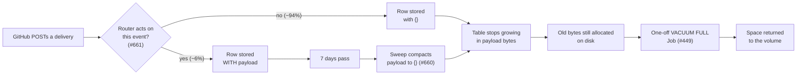

# Walkthrough — the three PRs for issue #637

**Issue:** [lightbridge-code-intelligence#637](https://github.com/ADORSYS-GIS/lightbridge-code-intelligence/issues/637) — `webhook_deliveries` has no retention and filled the shared database volume on 2026-08-29.

| PR | Repo | One line |
|---|---|---|
| [#660](https://github.com/ADORSYS-GIS/lightbridge-code-intelligence/pull/660) | lightbridge-code-intelligence | Compact payloads older than 7 days to `{}`, keep the row |
| [#661](https://github.com/ADORSYS-GIS/lightbridge-code-intelligence/pull/661) | lightbridge-code-intelligence | Store a payload only for events the router acts on |
| [#449](https://github.com/ADORSYS-GIS/ai-helm-values/pull/449) | ai-helm-values | One-shot Job + runbook to return a table's free space to the volume |

This document explains **why** each change looks the way it does — file by file, including the alternatives that were considered and rejected, and what each test is there to prove.

---

## 0. How the three fit together

The three PRs act at three different moments in a delivery's life:



- **#661 — at write time.** Most deliveries never need a payload stored at all. This stops most of the growth at the source.
- **#660 — after the retention window.** The payloads that *are* stored (routed events, and everything already in the table) are compacted once nothing can read them any more.
- **#449 — once, afterwards.** Postgres does not give freed space back to the filesystem on its own. This Job does, under controlled conditions.

**Why three PRs and not one:**

- #660 and #661 are both in the control plane, but they are different *kinds* of change. #660 adds a new background process with its own config, migration and metric. #661 changes what the webhook receiver writes. Reviewing them separately means each one can be judged, reverted or delayed on its own.
- #449 is in a different repo (`ai-helm-values`), because it's an operational action on the production cluster, not application code.
- Each is correct on its own. The merge order between #660 and #661 doesn't matter. #449 depends on both only in *when it should be run*, not in whether it can be merged.

**The one fact that shapes all three:** the row must stay, the payload doesn't have to. The row does three jobs (from §1.2 of the issue report):

| Job | Needs the row? | Needs the payload? |
|---|---|---|
| Redelivery dedup via `delivery_id` PRIMARY KEY | yes | no |
| `tasks.webhook_delivery_id` foreign key | yes | no |
| MCP-review quota (`payload_json->>'caller'`, last hour) | yes | yes, **only for one hour**, and only for `mcp.review` rows |

Every design decision below follows from this table.

---

## 1. PR #660 — compact aged webhook payloads

**Branch:** `feat/webhook-payload-retention` · **Commit:** `327f3c5` · **10 files, +320 / −1**

### 1.1 What it does, in one paragraph

On the dispatcher's existing storage-GC tick (every 10 minutes), a new sweeper finds up to 5,000 deliveries older than 7 days that still carry a payload, oldest first, and sets their `payload_json` to `{}`. No row is ever deleted. Both numbers are configurable. A partial index makes finding those rows cheap.

### 1.2 `db/webhook_deliveries.rs` (new) — the query

```rust
pub async fn compact_webhook_payloads(
    pool: &PgPool,
    retention_days: i64,
    batch: i64,
) -> Result<u64, sqlx::Error> {
    if retention_days <= 0 || batch <= 0 {
        return Ok(0);
    }
    let result = sqlx::query(
        "UPDATE webhook_deliveries SET payload_json = '{}'::jsonb \
         WHERE delivery_id = ANY(ARRAY( \
             SELECT delivery_id FROM webhook_deliveries \
             WHERE payload_json <> '{}'::jsonb \
               AND received_at < now() - make_interval(days => $1::int) \
             ORDER BY received_at \
             LIMIT $2 \
             FOR UPDATE SKIP LOCKED))",
    )
    ...
}
```

Each part of that statement is there for a reason:

**`UPDATE … SET payload_json = '{}'` instead of `DELETE`.**
A `DELETE` breaks two of the three jobs in §0: a redelivery of a deleted id would be processed as new (duplicate review on a PR), and rows referenced by `tasks` can't be deleted without a cascade that would wipe task history. Setting the payload to `{}` keeps the row and removes ~84% of its bytes.

**`'{}'` rather than `NULL`.**
The column is `payload_json JSONB NOT NULL` (from `0001_init.sql`). Making it nullable would need a migration and would change the type every reader sees. `{}` is valid JSON that every existing reader already handles.

**`if retention_days <= 0 || batch <= 0 { return Ok(0) }`.**
`make_interval(days => 0)` is `now()`, so a zero retention would match *every* row — including `mcp.review` rows the quota check is still reading. A mistyped config value must never mean "compact everything". This is the same guard `prune_outbox` and `sweep_terminal_a2a_tasks` already use, and it is repeated here (and not only in config parsing) so the function is safe for any direct caller.

**`$1::int`.**
`make_interval(days => …)` takes an `int`. Binding as `i64` and narrowing in SQL means an out-of-range value fails loudly with `integer out of range`, instead of silently wrapping like a Rust `as i32` cast would. Copied from `prune_outbox`'s documented pattern.

**`WHERE payload_json <> '{}'`.**
Makes the sweep idempotent: a compacted row no longer matches, so re-running is a no-op and the batch always contains real work. It is also exactly the partial index predicate (§1.3), which is what lets Postgres use that index.

**`ORDER BY received_at`.**
Oldest first. On the first run, the backlog drains from the far end, so the rows furthest from any possible reader go first, and progress is predictable.

**`LIMIT $2`.**
Bounds one tick's work. See §1.5 for why this matters more than it looks.

**`FOR UPDATE SKIP LOCKED`.**
The dispatcher spawns each sweep with `tokio::spawn` and doesn't wait for it. If one sweep outlives the 10-minute tick, the next one starts while it's still running. `SKIP LOCKED` makes the second sweep take *different* rows instead of blocking behind the first. It also means the sweep never waits on a row that a webhook handler might be touching.

**`= ANY(ARRAY(subquery))` instead of `IN (subquery)` — the one that was found by testing.**
The first draft used `IN (…)`. `EXPLAIN` showed:

```text
 Update on webhook_deliveries
   ->  Hash Semi Join
         ->  Seq Scan on webhook_deliveries          <- the whole table
         ->  Hash
               ->  … Index Scan using webhook_deliveries_payload_received_at_idx
```

The inner query used the new index, but the planner turned the outer side into a **sequential scan of the entire table**, hashed against the 5,000 ids. In production that's ~2.4M rows read every 10 minutes, forever. `ARRAY(…)` forces the subquery to run once as an `InitPlan` and produce a literal array; the outer side then becomes a primary-key lookup:

```text
 Update on webhook_deliveries
   InitPlan 1
     ->  Limit -> LockRows
           ->  Index Scan using webhook_deliveries_payload_received_at_idx
   ->  Index Scan using github_deliveries_pkey on webhook_deliveries
         Index Cond: (delivery_id = ANY ((InitPlan 1).col1))
```

Both sides indexed. (`github_deliveries_pkey` is the PK's name from before the table was renamed in migration `0024`.)

**Why a new file `db/webhook_deliveries.rs` rather than adding to `db/mod.rs`.**
The repo's convention (`CLAUDE.md`, "SOLID/SRP by file") splits `db/` by domain: `outbox.rs`, `tasks.rs`, `push_notifications.rs`… Webhook-delivery lifecycle is its own domain. `record_delivery` stays where it is in `mod.rs` — moving it would be a structural refactor mixed into a behaviour change, which the repo's refactor discipline forbids.

### 1.3 `migrations/0040_webhook_deliveries_payload_idx.sql` (new) — the index

```sql
-- no-transaction
CREATE INDEX CONCURRENTLY IF NOT EXISTS webhook_deliveries_payload_received_at_idx
    ON webhook_deliveries (received_at)
    WHERE payload_json <> '{}'::jsonb;
```

**Why an index at all.** There was no index on `received_at`. Without one, "find the oldest 5,000 rows with a payload" is a full scan of ~2.4M rows every tick.

**Why partial (`WHERE payload_json <> '{}'`).**
- The index only contains rows that still carry a payload. Once a row is compacted it leaves the index. So the index stays sized to roughly the retention window (a week of rows, much less after #661) instead of growing with the whole table forever. In the simulation it went from 12 MB to 288 kB after compaction.
- It exactly matches the sweep's predicate, so the planner can use it.
- It also serves the existing MCP-review quota query (`received_at > now() - 1 hour`), because those rows are recent and still have their payload.

**Why `CONCURRENTLY`.**
A plain `CREATE INDEX` takes a lock that blocks `INSERT` for the entire build. On a multi-GB table that's the webhook receiver unable to record deliveries for the duration. `CONCURRENTLY` builds without blocking writes.

**Why `-- no-transaction` and exactly one statement.**
`CREATE INDEX CONCURRENTLY` cannot run inside a transaction. sqlx runs migrations in a transaction unless the file *starts with* `-- no-transaction` (confirmed in `sqlx-core-0.9.0/src/migrate/source.rs:234`). A file with several statements would be sent as one multi-statement query, which Postgres also runs as an implicit transaction — so it has to be one statement per file.

**Why `IF NOT EXISTS`.** Makes a re-run safe. The known caveat (a failed concurrent build leaves an `INVALID` index that `IF NOT EXISTS` then skips) is documented in the PR's risk section with the fix.

### 1.4 `queue/webhook_payload_sweeper.rs` (new) — the sweeper

```rust
pub async fn sweep_once(pool: &PgPool, retention_days: i64, batch: i64) -> anyhow::Result<()> {
    let compacted = db::compact_webhook_payloads(pool, retention_days, batch).await?;
    if compacted > 0 {
        metrics::webhook_payloads_compacted(compacted);
        tracing::info!(compacted, retention_days, batch, "webhook payload sweeper: compacted aged payloads");
    }
    Ok(())
}
```

**Why a separate module.** It mirrors `outbox_sweeper.rs` and `a2a_sweeper.rs` exactly: a thin `sweep_once` that calls the `db::` function, emits a metric and logs. Anyone who knows one sweeper knows this one.

**Why log only when `compacted > 0`.** At steady state most ticks compact a few hundred rows; during an idle period, none. Logging "compacted 0" every 10 minutes is noise.

**Why the log includes `batch`.** It's how an operator knows the backlog is drained without database access: while `compacted == batch`, there's more; once `compacted < batch`, it's caught up. The #449 runbook uses exactly this signal.

### 1.5 `queue/dispatcher.rs` — defaults, config, wiring

**Defaults:**

```rust
const DEFAULT_WEBHOOK_PAYLOAD_RETENTION_DAYS: i64 = 7;
const DEFAULT_WEBHOOK_PAYLOAD_SWEEP_BATCH: i64 = 5000;
```

**Why 7 days.**
- The only reader of an old payload is the MCP quota, which looks back 1 hour. Even 1 day would be safe.
- 7 days keeps recent deliveries readable for someone debugging "why didn't my PR get reviewed yesterday?".
- It matches `outbox_posted_retention_days`, so the control plane has one mental model: "operational data is kept a week".

**Why 5,000 per tick — the part that matters most.**
It's a balance between two constraints:

| | Number |
|---|---|
| Ticks per day (every 600 s) | 144 |
| Capacity per day | 144 × 5,000 = **720,000** rows |
| Ingest measured 2026-09-17 | ~40,000 rows/day |
| Backlog at deploy time | ~2.3M rows → drains in **~3 days** |

It has to be well above ingest (otherwise it never catches up). But it must *not* be unbounded, because of what the volume went through in #637. Compacting a row doesn't only write a small new row version: it also marks that row's TOAST chunks (where the ~4.7 KB payload actually lives) as dead, which dirties those TOAST pages, which produces WAL (the write-ahead log). WAL lives on the **same volume** that filled up. Compacting the whole backlog at once would produce a multi-GB WAL burst on the disk the fix is supposed to protect. 5,000 per 10 minutes spreads that over ~3 days, letting checkpoints and WAL archiving recycle it as it goes. The simulation measured ~0.57 s per batch, so a tick is short.

**Config parsing:**

```rust
webhook_payload_retention_days: days(
    section.and_then(|s| s.webhook_payload_retention_days),
    DEFAULT_WEBHOOK_PAYLOAD_RETENTION_DAYS,
),
webhook_payload_sweep_batch: section
    .and_then(|s| s.webhook_payload_sweep_batch)
    .filter(|&b| b > 0)
    .unwrap_or(DEFAULT_WEBHOOK_PAYLOAD_SWEEP_BATCH),
```

- Retention reuses the existing `days` closure (positive → keep, else default).
- The batch uses the same rule inline rather than the `days` closure, because calling a row count "days" would mislead the next reader.
- Zero or negative falls back to the **default**, not to "skip". That's the existing convention for the outbox keys: a misconfiguration keeps the safe behaviour running rather than silently turning retention off. (The `db::` function's own guard in §1.2 is the second line of defence.)

**Why file config, not env vars.** The outbox retention keys live in the file config's `dispatcher` section; the A2A keys are env vars. These are the closest sibling of the outbox keys (same tick, same kind of setting), so they follow the outbox shape — which is also what the issue's acceptance criterion asked for: *"following the `outbox_*_retention_days` shape"*.

**Wiring:**

```rust
{
    // Compact aged webhook payloads; the rows stay for dedup and task references.
    let pool = pool.clone();
    let retention_days = cfg.webhook_payload_retention_days;
    let batch = cfg.webhook_payload_sweep_batch;
    tokio::spawn(async move {
        if let Err(error) = crate::queue::webhook_payload_sweeper::sweep_once(&pool, retention_days, batch).await {
            tracing::error!(%error, "webhook payload sweeper cycle failed");
        }
    });
}
```

Placed next to the index, outbox and A2A sweeper blocks on the same `prune_tick`. `tokio::spawn` (not `.await`) for the same reason the others do: a slow sweep must never delay task dispatch, which shares this loop. Errors are logged, not propagated, because a failed cleanup cycle is retried next tick and must not take down the dispatcher.

### 1.6 `config.rs` — two new optional keys

```rust
pub webhook_payload_retention_days: Option<i64>,
pub webhook_payload_sweep_batch: Option<i64>,
```

Using the same `lci_config::de::opt_i64` deserializer as the outbox keys, so `"7"` and `7` both parse. `DispatcherSection` has `deny_unknown_fields`, which is why the keys must be declared here: an operator who sets them against an older build gets a clear parse error rather than a silently ignored setting.

### 1.7 `http/metrics.rs` — `lci_webhook_payloads_compacted_total`

A counter, like `lci_outbox_prune_*_deleted_total` and `lci_a2a_task_sweep_deleted_total`. It exists so the sweep's progress is visible without database access — which matters here, because the people operating production mostly don't have DB access (§7 of the issue report).

### 1.8 Docs

- **`deploy/config-reference.md`** — adds a small *Storage GC* table listing the two new keys *and* the two existing outbox keys. The outbox keys were never documented; documenting only the new ones next to them would have looked odd and left the reference half-right.
- **`docs/runbooks/webhook-deliveries-unbounded-growth.md`** — the status line said *"open, not yet fixed"*. It now says growth is bounded by compaction and that the existing space needs a one-off `VACUUM FULL`. The rest of the runbook is the incident record and was left alone.

### 1.9 Tests — what each one proves

| Test | Proves |
|---|---|
| `compacts_only_payloads_past_retention` | A 10-day-old payload is compacted, a 2-day-old one isn't, and the row count is unchanged — compaction **never deletes**. |
| `redelivery_after_compaction_is_still_a_duplicate` | **The issue's own acceptance test.** After compaction, `record_delivery` for the same id returns `false`. Dedup survives. |
| `compaction_keeps_task_references_intact` | A delivery referenced by a real `tasks` row (created through `db::create_task`, not hand-written SQL, so it tracks schema changes) is compacted and the join still resolves. The FK survives. |
| `batch_bounds_each_call_oldest_first` | With batch 2 and 3 eligible rows: the two oldest go first, then the third, then nothing. Bounding, ordering and idempotence in one test. |
| `non_positive_settings_skip_compaction` | Retention 0, retention −1 and batch 0 all compact **nothing**, on a 999-day-old row that would otherwise match. |
| `webhook_payload_retention_defaults_overrides_and_non_positive_falls_back` (dispatcher) | Defaults are 7 / 5000; file values override them; 0 and −5 fall back to the defaults. |

The tests seed rows through `db::record_delivery` — the real ingest path — and then back-date `received_at`, rather than inserting raw rows. That way a future change to how deliveries are recorded is exercised by these tests too.

### 1.10 Evidence beyond unit tests

A production-shaped simulation: 100k deliveries, ~4.6 KB payloads (production averages 4,711 B), **inserted oldest first**, as in production.

```text
seeded                          542 MB   100,000 rows   87,905 past retention
drained                         19 ticks × 5,000, ~0.57 s each
after compaction + VACUUM       549 MB   ← space reusable, NOT returned
after VACUUM FULL               74 MB    ← only now returned; all 100,000 rows kept
```

**Why "oldest first" matters — a correction made during testing.** The first run seeded the newest rows first. Plain `VACUUM` then shrank the table from 544 MB to 93 MB, which looked like #449 wasn't needed at all. That was an artefact: the freed pages happened to be at the *end* of the file, and `VACUUM` can truncate trailing empty pages. In production the oldest rows (the ones compacted) are at the *front* of the file, so `VACUUM` can't truncate anything. Re-seeding in production order gave 549 MB after `VACUUM` — which is the real behaviour, and the reason #449 exists.

---

## 2. PR #661 — store payloads only for routed events

**Branch:** `feat/webhook-store-routed-payloads` · **Commit:** `22fe85c` · **1 file, +125 / −4**

### 2.1 What it does, in one paragraph

When a delivery arrives, `persist_delivery` still records a row for it — that's the dedup. But it now stores the actual payload only if the platform's router does something with that event. For every other event it stores `{}`. The handler still receives the full payload in memory, exactly as before.

### 2.2 The evidence that justified it

From the production control plane's `/metrics`, 2026-09-17, 3.1 hours:

```text
workflow_job 1961 · check_run 1553 · workflow_run 731 · check_suite 338 · issues 272
pull_request 148 · push 105 · issue_comment 40 · (other, unrouted) 138
routed = 294 / 5,286 = 5.6%
```

Only five GitHub event types reach a handler. The router's own doc comment said it plainly: *"Everything else is persisted to `webhook_deliveries` only."* So 94% of the rows — and most of the table's growth — were payloads written, never read, and kept forever.

**Before writing any code**, every reader of `payload_json` in the repo was checked, including the Grafana dashboard JSON and the dashboard generator (`tools/dashboard-gen`), because the Grafana read-only role has access to the `codeintel` database. The only reader is the `mcp.review` quota query in `db/tasks.rs`, which writes its rows through a different path and is untouched by this change.

### 2.3 `is_routed_event` — the new helper

```rust
/// Whether the platform router acts on `event`. Must list the same events as the `route_*_event`
/// matches below; an event missing here is still routed, it just isn't stored with its payload.
fn is_routed_event(platform: Platform, event: &str) -> bool {
    match platform {
        Platform::GitHub => matches!(event,
            "pull_request" | "push" | "issue_comment" | "installation" | "installation_repositories"),
        Platform::GitLab => matches!(event, "Merge Request Hook" | "Push Hook" | "Note Hook"),
        Platform::Bitbucket => matches!(event,
            "pullrequest:created" | "pullrequest:fulfilled" | "pullrequest:rejected"
                | "pullrequest:comment_created" | "repo:push"),
    }
}
```

**Why `match platform` first.** Event names are per platform — GitLab's `"Push Hook"` and GitHub's `"push"` are different strings. Matching on the platform first means a name from one platform can never accidentally match another's list. There's a test assertion for exactly this (`GitLab "push"` → `false`).

**Why an exhaustive `match` on `Platform`.** If a fourth platform is added, the compiler forces someone to decide what it stores. A `_ => false` arm would silently store nothing for it.

**Why a separate list rather than restructuring the routers.** The ideal would be one source of truth: a table of `(event, handler)` that both routing and storage read from. That means rewriting three routers into a new shape, which is a much bigger and riskier change than the problem needs. The key question was: what happens if the two lists drift?
- If someone adds a new routed event to a router but forgets the helper: the event **is still routed normally** — the handler gets the in-memory payload. Only the *stored copy* is `{}`, and nothing reads stored copies.
- So drift fails safe. It costs a debugging convenience, never behaviour.

Given that, a small list with a doc comment saying "keep in sync" plus a test enumerating each router's events was judged proportionate. The PR explicitly asks the reviewer to push back if they'd rather have the refactor.

**Why placed directly above the routers.** So anyone editing `route_github_event` sees the helper on the same screen.

**Why per event, not per action.** `installation` events with actions the handler ignores (`suspend`, `unsuspend`) still keep their payload. Splitting by action would need parsing the payload before deciding whether to store it, for events that arrive a handful of times a year. Not worth it.

### 2.4 `persist_delivery` — the change itself

```rust
Some(pool) => {
    let empty = serde_json::Value::Object(serde_json::Map::new());
    let stored = if is_routed_event(platform, event) {
        payload
    } else {
        &empty
    };
    ...
    crate::db::record_delivery(pool, platform, delivery_id, event, stored)
```

**Why here, and not in the three `*_webhook_body` handlers.** All three platforms go through `persist_delivery`. One change covers all of them, and the handlers keep passing the real payload to routing unchanged.

**Why the row is still written for unrouted events.** GitHub redelivers on timeout and operators redeliver by hand. Without the row, a redelivered `check_run` would be counted as new in `lci_webhook_deliveries_total`. For routed events it's far more important (a duplicate review), and treating all events the same keeps the dedup rule simple: *every verified delivery has a row*.

**Why only in the `Some(pool)` branch.** The `None` branch is the dev-only in-memory dedup set, which never stores payloads anyway.

**Why `{}` and not skipping the column.** Same reason as #660: the column is `NOT NULL JSONB`, and `{}` is the same value #660's sweep writes, so a compacted-at-write row and a compacted-by-sweep row look identical to every reader and to #660's partial index (neither is in it).

### 2.5 The doc comment on `route_github_event`

Changed from *"Everything else is persisted to `webhook_deliveries` only"* to *"… recorded in `webhook_deliveries` for dedup only, without its payload."* The old sentence became inaccurate with this change; leaving it would have been a small lie in the one place readers look.

### 2.6 The one existing test that had to change

`webhook_ingress_step_wrap_surfaces_persistence_errors_as_500` proves that a real database error during persistence returns HTTP 500. It triggers the error by sending a payload containing a NUL byte, which Postgres's `jsonb` rejects.

It used GitLab's `"Job Hook"` — an **unrouted** event. After this change, an unrouted event's payload is never written, so the poisoned payload never reaches Postgres, no error happens, and the endpoint returns 202. To make sure this wasn't hand-waved, the old fixture was put back on the new branch and run:

```text
test http::webhook::tests::webhook_ingress_step_wrap_surfaces_persistence_errors_as_500 ... FAILED
  left: 202
 right: 500
```

The fix switches the event to `"Push Hook"` (routed), so the payload is stored and the error still fires. The 500 is returned before routing, so the push handler never runs. **The assertion (`500`) is unchanged** — the test still proves exactly what it proved before. The repo's `CLAUDE.md` forbids weakening assertions to make a change pass; this is a fixture change forced by the new behaviour, not a weaker test, and the PR says so explicitly with the output above.

### 2.7 New tests

| Test | Proves |
|---|---|
| `is_routed_event_covers_each_platform_router` | Every event each router matches returns `true` (all three platforms); representative noise returns `false` (`workflow_job`, `check_run`, `check_suite`, `workflow_run`, `issues`, GitLab `Job Hook`, Bitbucket `pullrequest:updated`); and names don't cross platforms (GitLab `"push"` → `false`). This is the drift guard from §2.3. |
| `persist_delivery_stores_payloads_only_for_routed_events` | Through the real `persist_delivery`: a `pull_request` row stores the exact payload; a `workflow_job` row stores `{}`. |
| `unrouted_delivery_without_payload_still_dedups` | Recording the same unrouted delivery twice returns `Persisted` then `Duplicate`. Dedup is unaffected by not storing the payload. |

These call `persist_delivery` directly instead of going through the full HTTP handler, so they test the storage decision without also triggering routing side effects (task creation, repo lookups) that aren't what's under test.

---

## 3. PR #449 — the one-off reclaim Job (ai-helm-values)

**Branch:** `feat/db-table-reclaim-job` · **Commit:** `aa89891` · **2 files, +330**

### 3.1 Why this is needed at all

After #660 and #661, the table stops growing — but its files don't shrink. Postgres's `VACUUM` (and autovacuum) marks freed space as reusable **inside that table only**. The multi-GB already allocated to `webhook_deliveries` stays allocated on the volume that filled up in #637. §1.10's simulation shows it: 549 MB after compaction and `VACUUM`, 74 MB only after `VACUUM FULL`.

`VACUUM FULL` rewrites the table into new files containing only live rows and deletes the old ones. The cost: an `ACCESS EXCLUSIVE` lock for the whole rewrite — nothing can read or write the table meanwhile.

### 3.2 Why a Job in `hack/jobs/`, not a migration or a CronJob

- **Not a migration** in the control plane: migrations run automatically at startup, at whatever time a deploy happens. An exclusive lock on the webhook table at a random moment is exactly what must not happen. It also would run on every fresh environment where there's nothing to reclaim.
- **Not a CronJob or anything ArgoCD manages:** ArgoCD's `selfHeal` would re-apply it. A table lock must be a decision someone makes at a chosen time, not desired state a controller re-asserts.
- **`hack/jobs/`** already holds two operator-run, one-shot Jobs (`lightbridge-rbac-grant-admin.yaml`, `lightbridge-budget-global-refill-schedule.yaml`) for exactly these reasons. ArgoCD reads only `environments/`, so nothing in `hack/` can be applied by a sync. This PR follows that established pattern, including the placeholder-and-`sed` style and a runbook next to it.

### 3.3 Why generic (database / table / role placeholders)

The immediate need is `codeintel.webhook_deliveries`. But `usage.usage_events` has the same situation: [lightbridge-authz#678](https://github.com/ADORSYS-GIS/lightbridge-authz/pull/678) dropped its ~900 MB `attributes` column, and dropping a column doesn't return space either. Any future retention change on any tenant of this shared cluster will need the same step. One reviewed, tested Job serves all of them; the runbook carries `webhook_deliveries` as its worked example. The PR asks the reviewer whether they'd prefer one file per operation.

### 3.4 The manifest, decision by decision

**Two modes, `report` and `reclaim`.**
`report` is read-only: it prints the table's size breakdown and returns. The runbook makes it the first step, so nobody locks a table without first seeing whether there's anything to gain. `reclaim` prints the same report before and after, so the log of one run is the complete evidence of what it did.

**`bytes_per_live_row` in the report.**
The question "is this table mostly free space?" is hard to answer generically without extensions like `pgstattuple` (not installed). Total bytes ÷ live rows is a cheap, universal signal: if it's far above what a real row holds, the table is mostly free space. In the rehearsal it read **5754** before and **773** after — the difference is obvious without knowing anything else about the table.

**`lock_timeout = '5s'`.**
`VACUUM FULL` has to wait for every transaction already using the table. While it waits in the lock queue, **every new query on the table queues behind it** — so a long-running transaction could turn the Job into an outage before it's even started. 5 seconds caps that stall; the Job fails and nothing has changed. Tested: with another session holding a row lock, the Job printed `canceling statement due to lock timeout` and exited 3 with the table untouched.

**`statement_timeout = '15min'`.**
A hard ceiling on how long the table can be locked. On timeout, Postgres rolls the rewrite back and the original table is untouched — `VACUUM FULL` is atomic. The PR asks the reviewer whether 15 minutes is the right ceiling for the shared cluster.

**`VACUUM` built with `format(… %s, :'tbl'::regclass) \gexec`.**
`VACUUM` can't run inside a function or a `DO` block, so the table name can't be passed as a SQL parameter. Casting to `regclass` does two things: it fails immediately if the table doesn't exist, and its text form is correctly quoted (including a schema prefix), so an unusual name can't break or inject into the statement. `\gexec` then runs the generated statement.

**`backoffLimit: 0`.**
Every failure mode here — lock timeout, statement timeout, wrong owner, TLS — is something a person must read before deciding to run again. A retry would silently take the lock a second time. Same reasoning as the rbac bootstrap Job.

**`activeDeadlineSeconds: 1800`.** A backstop above the 15-minute statement timeout, so a pod stuck for any other reason can't linger.

**`ttlSecondsAfterFinished: 604800` (7 days).** The Job's log is the evidence of the run; it stays readable (`kubectl logs job/…`) long enough to attach to the issue.

**Image `__PG_IMAGE__`, read off the running database pods.**
- `psql` should match the server's major version (18).
- The CNPG image is already cached on the nodes, so nothing new is pulled.
- Reading it from the cluster (runbook step 1) makes "same version as production" true by construction, the same approach the other `hack/jobs` use for their images.

**`__ROLE_SECRET__` — the table owner, via `secretKeyRef`.**
`VACUUM FULL` is only allowed for the table's owner. The tenant roles (`codeintel`, `usage`, …) own their tables and aren't superusers. Passing the password by `secretKeyRef` means the pod gets it, but **the operator never needs to read Secrets** — which matters, because the people running this typically can't (my own production identity has no `get secrets`). A wrong secret fails harmlessly with `must be owner of table`.

**TLS: `PGSSLMODE=verify-full` with only `ca.crt` mounted.**
The control plane itself connects with Postgres's default (`prefer`, which doesn't verify the server). A Job that runs with an owner's credentials should verify it's talking to the real database. The CA Secret (`lightbridge-main-db-ca`) also contains the CA's **private key**; the volume uses `items:` to project only `ca.crt`, so the key never reaches the pod. The host is `lightbridge-main-db-rw.converse.svc`, which CNPG includes in its server certificate by default — this couldn't be verified with read-only access, so the PR asks a reviewer to confirm the certificate's hostname, and the runbook says a TLS failure should be investigated, never worked around by lowering `PGSSLMODE`.

**Pod hardening.** `runAsNonRoot`, `readOnlyRootFilesystem`, all capabilities dropped, no privilege escalation, `RuntimeDefault` seccomp, `automountServiceAccountToken: false` (the pod never talks to the Kubernetes API). `HOME=/tmp` plus an `emptyDir` at `/tmp`, because `psql` expects a writable home and the root filesystem is read-only.

**Network.** The `converse` namespace has only per-app NetworkPolicies (`console-ui`, `librechat-app`, `lightbridge-budget-internal`, `lightbridge-ci-notifier`); none select this pod or the database pods. The Job reaches the database the same way the two existing `hack/jobs` do.

### 3.5 The runbook, and the preconditions for `webhook_deliveries`

`docs/runbooks/postgres-table-reclaim.md` follows the shape of the repo's other runbooks: what it does, when you need it, what it costs, prerequisites, numbered steps with commands, and a failure table mapping each log line to its meaning and next step. Every `kubectl apply` is preceded by `--dry-run=server`, which is also how the manifest gets schema-validated against the real API before anything runs (that validation couldn't be done in the PR, see §3.6).

The worked example sets three preconditions before running it on `webhook_deliveries`, each for a reason:

1. **#660 is deployed and its backlog has drained** (the sweeper's log shows `compacted` below 5000). Before that, most of the table is still live payload — a `VACUUM FULL` would rewrite gigabytes of data that the sweep is about to discard anyway, and the lock would be long.
2. **#661 has been live for at least 7 days.** Then the only payloads still inside the retention window are routed events (~6% of rows), so the live data — and therefore the rewrite time and lock duration — is as small as it will ever be.
3. **`report` shows `bytes_per_live_row` in the thousands** — confirming there's real space to gain.

It also spells out who waits during the lock: the webhook receiver's insert and the MCP quota check. GitHub gives a webhook 10 seconds and doesn't retry a timeout on its own, so the runbook tells the operator to check the GitHub App's *Recent deliveries* afterwards and redeliver any failures — which is safe precisely because the table's primary key still dedups.

### 3.6 How it was tested

The script was extracted **unchanged** from the manifest (`yaml.safe_load` → `containers[0].args[0]`) and run with `sh` against a local Postgres, on the production-shaped table from §1.10. Only connection details differed (local host, no TLS).

| Case | Result |
|---|---|
| `report` | exit 0, one-row report, table unchanged |
| `reclaim` | exit 0, **549 MB → 74 MB**, locked for 2 s, all 100,000 rows kept |
| `MODE=oops` | exit 2, `MODE must be report or reclaim` |
| Another transaction holding a row lock | exit 3, `canceling statement due to lock timeout`, table unchanged |
| Placeholders after `sed` substitution | 0 remaining |

**Not verified, and said so in the PR:** server-side schema validation of the manifest (no `create jobs` permission, no offline validator installed — the runbook's `--dry-run=server` step covers it), `verify-full` against the real certificate, and the production lock duration (it depends on live data at run time; the preconditions keep it small and the 15-minute timeout caps it).

---

## 4. What was deliberately left out

| Left out | Why |
|---|---|
| Deleting old rows | Breaks redelivery dedup and the `tasks` FK. Compaction gets ~84% of the bytes without either cost. |
| `pg_repack` instead of `VACUUM FULL` | Avoids the long lock, but isn't in the cluster image and tenant roles can't `CREATE EXTENSION`. That's an `ai-helm` image decision. |
| Unsubscribing the GitHub App from CI events | Would also cut the traffic, but it's an App-settings change outside this repo, and it removes the dedup rows for those events. |
| A volume-usage alert | Still the cheapest protection against a repeat of any cause, not just this table. Skipped at your request. |
| A new issue for `usage.usage_events` | Already tracked and fixed: [lightbridge-authz#549](https://github.com/ADORSYS-GIS/lightbridge-authz/issues/549), closed by the merged [#678](https://github.com/ADORSYS-GIS/lightbridge-authz/pull/678). Its dropped column still needs the #449 Job to return the space. |

## 5. Rollout order

1. Merge and deploy **#660** and **#661** (either order). The control plane applies migration `0040` at startup and the sweep starts on the next tick.
2. Watch the dispatcher log `webhook payload sweeper: compacted aged payloads` and `lci_webhook_payloads_compacted_total`. About 3 days of `compacted=5000`, then smaller numbers.
3. Wait until #661 has been live 7 days.
4. Merge **#449** (can be merged any time; merging deploys nothing), then follow the runbook: `report`, pick a quiet window, `reclaim`, then redeliver any webhooks that failed during the lock.
