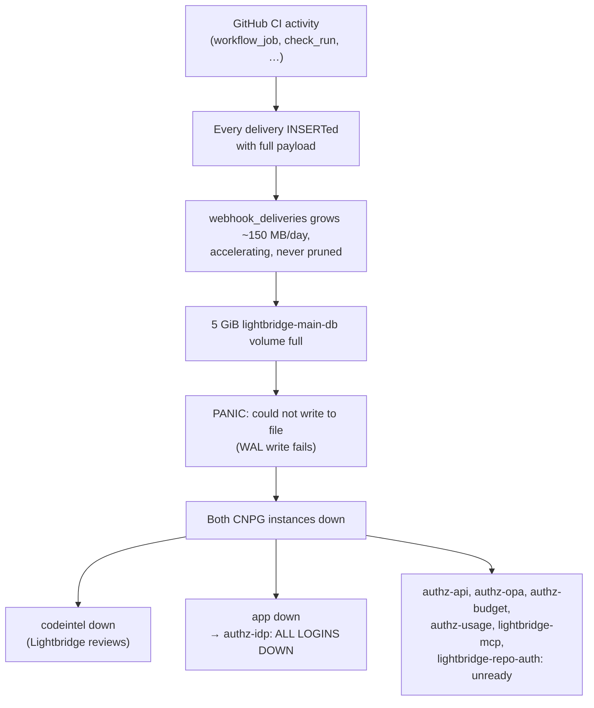

# Issue #637 — `webhook_deliveries` has no retention

**Status as of 2026-09-17: STILL OPEN AND UNMITIGATED. The root cause is unchanged, and the ingest rate has grown 1.43× since the incident.**

- Issue: [ADORSYS-GIS/lightbridge-code-intelligence#637](https://github.com/ADORSYS-GIS/lightbridge-code-intelligence/issues/637) (`bug`, `P0`, open, filed 2026-08-29, epic [#643](https://github.com/ADORSYS-GIS/lightbridge-code-intelligence/issues/643))
- Verified against: `origin/main` @ `5c936ab`, and the live `hetzner-prod` cluster, namespace `converse`
- Report date: 2026-09-17

---

## 1. The issue, explained

This section explains the problem from the ground up: what the table is for, why it grows without limit, and how a single table in a code-review tool took down logins for the whole platform. The later sections cover what is true today and how to fix it.

### 1.1 How webhooks reach Lightbridge

Lightbridge is installed as a GitHub App (and on GitLab/Bitbucket) in the organisation's repositories. Each time something happens in one of those repositories — a PR opens, a comment is posted, a CI job starts or finishes, an issue is labelled — GitHub sends an HTTP `POST` to the control plane's `/webhook/github` endpoint. Every delivery carries a unique `X-GitHub-Delivery` id and the full JSON description of the event.

For every delivery, the control plane (`services/control-plane/src/http/webhook.rs`, the `serve` role) does four things in this order:

1. **Verify** the HMAC signature, so only GitHub can call it.
2. **Parse** the body as JSON.
3. **Persist** the delivery into `webhook_deliveries` (`persist_delivery` → `db::record_delivery`).
4. **Route** it: if the event type is one Lightbridge acts on, create the work (a review task, a re-index, an installation change). Otherwise do nothing more.

Step 3 happens **before** step 4 and happens **for every event**, whether or not step 4 will do anything with it.

### 1.2 What `webhook_deliveries` is for

The table was created in `migrations/0001_init.sql` as `github_deliveries` and renamed to `webhook_deliveries` in `0024_platform_abstraction.sql`, when GitLab and Bitbucket support added a `platform` column:

```sql
-- X-GitHub-Delivery is the natural idempotency key: the PRIMARY KEY + ON CONFLICT gives us
-- exactly-once delivery handling without an in-process dedup set.
CREATE TABLE IF NOT EXISTS github_deliveries (
    delivery_id     TEXT PRIMARY KEY,
    event_name      TEXT        NOT NULL,
    installation_id BIGINT,
    repository_id   BIGINT,
    received_at     TIMESTAMPTZ NOT NULL DEFAULT now(),
    payload_json    JSONB       NOT NULL
);
```

It does three separate jobs, and all three matter for the fix:

| Job | How it works | Which column carries it |
|---|---|---|
| **Exactly-once processing** | GitHub retries a delivery if it doesn't get a timely `2xx`, and operators can redeliver by hand. `INSERT … ON CONFLICT (delivery_id) DO NOTHING` returns 0 rows for a delivery already seen, so the handler answers `duplicate delivery` and does not create the review task a second time. There is **no other dedup store**. | `delivery_id` (the PRIMARY KEY) |
| **Anchor for tasks** | Each row in `tasks` records the delivery that caused it, through a foreign key: `tasks.webhook_delivery_id REFERENCES webhook_deliveries(delivery_id)`. | `delivery_id` |
| **MCP-review quota ledger** | Reviews requested through MCP are recorded as synthetic `event_name = 'mcp.review'` rows. The per-caller rate limit counts that caller's rows in the last `A2A_QUOTA_WINDOW_SECS` (default 3600 s) by reading `payload_json->>'caller'`. | `payload_json`, but only for the last hour |

Note what is **not** on that list: nothing reads the payload of an ordinary GitHub delivery once it has been routed. After the first second of its life, `payload_json` on a `check_run` row is dead weight.

### 1.3 The defect: an append-only table with no exit

The table only ever grows:

- **Every** delivery is inserted — including the event types Lightbridge ignores. `route_github_event` acts on only five of them (`pull_request`, `push`, `issue_comment`, `installation`, `installation_repositories`), and its own doc comment says *"Everything else is persisted to `webhook_deliveries` only."*
- **Every** row keeps its **full JSON payload** — about 4.6 KB on average, since a GitHub event carries complete repository, sender, and workflow objects.
- **Nothing** ever deletes, trims, or shrinks a row. No retention setting, no background sweep, no scheduled job.

This is unusual in this codebase. The other append-only control-plane table, `outbox` (the queue of writes going out to GitHub), received retention in PR #221 (ADR-0059): `db/outbox.rs::prune_outbox` deletes delivered and failed rows after `outbox_posted_retention_days` / `outbox_failed_retention_days`, on a background tick every `prune_interval_seconds` (ADR-0052). `webhook_deliveries` never received the equivalent. It is the only append-only table in the control plane without a retention mechanism.

The consequence that is easy to miss: **the table's growth tracks how busy the organisation's repositories are, not how much anyone uses Lightbridge.** Most of the traffic is CI noise. Every GitHub Actions job produces several `workflow_job` events (queued, in progress, completed), plus `check_run`, `check_suite`, and `workflow_run` events for each run. An organisation that adds CI pipelines, matrix builds, or repositories grows this table even if nobody ever asks Lightbridge for a review. That explains the acceleration the issue measured (13,338 rows/day on average since June, 28,111/day in the final week), and §4 shows it has kept accelerating.

At the incident, the table held **947,014 rows over 71 days, 5,061 MB**. Of that, **4,255 MB (84%) was `payload_json`**. That was more than half of all data on the database volume.

### 1.4 Why one table filling up took down every login

This is what turned a housekeeping bug into a P0. `webhook_deliveries` does not live in its own database server. It lives in the `codeintel` database on **`lightbridge-main-db`**, a CloudNativePG (CNPG) Postgres cluster **shared** by several platform tenants:

```
lightbridge-main-db   (CNPG, 2 instances: primary + streaming standby)
│   one volume per instance: data files AND WAL on the same disk
│
├── codeintel   7,413 MB   ← Lightbridge Code Intelligence (this repo)
│     ├── webhook_deliveries   5,061 MB
│     └── code_chunks          2,317 MB
├── usage       1,507 MB   ← lightbridge-authz usage metering
├── app            10 MB   ← lightbridge-authz: identity, sessions, roles — ALL LOGINS
└── repoauth, governance, grafana_ro, coder, …
```

Postgres cannot keep running once its disk is full. Every change is written first to the write-ahead log (WAL), and the WAL shares the volume with the data (there is no separate `-wal` PVC on this cluster). When a WAL write fails, Postgres does not return an error to one client. It **`PANIC`s and the whole server stops**, because it can no longer guarantee durability. The standby receives the same data through physical replication, so its volume fills at the same rate and it cannot take over.

The chain on **2026-08-29, ~10:05 UTC**:



The impact was far out of proportion to the cause. The authz `app` database, which owns authentication for the whole platform, is **10 MB**. A 5 GB table of CI webhook payloads it never touches took it offline, and with it every product that depends on logging in, not only Lightbridge.

### 1.5 How service was restored, and why that was not a fix

Service came back by giving the database more disk, not by removing data:

| When | Change | Result |
|---|---|---|
| 2026-08-29 | `ai-helm` #1059 — volume 5 GiB → 20 GiB | Service restored. Measured runway: ~42 days |
| 2026-08-29 (same day) | `ai-helm` #1060 — volume 20 GiB → 40 GiB | Runway ~122 days at the measured rate |
| 2026-08-29 12:50 UTC | Issue #637 filed, docs PR #638 opened | — |

The second growth was a deliberate choice, not a second emergency. With both instances healthy, CNPG expands the volumes online by itself. With the instances down, as on the 29th, the volumes have to be patched by hand and the pods deleted to trigger the filesystem resize. Growing early costs nothing; growing during an outage is manual surgery.

Growing the volume does not change the curve. It moves the date the curve hits the ceiling. The table still gains every row, every payload, every day, and the ceiling is now 40 GiB instead of 5 GiB. At the growth rate the issue measured that meant about four months, and §4–§6 show the rate has risen since.

### 1.6 Why the obvious fix is dangerous

The natural first idea is a nightly `DELETE FROM webhook_deliveries WHERE received_at < now() - interval '7 days'`. That would break things, because of the three jobs in §1.2:

1. **Deleting a row removes the dedup record.** If GitHub or an operator later redelivers that delivery id, the `INSERT` succeeds as if it were new and the event is processed a second time. For a `pull_request.opened`, that means a duplicate review posted on the PR.
2. **Deleting a row that a task references fails the foreign key.** 3,590 rows were referenced by `tasks` at the incident. The `DELETE` either errors, or needs a cascade that deletes task history too.
3. **Deleting the payload of an `mcp.review` row within the last hour breaks the quota count** — only within that hour, which is why a multi-day retention is safe for this job.

The issue's proposal avoids all three by keeping the row and replacing only the payload:

```sql
UPDATE webhook_deliveries
   SET payload_json = '{}'::jsonb
 WHERE received_at < now() - make_interval(days => $1::int)
   AND payload_json <> '{}'::jsonb;
```

`delivery_id` survives, so dedup and the foreign key still work. The payload goes, and the payload is 84% of the bytes. Any retention above one hour is safely outside the quota window. And the mechanism already exists — the sweep is a sibling of `prune_outbox` on the tick that already runs.

One caveat that belongs to the problem, not the fix: `UPDATE` in Postgres does not shrink the file on disk. It marks the old row versions dead, and ordinary `VACUUM` makes that space reusable **inside** the table. That is enough to stop the growth. Returning the 4+ GB already used to the filesystem needs a one-off `VACUUM FULL` or `pg_repack`, and `VACUUM FULL` takes an exclusive lock on a table the webhook handler writes to constantly, so it must be scheduled.

### 1.7 Why it is P0

- **Recurrence is certain, not probable.** Nothing has changed the rate of rows entering or leaving the table. The only open question is the date.
- **The blast radius is the whole platform.** The failure takes down authentication, not just code review.
- **Nothing would warn anyone.** There is no alert on volume usage (§7a). Last time, the first signal was the outage.
- **Recovery is manual and gets worse as it waits.** A full volume stops CNPG from resizing online, and the table that has to be reclaimed keeps getting bigger.

---

## 2. Verdict

| Acceptance item from #637 | State today | Evidence |
|---|---|---|
| `webhook_payload_retention_days` config | **Not done** | no such symbol anywhere on `origin/main` |
| Payload-nulling sweep on the `prune_interval_seconds` tick | **Not done** | only `prune_outbox` exists in `queue/dispatcher.rs` |
| Test proving dedup survives a nulled payload | **Not done** | no such test |
| One-off reclaim of the 4.2 GB (`VACUUM FULL`/`pg_repack`) | **Not done** | no `CronJob` and no `Job` in ns `converse` |
| Same treatment for `usage.usage_events` | **Not done** | different repo, no change observed |

Even the **documentation** PR is unmerged: [#638](https://github.com/ADORSYS-GIS/lightbridge-code-intelligence/pull/638) (`docs: record webhook_deliveries unbounded growth as P0`) has been open, clean and mergeable, since 2026-08-29 — 19 days with one comment and no review. `docs/runbooks/webhook-deliveries-unbounded-growth.md` therefore does not exist on `main`, so the runbook the issue points at is not available to anyone on call.

The **only** thing that changed since the incident is the thing that was always the stopgap: the volume was grown 5 → 20 → 40 GiB.

---

## 3. What is actually running in production

All six control-plane roles run the same image, and it is exactly `origin/main` HEAD:

```
$ kubectl --context hetzner-prod -n converse get deploy -o json | ...
lightbridge-ci-a2a             main  ghcr.io/adorsys-gis/lightbridge-control-plane:sha-5c936ab
lightbridge-ci-control-plane   main  ghcr.io/adorsys-gis/lightbridge-control-plane:sha-5c936ab
lightbridge-ci-dispatcher      main  ghcr.io/adorsys-gis/lightbridge-control-plane:sha-5c936ab
lightbridge-ci-mcp             main  ghcr.io/adorsys-gis/lightbridge-control-plane:sha-5c936ab
lightbridge-ci-notifier        main  ghcr.io/adorsys-gis/lightbridge-control-plane:sha-5c936ab
lightbridge-ci-reconciler      main  ghcr.io/adorsys-gis/lightbridge-control-plane:sha-5c936ab

$ git log --oneline origin/main -1
5c936ab feat(graph): index symbol identity in Neo4j, and submit the graph in pages (#657)
```

`git grep webhook_payload_retention origin/main` → nothing. `git grep 'outbox_.*retention_days' origin/main` → `config.rs:499`, `config.rs:503`, `queue/dispatcher.rs:67,69,127,131,222,223`. The sibling mechanism the issue describes is there; the webhook sweep was never written alongside it.

The prod values file `ai-helm-values/environments/prod/values/lightbridge-code-intelligence.yaml` (834 lines) sets **no** retention keys at all — not the outbox ones either. Everything runs on compiled-in defaults.

The database itself is currently healthy:

```
$ kubectl --context hetzner-prod -n converse get cluster.postgresql.cnpg.io
NAME                  AGE    INSTANCES   READY   STATUS                      PRIMARY
lightbridge-main-db   102d   2           2       Cluster in healthy state    lightbridge-main-db-2

$ kubectl --context hetzner-prod -n converse get pvc
lightbridge-main-db-1   Bound   ...   40Gi   RWO   hcloud-volumes
lightbridge-main-db-2   Bound   ...   40Gi   RWO   hcloud-volumes
```

40 GiB confirms both emergency growths landed (`ai-helm` `5a971dac` 5→20 GiB #1059, `aa9cb8ee` 20→40 GiB #1060) and that `charts/lightbridge-db/values.yaml` now pins `size: "40Gi"`.

Note there are **no separate `-wal` PVCs** — WAL shares the data volume. That is precisely why a table filling `base/` was able to produce `PANIC: could not write to file` and take both instances down rather than merely stalling writes.

---

## 4. The rate has gone up, not down

`http/webhook.rs:110-122` logs `"github: accepted webhook"` **only after** `persist_delivery` returns `Persisted` — `Duplicate` returns early at line 112. So each such log line is exactly one new row in `webhook_deliveries`. This is a count, not an estimate.

Over a 3.07 h window on the single `control-plane` replica (1 replica, confirmed):

```
window: 2026-09-17T12:12:24Z -> 2026-09-17T15:16:30Z  (3.07 h)
unique accepted deliveries: 5,133
rate: 1,673/h  =>  ~40,100 rows/day
```

Corroborated independently by the publicly reachable metrics endpoint (`https://code-intelligence-api.ai.camer.digital/metrics` → HTTP 200 unauthenticated — see §7b):

```
sum(lci_webhook_deliveries_total) = 5,286   (since pod start, ~3.1 h)
```

| Measure | Rows/day | vs today |
|---|---|---|
| 71-day average at the incident | 13,338 | 3.01× lower |
| Last 7 days at the incident | 28,111 | 1.43× lower |
| **Measured 2026-09-17** | **~40,100** | — |

**Caveat, stated plainly:** the window is three hours of European working time (12:12–15:16 UTC), which is very likely above the 24 h mean. Treat ~40,100/day as an upper bound on the daily rate, and ~28,000/day as a floor — the incident's own "last 7 days" number, which the acceleration has not reversed.

### 94% of these rows do nothing but exist

`route_github_event` (`http/webhook.rs:483`) dispatches only `pull_request`, `push`, `issue_comment`, `installation`, `installation_repositories`. The doc comment above it says it outright: *"Everything else is persisted to `webhook_deliveries` only."*

Measured mix over the same window:

| Event | Count | Routed? |
|---|---:|---|
| `workflow_job` | 1,961 | no |
| `check_run` | 1,553 | no |
| `workflow_run` | 731 | no |
| `check_suite` | 338 | no |
| `issues` | 272 | no |
| `pull_request` | 148 | **yes** |
| `push` | 105 | **yes** |
| `issue_comment` | 40 | **yes** |
| everything else | 138 | no |

**294 of 5,286 rows (5.6%) drive any work. The other 94.4% are stored, with full payload, and read by nothing.** `workflow_job` + `check_run` + `workflow_run` alone — three CI-noise event types — are 80% of the volume.

---

## 5. Why the proposed fix is still the right one

All three constraints from the issue are still literally true on `main` today; I traced each to its call site rather than assuming:

1. **PK dedup.** `db/mod.rs:147` — `INSERT INTO webhook_deliveries (...) ON CONFLICT (delivery_id) DO NOTHING`, and `record_delivery` returns `rows_affected() > 0`. That boolean *is* the idempotency decision. There is no second dedup store. Delete a row and a GitHub redelivery of that id reprocesses as new.
2. **Foreign key.** `migrations/0024_platform_abstraction.sql:26` renames `tasks.github_delivery_id` → `tasks.webhook_delivery_id`; the FK to `webhook_deliveries` rides along. `db/tests.rs:994,1101` both note the ordering constraint.
3. **Payload read-back.** `db/tasks.rs:844` — the MCP-review quota counts `webhook_deliveries WHERE event_name = 'mcp.review' AND payload_json->>'caller' = $1 AND received_at > now() - <window>`. It reads `payload_json`, but only inside the quota window (default 3600 s).

So "null the payload, keep the row" still satisfies all three, and a retention of even a few days clears the 1-hour read-back window by two to three orders of magnitude.

**One addition worth considering on top of the issue's plan:** given §4, a large share of the bytes never needed to be written at all. A *write-side* filter — store `'{}'::jsonb` immediately for event types `route_github_event` does not handle, keeping the row for dedup — would cut ~94% of the payload bytes at the source and make the retention sweep a much smaller cleanup job rather than the whole defence. The sweep is still needed (routed events accumulate too, and the write-side rule must not be the only thing standing between the platform and another PANIC), but the two together are strictly better than the sweep alone.

---

## 6. Runway — modelled, not measured

I could not read the database (§7), so this is a projection from the numbers in the issue plus today's measured ingest rate. It is labelled as such.

Inputs: at recovery on 2026-08-29, `base` = 8.9 GB and `pg_wal` = 577 MB (from PR #638's investigation) ≈ 9.5 GB on a 40 GiB (42.9 GB decimal) volume. Average `webhook_deliveries` row = 5061 MB / 947,014 rows = **5.47 KB**. `usage.usage_events` ≈ 100 MB/day (`ai-helm` `charts/lightbridge-db/values.yaml` comment). 19 days elapsed.

| Scenario | webhook | + usage | Est. used today | Est. free | Runway from today |
|---|---|---|---|---|---|
| Incident-era rate (28,111/day) | 150 MB/d | 250 MB/d | ~14.2 GB | ~28.7 GB | **~115 days** → early Jan 2027 |
| Today's measured rate (40,100/day) | 214 MB/d | 314 MB/d | ~15.7 GB | ~27.3 GB | **~87 days** → mid-Dec 2026 |

Neither figure includes `code_chunks` growth (2317 MB at measurement, rate unknown) or continued acceleration — and acceleration is the established pattern here, not a worry: 13,338 → 28,111 → ~40,100.

**Call it roughly three months, expiring somewhere in December 2026, with the error bars pointing the wrong way.** The issue's "~122 days" was measured on 2026-08-29; 19 days of that are already spent and the burn since has been higher than the burn it was computed from.

None of the 4.2 GB of existing payload has been reclaimed. No nulling ran, so it is still live data, not dead tuples — a `VACUUM FULL` today would return almost nothing. The reclaim and the sweep have to happen in that order, sweep first.

---

## 7. Two findings not in the original issue

**(a) There is still no alert.** The cluster has exactly one `PrometheusRule`, `governance/lightbridge-governance`. Nothing anywhere alerts on `kubelet_volume_stats_available_bytes` or any volume-fill signal, and `charts/lightbridge-db/` ships no alerting template. If this recurs — or if any other PVC in the cluster fills — the first signal is again the PANIC. A single "PVC above 80%" rule is much cheaper than the retention work and would have turned a platform-wide login outage into a ticket.

**(b) `/metrics` is served unauthenticated on the public ingress.**

```
$ curl -s -o /dev/null -w '%{http_code}' https://code-intelligence-api.ai.camer.digital/metrics
200
```

It was genuinely useful for this report, and the exposed series are operational counters rather than secrets — but `lci_webhook_deliveries_total{event=...}` does publish the org's CI and PR cadence to anyone who asks. Worth a separate ticket; it is not part of #637.

---

## 8. What I could not check, and how to close the gap

My kube identity `ssg:christian.leghadjeu@adorsys.com` on context `hetzner-prod` is read-only and deliberately narrow:

| Action | Allowed |
|---|---|
| `get pods`, `get pvc`, `get deploy`, `get pods/log`, `get configmaps`, `get jobs` | yes |
| `get secrets` | **no** |
| `create pods/exec` | **no** |
| `create pods/portforward` (ns `converse` and `observability`) | **no** |
| `get clusters.postgresql.cnpg.io` | **no** |
| `get nodes/proxy` (kubelet volume stats) | **no** |

So §5 of the `prod-rollout-verify` runbook — `psql` against `svc/lightbridge-main-db-ro` — was closed to me: no secret read for the credentials, no port-forward to reach it. Context `admin@homeos` is not in this kubeconfig either (only `hetzner-prod` and two GKE moodle clusters), so I could not read the ArgoCD Application objects.

**To turn §6's projection into a measurement**, someone with those rights should run:

```bash
PW=$(kubectl --context hetzner-prod -n converse get secret lightbridge-codeintel-db-role \
       -o jsonpath='{.data.password}' | base64 -d)
kubectl --context hetzner-prod -n converse port-forward svc/lightbridge-main-db-ro 55987:5432 &
```

```sql
-- confirm you are on the standby
SELECT pg_is_in_recovery();

-- per-database footprint on the shared volume
SELECT datname, pg_size_pretty(pg_database_size(datname)) FROM pg_database ORDER BY pg_database_size(datname) DESC;

-- the table, and how much of it is payload  (run inside `codeintel`)
SELECT pg_size_pretty(pg_total_relation_size('webhook_deliveries')) AS total,
       pg_size_pretty(sum(pg_column_size(payload_json))::bigint)    AS payload,
       count(*)                                                     AS rows,
       min(received_at), max(received_at)
  FROM webhook_deliveries;

-- has the rate kept climbing?
SELECT date_trunc('day', received_at) AS d, count(*)
  FROM webhook_deliveries
 WHERE received_at > now() - interval '14 days'
 GROUP BY 1 ORDER BY 1;

-- how much would a retention sweep actually reclaim, per cut-off
SELECT days, pg_size_pretty(sum(pg_column_size(payload_json))::bigint)
  FROM generate_series(1,14) AS days,
       LATERAL (SELECT payload_json FROM webhook_deliveries
                 WHERE received_at < now() - make_interval(days => days)) s
 GROUP BY days ORDER BY days;
```

And to confirm the actual fill level:

```bash
kubectl --context hetzner-prod -n converse exec lightbridge-main-db-1 -c postgres -- df -h /var/lib/postgresql/data
```

---

## 9. Recommendation

1. **Merge [#638](https://github.com/ADORSYS-GIS/lightbridge-code-intelligence/pull/638) now.** It is clean, mergeable, documentation-only, and it is the runbook for an incident that can recur. Nineteen days unreviewed on a P0 write-up is the cheapest thing on this list to fix.
2. **Add the PVC-fill alert** (§7a) before the code work. It is hours, not days, and it is what converts the next occurrence from an outage into a warning.
3. **Write the sweep** — `webhook_payload_retention_days` on the `outbox_*_retention_days` shape, nulling alongside `prune_outbox` on the existing `prune_interval_seconds` tick, plus the redelivery-after-nulling test. Consider pairing it with the write-side filter in §5.
4. **Then reclaim** — sweep first so the payload becomes dead tuples, then `pg_repack` (preferred over `VACUUM FULL`; it avoids the exclusive lock on a cluster that carries all platform authentication) in a scheduled window.
5. **Separately, the platform question the issue flags as out of scope is now sharper, not softer.** `codeintel` was 78% of a volume shared with the 10 MB database that owns every login on the platform. The fix in step 3 removes today's specific cause; it does not remove the shared-blast-radius property that turned it into a platform outage. That belongs in epic #643 or in an `ai-helm` decision about per-database quotas or a separate cluster for `authz`.

---

## Appendix — commands run for this report

```
git log --oneline origin/main -8
git grep -n "webhook_payload_retention\|prune_webhook" origin/main -- services docs        # no output
git grep -n "outbox_.*retention_days" origin/main -- services/control-plane/src
kubectl --context hetzner-prod -n converse get cluster.postgresql.cnpg.io
kubectl --context hetzner-prod -n converse get pvc
kubectl --context hetzner-prod -n converse get pods
kubectl --context hetzner-prod -n converse get deploy -o json          # image extraction
kubectl --context hetzner-prod -n converse get cronjob                 # No resources found
kubectl --context hetzner-prod -n converse logs deploy/lightbridge-ci-control-plane --since=6h
kubectl --context hetzner-prod get prometheusrule -A
kubectl --context hetzner-prod auth can-i <verb> <resource> -n converse
curl -s https://code-intelligence-api.ai.camer.digital/metrics
```

AI usage: this report was produced with Claude Opus 5 (Claude Code). Every cluster number above is the output of a command listed in this appendix. The §6 runway figures are a model, not a measurement, and are marked as such — the database itself was unreachable with my credentials (§8).
