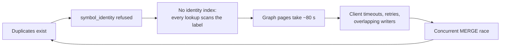
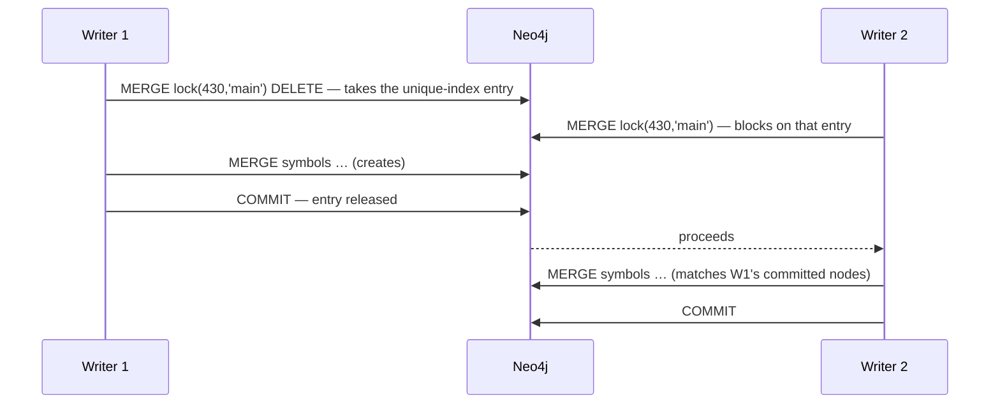
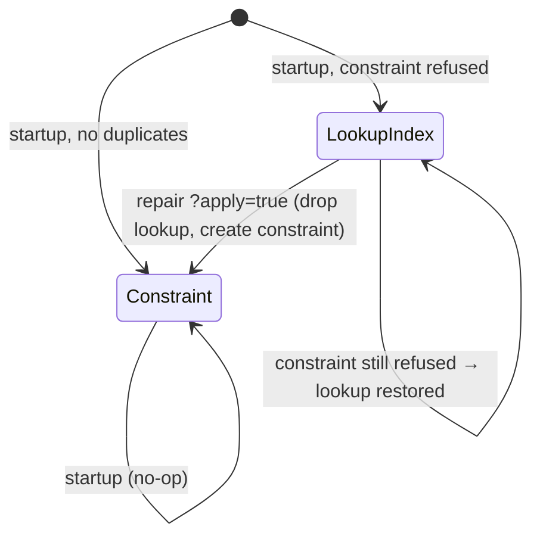
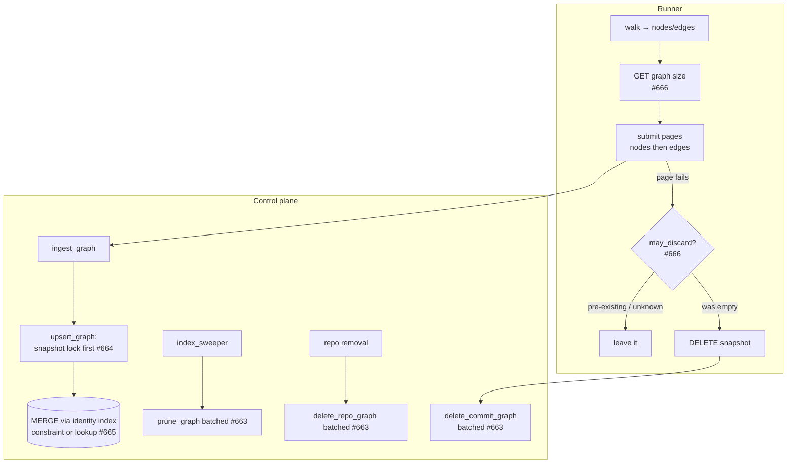

# Neo4j Graph Resilience — Walkthrough of PRs #659, #663, #664, #665, #666

> **Scope:** the code-intelligence side of the 2026-09-18 Neo4j outage (#662) and of the graph-submit
> failures that preceded it (#656). Chart-side mitigations (heap sizing, probes) live in
> ADORSYS-GIS/ai-helm#1130 and are only referenced here.
>
> **State at time of writing:** `main` = `2054b46`. All five PRs open, none approved. Evidence below
> is either quoted from prod logs / the #662 thread, or measured locally on Neo4j 5.26.29 Community —
> each item says which.

---

## 0. At a glance

| PR | Branch | Solves | Runs in | Review status |
|---|---|---|---|---|
| [#663](https://github.com/ADORSYS-GIS/lightbridge-code-intelligence/pull/663) | `feat/bounded-graph-deletes` | Deletes grew with snapshot size — the transaction that crashed Neo4j | control plane | no reviews yet |
| [#664](https://github.com/ADORSYS-GIS/lightbridge-code-intelligence/pull/664) | `feat/snapshot-write-lock` | Concurrent writers create duplicate `:Symbol` nodes | control plane | bot: 2 × P2 (verified, open) |
| [#665](https://github.com/ADORSYS-GIS/lightbridge-code-intelligence/pull/665) | `feat/symbol-identity-repair` | Existing duplicates block `symbol_identity`, leaving every lookup a label scan | control plane | no reviews yet |
| [#666](https://github.com/ADORSYS-GIS/lightbridge-code-intelligence/pull/666) | `feat/scoped-graph-discard` | A failed re-index deletes a graph it didn't write | runner + control plane | no reviews yet |
| [#659](https://github.com/ADORSYS-GIS/lightbridge-code-intelligence/pull/659) | `feat/neo4j-index-health` | Index state was invisible; failures had to be guessed at | control plane | bot P2 + stephane P1/P2 (verified, open) |

**Recommended merge order:** #663 → #664 → #665 → #666 → #659 (after rework). Details in §4.

---

## 1. The issues

### 1.1 The outage (#662)

On 2026-09-18 the prod Neo4j (`neo4j:5.26-community`, 2 Gi limit, heap never sized) ran out of
heap, marked the database failed, and rejected every transaction afterwards — 608
`TransactionStartFailed … needs to be restarted` in the following hour — while the pod stayed
`Running` with 0 restarts, because its probes only check that the Bolt port is open.

The root-cause comment on #662 correlated each Neo4j error with a control-plane log line
(2 ms apart each time):

| Time (UTC) | Neo4j | Control plane | Role |
|---|---|---|---|
| 13:25:44 | Transaction **#7983** starts — **28,563 commands** | `lightbridge-governance`: `graph discard failed` | **The panic transaction** — `delete_commit_graph` deleting the governance `main` snapshot (3,610 nodes + edges) in one transaction |
| 13:26:13 | `OutOfMemoryError: Java heap space` | `ai-helm-values`: `merge edges … Java heap space` | A concurrent edge upsert, where the OOM surfaced |
| 13:26:26 | `TransactionCommitFailed` for #7983 ("logged but not applied") | | The condition under which Neo4j fails the database |
| 13:26:27 | `TransactionLogError` | `CoopData`: `attaching symbol embeddings failed` | First victim of the failed state |

Two takeaways:

1. **The unbounded transaction was a delete, not an upsert.** Upserts have been paged at 2,000 rows
   since #657. The #662 body originally said otherwise; the comment corrected it.
2. **Three indexing tasks were writing to the shared heap at once.** Nothing bounds concurrency.

### 1.2 Every write path, and whether its transaction is bounded

On `main` today:

| Path | Triggered by | Transaction size scales with | Bounded? |
|---|---|---|---|
| `upsert_graph` | runner page submit | the page (≤ 2,000 rows client-side) | by the client only — the server writes whatever arrives |
| `attach_symbol_embeddings` | chunk ingest | the embed batch (16 rows) | yes |
| `delete_commit_graph` | failed-submit rollback | the **whole snapshot** | **no** ← #7983 |
| `prune_graph` | `index_sweeper`, automatic | **every stale snapshot of the repo**, `collect()`ed into one heap list first | **no** |
| `delete_repo_graph` | repo removal/denial | **every snapshot of the repo**, same `collect()` pattern | **no** |

→ **#663** bounds the three delete paths.

### 1.3 Why `symbol_identity` could not be created

The constraint was declared by #657. In prod it was refused (from #662):

```text
ConstraintCreationFailed: Unable to create Constraint( name='symbol_identity', type='UNIQUENESS', … ):
Both Node(3379) and Node(3387) have … repo_id = 430, commit = 'main',
node_id = 'charts/librechat-app/files/seed-agents.js'
```

**How `MERGE` produced a duplicate.** Without a uniqueness constraint behind it, `MERGE` is not
atomic: each transaction looks for the node, finds nothing (the other's write is uncommitted), and
creates it. Reproduced locally with that exact key, two concurrent writers held open before commit:

| Setup | Nodes with that triple afterwards |
|---|---|
| no constraint | **2** — neither writer errors |
| `symbol_identity` present | **1** — the second `MERGE` waits on the index entry, then matches |

**Why writers to the same snapshot overlap.** Three code-level causes:

1. **Default-branch snapshots are keyed by branch name.** `head_sha.unwrap_or(default_branch)` puts
   every default-branch index of a repo in `(repo, 'main')` regardless of the real commit.
2. **Nothing serializes tasks per repo.** `claim_next_task` takes any queued row; `perform_indexing`
   runs for review tasks as well as index tasks.
3. **A client timeout does not stop the server.** The runner gives up at 180 s; the page keeps
   running in Neo4j while a retry writes the same keys.

**The loop this creates:**



Duplicates also **multiply edges**: an edge `MATCH` hits every copy of an endpoint, so each edge is
written once per copy pair.

→ **#664** stops new duplicates. **#665** removes existing ones and keeps the key indexed meanwhile.

**About that `node_id` with no `#line:name`.** It is correct: `lci-codegraph` (pinned `b3062f86`) emits
four id shapes, and a bare path is a **file node**:

| Shape | Minted at | Meaning |
|---|---|---|
| `<file>` | `src/graph/emit.rs:45` | one per file, basename label, line 1 |
| `<file>#<line>:<name>` | `def_node_id` | one per definition |
| `service:<name>` | `lci-codegraph-spring/feign.rs` | Feign client |
| `route:<METHOD>:<path>` | `lci-codegraph-spring/route.rs` | Spring route |

Running the real walk over `ai-helm` gave 401 nodes (40 file, 361 definition) and **0 duplicate ids in
one run's output** — `dedup_colliding_node_ids` guarantees it. So a duplicate in Neo4j needs two
writers, never one run. File nodes collide first because their id is stable across commits, while a
definition's id moves whenever its line does.

### 1.4 What the prod runs showed before the outage

From the `cratestack` run the user posted (task `9df34a5f`):

```text
16,022 nodes / 28,887 edges → 9 node pages + 15 edge pages; failed on edge page 5
13:22:46 → 13:44:37 = 1,311 s → ~81 s per page → ~30 ms per identity lookup   (label-scan speed)
WARN discarding the partial graph failed … 500 Internal Server Error
```

- **~30 ms per lookup** — with any identity index it is microseconds (measured: 3–4 database
  accesses vs 120,517). Same pattern on CoopData (5,154 / 7,893, edge page 0 timed out).
- **The rollback itself failed**, leaving 16,022 nodes and ~10,000 of 28,887 edges in the `main`
  snapshot — a partial graph that reads as complete.
- The discard's selector names two of the three identity properties, so it scans the label even
  when the identity index exists (measured: 2-of-3 never uses a 3-property composite).

### 1.5 The rollback deletes graphs it didn't write

`DELETE /internal/tasks/{id}/graph` is keyed on `(repo_id, commit)`. A re-index at the same key is
routine (1.3), so a re-index that fails partway deletes the **previous, complete** graph — where the
single-transaction submit before #657 would have rolled back and left it. The fix was written and
reviewed on #657 as `a87c084` but pushed after the squash, so it **never reached `main`**; the #662
thread shows this very delete running against governance's `main`.

→ **#666.**

### 1.6 Failures were undiagnosable

The only record that the identity constraint had been refused was one `WARN` at control-plane
startup, in a different pod, possibly days earlier. The runner's error said only
`operation timed out`. Diagnosing it meant guessing — and one guess (a `145,029` figure) turned out
not to reproduce.

→ **#659.**

### 1.7 Issue → PR map against #662's acceptance criteria

| #662 acceptance criterion | Covered by |
|---|---|
| No single transaction holds more than a configured batch | **#663** for deletes; upserts paged since #657 (server-side cap still deferred, §6.5) |
| A partial failure between batches stays idempotent on re-run | **#663** (deletes re-runnable), **#664** (overlapping re-runs can't duplicate) |
| Duplicates removed, `symbol_identity` created | **#665**, applied after **#664** is deployed |
| A panicked database is detected and restarted | **not in these PRs** — ai-helm probe; #659 covers index state, not DB failure |
| Existing tests pass; a batching test added | **#663** (`deletes_spanning_several_batches…`) + every PR's suite |

---

## 2. PR walkthroughs

### 2.1 #663 — Delete graph data in bounded transactions

**One file:** `services/control-plane/src/integrations/neo4j.rs` (+183 / −58).

#### Before (`main`)

```cypher
-- delete_commit_graph: one transaction, whole snapshot
MATCH (s:Symbol {repo_id: $repo, commit: $commit})
WITH s, count(s) AS _c
DETACH DELETE s
RETURN count(_c) AS deleted

-- delete_repo_graph and prune_graph: every node collected into one heap list first
MATCH (s:Symbol {repo_id: $repo})            -- prune adds: WHERE NOT s.commit IN $keep
WITH collect(s) AS nodes, count(s) AS deleted
FOREACH (n IN nodes | DETACH DELETE n)
RETURN deleted
```

#### After — one helper, three callers

```rust
const DELETE_BATCH_ROWS: u32 = 1_000;

async fn delete_symbols_in_batches(
    graph: &Graph,
    selector: &str,
    params: &[(&str, BoltType)],
) -> anyhow::Result<u64> {
    // 1. count first — deleted nodes leave the query context
    let mut count = query(&format!("{selector} RETURN count(s) AS n"));
    /* … bind params, read `matched`, return early on 0 … */

    // 2. delete in fixed-size transactions
    let mut delete = query(&format!(
        "{selector} CALL (s) {{ DETACH DELETE s }} IN TRANSACTIONS OF {DELETE_BATCH_ROWS} ROWS"
    ));
    /* … bind params … */
    graph.run(delete).await.context("delete symbols")?;
    Ok(matched)
}
```

| Caller | Selector |
|---|---|
| `delete_commit_graph` | `MATCH (s:Symbol {repo_id: $repo, commit: $commit})` |
| `delete_repo_graph` | `MATCH (s:Symbol) WHERE s.repo_id = $repo AND s.commit IS NOT NULL` |
| `prune_graph` | `MATCH (s:Symbol {repo_id: $repo}) WHERE NOT s.commit IN $keep` |

Plus a new index in `ensure_indexes`:

```rust
create_index_idempotent(
    graph,
    "CREATE INDEX symbol_snapshot IF NOT EXISTS FOR (s:Symbol) ON (s.repo_id, s.commit)",
    "symbol_snapshot",
)
.await?;
```

#### Why this shape

- **`CALL { … } IN TRANSACTIONS` only runs in an auto-commit transaction.** Verified: inside
  `:begin … :rollback` Neo4j refuses it outright. neo4rs 0.8's `Graph::run` sends a plain `RUN`
  on a pooled connection (auto-commit), so the helper uses `run`, never `start_txn`.
- **`CALL (s) { … }` scope syntax** needs Neo4j ≥ 5.23; compose (`neo4j:5`) and prod
  (`5.26-community`) both qualify, and ADR-0114's 4096-dim vector index already requires 5.26.
- **Which selectors the new index serves** — measured with `EXPLAIN`:

  | Path | Predicate | Plan |
  |---|---|---|
  | discard | `repo_id = … AND commit = …` | `NodeIndexSeek` |
  | prune | `repo_id = … AND NOT commit IN $keep` | `NodeIndexSeek` (planner infers `commit IS NOT NULL`) |
  | repo removal, old | `repo_id = …` | `NodeByLabelScan` |
  | repo removal, new | `… AND commit IS NOT NULL` | `NodeIndexSeek` |

  Every `:Symbol` has a `commit`, so that predicate changes the plan, not the result. Measured on a
  16,022-node snapshot: the discard's selection went 74,125 → 32,045 database accesses, and from
  "every symbol in the DB" to "this snapshot" in what it scales with.

#### Verification

`deletes_spanning_several_batches_remove_exactly_their_selection` seeds three 2,500-node commits
(with edges) plus a second repo; discard, prune and repo removal each span three batches; asserts
exact counts, the kept commit intact, the other repo untouched. Being a live test, it is also the
proof that `IN TRANSACTIONS` works through neo4rs.
Suite **1,025 passed / 0 failed / 7 ignored**, 6/6 live Neo4j, clippy + fmt clean (`0f54d53`).

---

### 2.2 #664 — Serialize writes to one graph snapshot

**One file:** `neo4j.rs` (+139).

#### Change

Every `upsert_graph` transaction now opens with:

```rust
txn.run(
    query("MERGE (l:SnapshotWriteLock {repo_id: $repo, commit: $commit}) DELETE l")
        .param("repo", repository_id)
        .param("commit", commit_sha),
)
.await
.context("lock snapshot for writing")?;
```

backed by a constraint declared at startup:

```rust
pub async fn ensure_snapshot_write_lock(graph: &Graph) -> anyhow::Result<()> {
    create_index_idempotent(
        graph,
        "CREATE CONSTRAINT snapshot_write_lock IF NOT EXISTS \
         FOR (l:SnapshotWriteLock) REQUIRE (l.repo_id, l.commit) IS UNIQUE",
        "snapshot_write_lock",
    )
    .await
}
```

#### How it works



- The unique-index entry lock is held **until the transaction ends**, even though the node is deleted
  in the same statement — so writers serialize and the label never accumulates nodes. Verified 3/3:
  one symbol, zero lock nodes left; without the lock line, two symbols every time.
- The lock key is `(repo_id, commit)`: writers to **different** snapshots don't wait on each other.
- Only `upsert_graph` takes it — it is the only path that **creates** nodes.

#### Why a Neo4j lock and not the existing Postgres advisory lock

`tasks.rs` already uses `pg_advisory_xact_lock`. Reusing it would hold a pooled Postgres connection
for the entire Neo4j write — up to minutes per page without the identity index — so a queue of
writers on one snapshot could drain the pool the webhook and API paths share. The Neo4j lock is
scoped to exactly the transaction it protects and released on commit, rollback, or server abort.

#### Verification

`concurrent_writes_to_one_snapshot_create_each_symbol_once` drops `symbol_identity`, spawns four tasks
writing the same 1,500 nodes to one snapshot. **Mutation-verified** — lock statement replaced by a
no-op:

```text
mutant run 1: left: 5884  right: 1500
mutant run 2: left: 5934  right: 1500
mutant run 3: left: 5782  right: 1500
```

With the lock: exactly 1,500, no lock node left. Suite **1,025 / 0 / 7**, 6/6 live, clippy + fmt
clean (`53659fa`).

---

### 2.3 #665 — Keep the identity key indexed, and repair duplicates

**Files:** new `integrations/neo4j/identity.rs` (+501), `neo4j.rs` (+40 / −25), `http/admin.rs` (+32),
`main.rs` (+4). The new module is a child of `neo4j.rs` (non-`mod.rs` layout), so no existing path
changes and no file was renamed under the other open PRs.

#### The constraint behaviour that shapes the design (verified)

1. Neo4j refuses `symbol_identity` while **any** key is duplicated.
2. Neo4j **also** refuses it while a plain index covers the same properties:
   ```text
   There already exists an index (:Symbol {repo_id, commit, node_id}).
   A constraint cannot be created until the index has been dropped.
   ```

So the key is always served by exactly one of two indexes, and switching between them has to be
deliberate:



#### Startup — `identity::declare`

```rust
pub async fn declare(graph: &Graph) -> anyhow::Result<IdentityIndex> {
    if exists(graph, "CONSTRAINTS", CONSTRAINT).await? {
        return Ok(IdentityIndex::Constraint);
    }
    if exists(graph, "INDEXES", LOOKUP_INDEX).await? {
        return Ok(IdentityIndex::LookupIndex);
    }
    match create_constraint(graph).await {
        Ok(()) => Ok(IdentityIndex::Constraint),
        Err(refused) => {
            tracing::warn!(/* … */ "symbol identity constraint refused; serving the key from a lookup index …");
            create_lookup_index(graph).await?;   // CREATE INDEX symbol_identity_lookup … ON (repo_id, commit, node_id)
            Ok(IdentityIndex::LookupIndex)
        }
    }
}
```

It **never** drops an existing lookup index: doing that on every restart would leave the key
unindexed while the replacement repopulates the whole label.

`ensure_indexes` replaces the old warn-and-carry-on block (which left the key unindexed on refusal)
with a call to `declare`, logging which index is serving. **The lookup index gives the same seek**
(measured: node upsert 4 database accesses vs the constraint's 3 vs 120,517 unindexed; edge write
11 vs 9 vs 241,037).

#### Repair — `POST /admin/graph/symbol-identity/repair?apply=`

- Scope `repo:configure`. **Dry run by default**; `?apply=true` mutates.
- Returns a JSON report:
  ```json
  {"applied":false,"snapshots":[{"repo_id":430,"commit":"main","duplicated_symbols":…,"extra_nodes":…}],
   "extra_nodes":…,"identity":"lookup_index"}
  ```

**Finding duplicates** — one snapshot at a time, never a database-wide aggregation (which on the prod
heap would hold one entry per stored symbol):

```cypher
MATCH (s:Symbol) RETURN DISTINCT s.repo_id AS repo, s.commit AS commit      -- enumerate snapshots
-- then per snapshot:
MATCH (s:Symbol {repo_id: $repo, commit: $commit})
WITH s.node_id AS id, count(*) AS copies WHERE copies > 1
RETURN count(id) AS symbols, coalesce(sum(copies - 1), 0) AS extra
```

**Collapsing one snapshot** — in place, survivor = lowest `elementId`:

*Step 1 — move every edge touching a surplus copy onto the survivors*

```cypher
UNWIND $ids AS id
MATCH (:Symbol {repo_id: $repo, commit: $commit, node_id: id})-[r:REL]-()
WITH DISTINCT r
CALL (r) {
  WITH r, startNode(r) AS a, endNode(r) AS b
  MATCH (ka:Symbol {repo_id: $repo, commit: $commit, node_id: a.node_id})
  WITH r, a, b, min(elementId(ka)) AS ka_id
  MATCH (kb:Symbol {repo_id: $repo, commit: $commit, node_id: b.node_id})
  WITH r, a, b, ka_id, min(elementId(kb)) AS kb_id
  WHERE ka_id <> elementId(a) OR kb_id <> elementId(b)
  MATCH (ka:Symbol) WHERE elementId(ka) = ka_id
  MATCH (kb:Symbol) WHERE elementId(kb) = kb_id
  MERGE (ka)-[:REL {relation: r.relation}]->(kb)
  DELETE r
} IN TRANSACTIONS OF 1000 ROWS
```

*Step 2 — remove surplus copies, carrying any embedding to the survivor*

```cypher
UNWIND $ids AS id
MATCH (s:Symbol {repo_id: $repo, commit: $commit, node_id: id})
WITH id, s ORDER BY elementId(s)
WITH id, collect(s) AS copies
WITH head(copies) AS keep, tail(copies) AS extras
UNWIND extras AS extra
CALL (keep, extra) {
  SET keep.embedding = coalesce(keep.embedding, extra.embedding)
  DETACH DELETE extra
} IN TRANSACTIONS OF 1000 ROWS
RETURN count(*) AS removed
```

Then `promote`: drop the lookup index → create the constraint → if refused (new duplicates arrived
meanwhile), restore the lookup index and report `"identity": "lookup_index"`.

**Before / after on the test fixture:**

```text
BEFORE  a ×2 (6 edges), b ×3 (12 edges), c ×1; one embedding on the surplus `a`;
        plus an edge `a -contains-> c` held only by that surplus copy
AFTER   a ×1, b ×1, c ×1
        a -calls-> b · a -contains-> c · b -calls-> b · b -calls-> c
        embedding on the surviving `a`; the clean `other` snapshot untouched
```

#### Why in place, not drop-and-re-index

The race is routine, so many repositories may be affected. Dropping and re-indexing each would
re-embed it in full (≈17k chunks for cratestack alone) against the database already under pressure.
The in-place repair touches only the graph.

#### Verification

`repair_collapses_duplicates_and_keeps_every_edge_and_embedding` — dry run reports exactly the
duplicated snapshot and changes nothing; apply collapses it as above, installs the constraint and
removes the lookup index; a repeat finds nothing. **Mutation-verified**:

```text
M1 edge re-pointing disabled         → fails ("every relation survives …")
M2 embedding not carried over        → fails (survivor has no embedding)
M3 survivor rule differs per step    → fails ("every relation survives …")
```

M1 only fails because the fixture includes an edge that **only a surplus copy** holds — with a pure
copy-to-copy product the survivor already has every edge and a broken step would pass.

Real control-plane run with a duplicate present:

```text
WARN  symbol identity constraint refused; serving the key from a lookup index until the duplicates are repaired
WARN  symbol identity served by a lookup index: duplicated symbols prevent the uniqueness constraint;
      POST /admin/graph/symbol-identity/repair resolves them
POST /api/v2/admin/graph/symbol-identity/repair -> 503   (registered; OIDC unset locally → fail closed)
POST /api/v2/admin/graph/no-such-route          -> 404
```

Suite **1,025 / 0 / 7**, 6/6 live, clippy + fmt clean (`b24d286`).

---

### 2.4 #666 — Discard on failure only a snapshot this run created

**Files:** runner `indexer/graph.rs`, `agent-clients` `indexing.rs` + contract test, control plane
`internal.rs` / `neo4j.rs` / `main.rs`, plus ADR-0117, its index row, and `ROADMAP.md` (9 files,
+263 / −18). Cherry-picked from the `a87c084` reviewed on #657.

#### Before (`main`) — `index_graph`

```rust
if let Err(error) = client.submit_graph_paged(/* … */).await {
    if let Err(discard) = client.discard_graph(context.task_id).await { /* warn */ }
    return Err(error).context("submitting codegraph structural graph");
}
```

Unconditional: any failure deletes the whole `(repo, commit)` snapshot.

#### After

```rust
#[must_use]
fn may_discard(symbols_before: Option<u64>) -> bool {
    matches!(symbols_before, Some(0))
}
```

```rust
// Read before the first page lands; afterwards the count reflects this run's own writes.
let symbols_before = match client.graph_node_count(context.task_id).await {
    Ok(count) => Some(count),
    Err(error) => { /* warn */ None }
};
if let Err(error) = client.submit_graph_paged(/* … */).await {
    if may_discard(symbols_before) {
        if let Err(discard) = client.discard_graph(context.task_id).await { /* warn */ }
    } else {
        tracing::warn!(
            symbols_before = ?symbols_before,
            "graph submit failed over a snapshot that predates this run; leaving it in place"
        );
    }
    return Err(error).context("submitting codegraph structural graph");
}
```

| Snapshot before page 1 | On failure |
|---|---|
| `Some(0)` — first index | discard: every page came from this run |
| `Some(n)` — earlier graph | keep: complete for this commit; landed pages re-`MERGE`d the same identities |
| `None` — size read failed | keep: a graph left in place is recoverable next run, a deleted one is not |

The size comes from a new `GET /internal/tasks/{id}/graph` (`{"nodes": n}`), backed by
`neo4j::count_commit_symbols` — completing the resource next to its `POST` and `DELETE`.

#### Verification

`only_a_snapshot_this_run_created_may_be_discarded` (unit, **mutation-verified** — an always-true
predicate fails it), `counting_a_snapshot_separates_a_first_index_from_a_re_index` (live),
`graph_node_count_reads_the_task_snapshot_size` (wire contract).
Suite **1,027 / 0 / 7**, 6/6 live, clippy + fmt clean (`8b36e13`).

---

### 2.5 #659 — Report index state in logs, metrics and the write path

**Files:** `neo4j.rs`, `metrics.rs`, `internal.rs`, `main.rs`, plus one-line test-fixture updates in
`admin.rs`, `webhook.rs`, `mcp/auth.rs`. Based on `5c936ab` (the #657 merge).

#### Change

- `index_states(graph)` reads `SHOW INDEXES` back for the managed indexes, reporting `ABSENT` for
  any not listed — because a successful `CREATE` says nothing about whether the planner will use it.
- `report_index_states` at the end of `ensure_indexes`: one log line per index (`WARN` if not
  `ONLINE`) and a gauge.
- The gauge:
  ```text
  lci_neo4j_index_ready{index="symbol_identity",state="ABSENT"} 0
  lci_neo4j_index_ready{index="symbol_label_fulltext",state="ONLINE"} 1
  ```
- In `ingest_graph`, next to the write that will be slow:
  ```text
  WARN writing a graph page while the identity index is unusable; every symbol lookup is a label
       scan, so this write is slow in proportion to all symbols stored  index=symbol_identity state=ABSENT
  ```
  The check is latched once `ONLINE` so it leaves the hot path.

#### Verification

Real control-plane run (healthy and duplicate-blocked), real `curl` of `/metrics`, live test proving
`ABSENT → ONLINE` and the latch in both directions. Suite **1,026 / 0 / 7** (`3793f41`).

**This PR needs rework before merging** — see §6.1 and §6.2.

---

## 3. How the pieces fit after all merge



Every node-creating write is serialized per snapshot, every lookup has an index, and every delete
has a bounded transaction.

---

## 4. Merge order

### 4.1 Trial merges (in a scratch worktree off `main`)

| Merged onto `main` + previous | Result | Conflict |
|---|---|---|
| #663 | clean | — |
| #664 | **conflict**, `neo4j.rs` | both add a line after the fulltext index in `ensure_indexes` (`symbol_snapshot` vs `ensure_snapshot_write_lock`), and both add a live test at the same spot |
| #665 | clean (on #663) | — (with #664 in: adjacent edit around the identity block — same kind) |
| #666 | **conflict**, `neo4j.rs` | both add code right above `delete_commit_graph` (#663's helper vs #666's `count_commit_symbols`) |
| #659 | **conflict**, `neo4j.rs` | same `ensure_indexes` tail |

Every conflict is **"both sides added code at the same point" — resolve by keeping both**. None is a
logic conflict. Order matters only for #664 vs #665 inside `ensure_indexes`: the lock constraint must
be declared, and `identity::declare` is the last step.

### 4.2 Recommended order

1. **#663** — the direct fix for the outage class; no dependencies.
2. **#664** — must be **deployed before** the #665 repair is applied, or overlapping writers
   re-create duplicates right after the repair.
3. **#665** — on deploy, startup immediately creates the lookup index in prod (duplicates exist), which
   alone restores index-speed lookups; the repair is then an operator step (§5).
4. **#666** — independent logic; only one touching the runner (needs the agent image rebuilt).
5. **#659** — last, **after rework** (§6.1–6.2): it must learn about `symbol_identity_lookup`,
   `symbol_snapshot` and `snapshot_write_lock`, or it will raise false alarms.

---

## 5. Rollout after merge (operational order)

1. Neo4j restarted and heap sized — outside these PRs (ai-helm#1130).
2. Deploy control plane with #663–#665. Check the startup log: expect
   `symbol identity served by a lookup index` while duplicates exist. Confirm with
   `SHOW INDEXES YIELD name, state` that `symbol_identity_lookup` and `symbol_snapshot` are `ONLINE`
   (population is online and takes time on a large label).
3. `POST /admin/graph/symbol-identity/repair` (dry run) — review the snapshot list.
4. During low indexing activity: `…/repair?apply=true`. Expect `"identity": "constraint"`.
5. Rebuild and roll the agent image (#666).
6. Clean up partial graphs the repair does **not** address (it fixes duplicates, not incompleteness):
   cratestack's `main` from task `9df34a5f` (discard 500'd), and any snapshot whose discard failed.
   Then re-index those repos and those whose graph was discarded during the incident
   (e.g. `lightbridge-governance`).
7. Close #662 manually — no PR body uses a closing keyword.

---

## 6. Open concerns and decisions

### 6.1 Review findings — verified, unresolved

| PR | From | Finding | Verified | Action needed |
|---|---|---|---|---|
| #664 | bot, P2 | `ensure_snapshot_write_lock`'s doc was inserted after `ensure_indexes`' doc block, so `ensure_indexes` lost its docs and the new fn inherited them | **yes** — lines 385–408 form one contiguous `///` block above `ensure_snapshot_write_lock` | move the new fn above `ensure_indexes`' doc comment |
| #664 | bot, P2 | the live test drops the shared `symbol_identity` constraint without test-level serialization | **yes** — safe only under `--test-threads=1` (how this repo runs `--ignored`); **#665's test does the same** | serialize the schema-mutating tests or restore more defensively |
| #659 | stephane, **P1** | `report_index_states` is unreachable when vector/fulltext creation fails — `ensure_indexes` returns via `?` first | **yes** | report states on every exit path |
| #659 | bot, P2 | gauge keys the series on `state`, leaving a stale series after a transition; with the latch it is never re-read once `ONLINE` | **yes** | state as value or reset old series; reconsider the latch |
| #659 | stephane, P2 | the `ONLINE → 1 / else → 0` mapping has no test | **yes** | add an assertion on the rendered gauge |

### 6.2 Cross-PR interactions to resolve

- **#659 × #665.** #659 treats the identity key as usable only when `symbol_identity` is `ONLINE`.
  After #665 the key may be served by `symbol_identity_lookup`, which #659 would report as
  `symbol_identity ABSENT` and warn on **every write** — a false alarm. #659 must consider either
  index as serving the key, and add `symbol_snapshot` / `snapshot_write_lock` to its managed list.
- **`ensure_indexes` short-circuits on `?`.** Stephane's #659 P1 generalises: #663 (`symbol_snapshot`),
  #664 (`snapshot_write_lock`) and #665 (`declare`) all run after the vector/fulltext steps. If an
  early step fails, the later ones never run — no lock constraint (so #664 silently doesn't
  serialize) and no identity index. Each declaration should be attempted and reported independently.
  Best done once, on top of all merged.
- **Two count paths.** #663's helper counts before deleting; #666 adds `count_commit_symbols` for
  the runner. Same query shape, different purpose — acceptable, but worth noticing.

### 6.3 Design decisions left to reviewers

| PR | Decision | Choice made | Alternative |
|---|---|---|---|
| #663 | Batch size | constant 1,000 | configurable env var |
| #664 | Where to serialize | Neo4j lock node | Postgres advisory lock (holds a PG connection per waiting writer) |
| #664 | Waiting writers | hold a Bolt connection while queued | — worth confirming neo4rs pool size under queueing |
| #665 | Repair strategy | in place, graph only | drop affected snapshots + re-index (simpler Cypher, re-embeds everything) |
| #665 | Scope | `repo:configure` | a new platform-admin scope (the repair is database-wide) |
| #665 | Writes during repair | edges attached to a surplus copy mid-repair are dropped; restored by re-index | pause indexing during repair |
| #666 | Unknown prior state | treat as pre-existing (keep) | treat as empty (discard) — stronger "no partial graph" guarantee, risks deleting a complete one |
| #659 | Surfaces | startup log + gauge + write-path warning | fewer; the write-path line is the one tied to the failure |

### 6.4 Known residual risks

- **Partial deletes.** #663's batches commit individually; an interrupted delete leaves the rest,
  re-run by the next discard / sweep / retry.
- **Snapshots keyed by branch name.** Still true. #664 makes overlap safe; it doesn't make it rarer.
- **The runner's timeout still doesn't cancel server work.** A timed-out page keeps running, and
  #666 may then issue a discard into the same locks.

### 6.5 Deferred (not in any of these PRs)

- Server-side ceiling on ingest page size (runner pages at 2,000; the server trusts it).
- Removing the unused `embedding` field from the structural ingest body — a stale client could still
  send 2,000 × 4096-dim vectors (≈64 MB of raw doubles) in one transaction.
- Per-transaction timeouts from the control plane (neo4rs support unverified).
- A distinct signal for a failed database (`TransactionStartFailed` counter / 503 short-circuit).
- Limiting concurrent graph writes **across** snapshots (the #662 comment's second scope item;
  #664 only serializes within one snapshot).
- Keying default-branch snapshots by resolved SHA.

### 6.6 Process

- **No approving review on any of the five.** #663, #665, #666 have no reviews yet.
- **AI-usage human-verification boxes** are unticked on all five, deliberately.
- **CI results unverified by me** — the available GitHub tooling exposes only legacy commit statuses;
  check the Checks tab.
- Per CLAUDE.md, re-pull the PRs' own bot comments before each merge.
