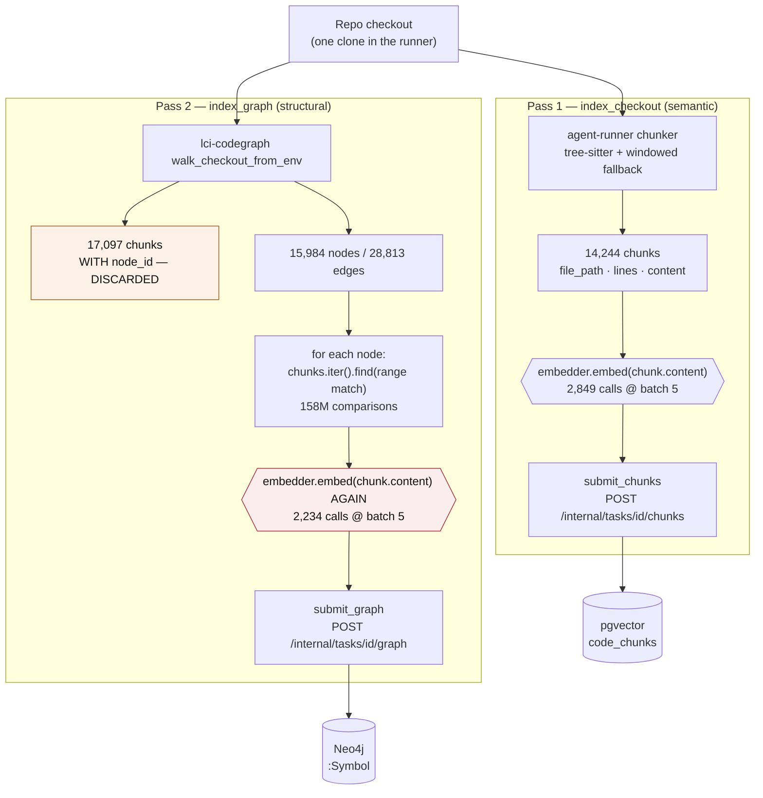
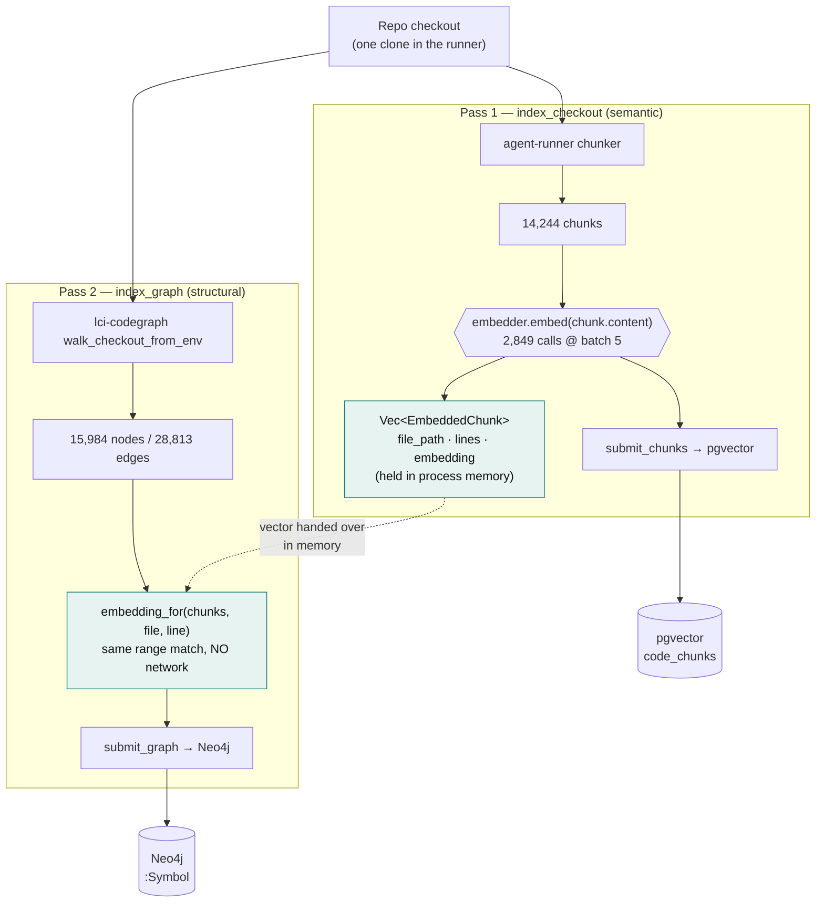
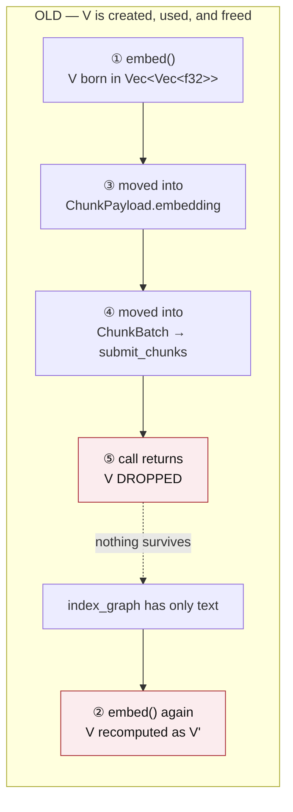
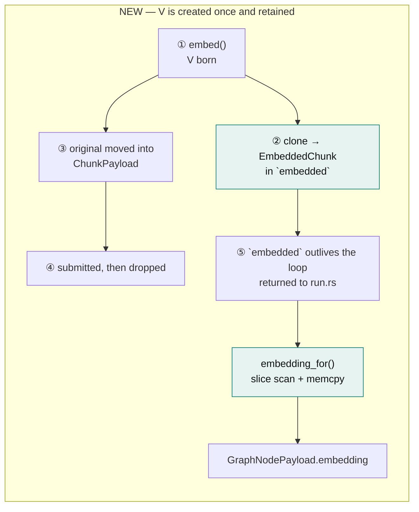

# PR #653 — Symbol embeddings reuse the chunk pass's vectors

> Walkthrough of [PR #653](https://github.com/ADORSYS-GIS/lightbridge-code-intelligence/pull/653)
> · closes [#652](https://github.com/ADORSYS-GIS/lightbridge-code-intelligence/issues/652)
> · refs [#651](https://github.com/ADORSYS-GIS/lightbridge-code-intelligence/issues/651)
> · [ADR-0116](docs/adr/0116-symbol-embeddings-reuse-chunk-vectors.md)

---

## Three questions answered up front

Before the flows, the three things that are easiest to get wrong about this change.

### Is `node_id` used?

**Yes — but not for what you might expect, and this PR does not change that.**

`node_id` has exactly one job in both the old and new flow: it is the **Neo4j `MERGE` key**. It is
minted by `lci-codegraph` as `<file>#<line>:<name>`, carried verbatim through `GraphNodePayload`, and
used by the control plane to identify the `:Symbol` node to upsert.

It is **not** used to decide which chunk a symbol's vector comes from. That decision is made by
`(file_path, start_line, end_line)` range containment, both before and after this PR.

There is a `Chunk::node_id` in `lci-codegraph` that *would* make the correlation exact — the crate
links each chunk to the graph node it is the body of during the same parse. `agent-runner` doesn't
use it, because it throws away `lci-codegraph`'s chunks entirely (see the flow diagrams — this is a
real and slightly surprising fact about the current pipeline). Adopting it is Option D in ADR-0116
and is deliberately out of scope here.

### Does anything read from the database?

**No. The runner has no database access at all.**

`agent-runner` has no `sqlx` dependency and no `DATABASE_URL` — it is the untrusted side of the
ADR-0002 trust boundary. It never reads back what it wrote. Both before and after this PR, vectors
live in the runner's **process memory** for the duration of the task, and travel to storage in one
direction only, through the mediated internal API.

So "reuse" here means *"the `Vec<f32>` is still in RAM from a few hundred milliseconds ago"*, not
*"query pgvector for it"*.

### What changed about calling the embedding model?

| | calls to `POST {base}/v1/embeddings` |
|---|---|
| **Old** | once per chunk batch in the semantic pass **and** once per symbol batch in the structural pass |
| **New** | once per chunk batch in the semantic pass, only |

The structural pass now makes **no network call while building its node payloads**.

To be unambiguous, because "no network call" is easy to over-read: `index_graph` still makes exactly
one outbound call — the `submit_graph` POST — and that request still carries every vector.
**Embeddings are still written to Neo4j, for the same nodes as before.** What is gone is the
*embeddings* call, not the graph write. Nothing about `:Symbol.embedding`'s contents or coverage
changes; the vector simply comes from memory instead of a second round trip to the gateway.

---

## The old flow



Two things stand out. `E2` sends **the same strings** `E1` already sent — `chunk.content` in both
cases. And `DIS`: `lci-codegraph` chunks the entire checkout, producing 17,097 chunks that already
carry `node_id`, and `agent-runner` reads only `out.graph` from that walk. `out.chunks` is never
touched.

### Old code — `indexer/graph.rs`

```rust
let mut nodes: Vec<GraphNodePayload> = Vec::with_capacity(out.graph.nodes.len());
// (node index into `nodes`, text to embed) — collected first so embedding happens in batches,
// not one call per symbol.
let mut embeddable: Vec<(usize, &str)> = Vec::new();
for n in &out.graph.nodes {
    if let Some(chunk) = chunks
        .iter()
        .find(|c| chunk_contains_symbol(c, &n.source_file, n.start_line))
    {
        embeddable.push((nodes.len(), chunk.content.as_str()));   // ← the text, to re-embed
    }
    nodes.push(GraphNodePayload {
        node_id: n.node_id.clone(),
        label: n.label.clone(),
        source_file: n.source_file.clone(),
        start_line: n.start_line,
        embedding: None,                                          // ← back-patched below
    });
}

let embed_batch_size = IndexTuning::from_env().embed_batch_size;
for batch in embeddable.chunks(embed_batch_size) {
    let texts: Vec<&str> = batch.iter().map(|(_, text)| *text).collect();
    let embeddings = embedder
        .embed(&texts)                                            // ← second network round trip
        .await
        .context("embedding symbol batch")?;
    for ((idx, _), embedding) in batch.iter().zip(embeddings) {
        nodes[*idx].embedding = Some(embedding);
    }
}
```

The `(usize, &str)` tuple exists only to remember *which* node each vector belongs to, because the
node was pushed with `embedding: None` before its vector existed. The whole index-tracking
apparatus is a consequence of embedding in a second pass.

---

## The new flow



### New code — `indexer/graph.rs`

```rust
let nodes: Vec<GraphNodePayload> = out
    .graph
    .nodes
    .iter()
    .map(|n| GraphNodePayload {
        node_id: n.node_id.clone(),                 // ← still the Neo4j MERGE key
        label: n.label.clone(),
        source_file: n.source_file.clone(),
        start_line: n.start_line,
        embedding: embedding_for(chunks, &n.source_file, n.start_line),
    })
    .collect();
```

`nodes` is no longer `mut`, there is no back-patching, and there is no `await` in the construction.

```rust
/// The vector a symbol at `(source_file, start_line)` carries: the one embedded for the chunk whose
/// line span covers it. `None` when no chunk covers that line — the symbol is still submitted, with
/// its structural facts and no embedding.
fn embedding_for(chunks: &[EmbeddedChunk], source_file: &str, start_line: i64) -> Option<Vec<f32>> {
    chunks
        .iter()
        .find(|c| chunk_contains_symbol(c, source_file, start_line))
        .map(|c| c.embedding.clone())
}
```

---

## Where the vector actually comes from

This is the heart of the change, at statement granularity.

```mermaid
sequenceDiagram
    participant R as agent-runner
    participant G as embeddings gateway
    participant CP as control plane
    participant PG as pgvector
    participant N4 as Neo4j

    rect rgb(251, 241, 231)
    note over R,N4: OLD — the same text embedded twice
    R->>G: embed(["fn parse() {…}", …])
    G-->>R: [[0.017, …], …]
    R->>CP: submit_chunks(content + vector)
    CP->>PG: INSERT … ON CONFLICT DO UPDATE
    note over R: vectors dropped; chunks kept for their text
    R->>G: embed(["fn parse() {…}", …])
    note right of G: identical input,<br/>identical output
    G-->>R: [[0.017, …], …]
    R->>CP: submit_graph(nodes + vectors)
    CP->>N4: UNWIND … MERGE (:Symbol {node_id})
    end

    rect rgb(230, 243, 241)
    note over R,N4: NEW — embedded once, read from memory
    R->>G: embed(["fn parse() {…}", …])
    G-->>R: [[0.017, …], …]
    R->>CP: submit_chunks(content + vector)
    CP->>PG: INSERT … ON CONFLICT DO UPDATE
    note over R: vectors retained as EmbeddedChunk
    note over R: embedding_for() — local lookup, no I/O
    R->>CP: submit_graph(nodes + vectors)
    CP->>N4: UNWIND … MERGE (:Symbol {node_id})
    end
```

Note what is **absent** from both sides: any arrow from `PG` back to `R`. The runner never queries
pgvector. The "reuse" is purely in-process.

---

## The type that carries the vector

```rust
/// A chunk's location in the checkout paired with the vector embedded for its text.
///
/// `index_graph` (ADR-0114) resolves each symbol node to the chunk whose line span contains it and
/// attaches that chunk's vector to the node, so the structural pass needs a chunk's position and
/// embedding but never its text — the content stays behind in the semantic pass that submitted it.
#[derive(Clone, Debug)]
pub struct EmbeddedChunk {
    pub file_path: String,
    pub start_line: i32,
    pub end_line: i32,
    pub embedding: Vec<f32>,
}
```

The omission is the point: **no `content`**. Once nothing re-embeds, text is dead weight — and
leaving it out means a future caller cannot quietly start embedding it again. The three remaining
fields are exactly what `chunk_contains_symbol` reads, plus the vector.

Accumulation in `index_checkout`:

```rust
let mut submitted = 0usize;
let total = chunks.len();
// Every vector this pass computes is kept, so the structural pass can attach a symbol's vector
// without asking the embeddings endpoint for text that was embedded here.
let mut embedded: Vec<EmbeddedChunk> = Vec::with_capacity(total);

for (batch_idx, batch_chunks) in chunks.chunks(tuning.embed_batch_size).enumerate() {
    let texts: Vec<&str> = batch_chunks.iter().map(|c| c.content.as_str()).collect();
    let embeddings = embedder.embed(&texts).await
        .with_context(|| format!("embedding batch {batch_idx}"))?;

    let mut payloads: Vec<ChunkPayload> = Vec::with_capacity(batch_chunks.len());
    for (c, embedding) in batch_chunks.iter().zip(embeddings) {
        embedded.push(EmbeddedChunk {
            file_path: c.file_path.clone(),
            start_line: c.start_line,
            end_line: c.end_line,
            embedding: embedding.clone(),   // clone: `embedding` moves into the payload below
        });
        payloads.push(ChunkPayload {
            file_path: c.file_path.clone(),
            language: c.language.clone(),
            chunk_type: c.chunk_type.clone(),
            symbol_name: c.symbol_name.clone(),
            start_line: c.start_line,
            end_line: c.end_line,
            content: c.content.clone(),
            embedding,
        });
    }

    client.submit_chunks(context.task_id, ChunkBatch { commit_sha: commit_sha.clone(), chunks: payloads }).await?;
    submitted += batch_chunks.len();
    tracing::info!(submitted, total, "indexing progress");
}

Ok((submitted, embedded))
```

The iterator chain became an explicit loop because each vector is now needed in two places: moved
into `ChunkPayload` for the POST, and cloned into `EmbeddedChunk` for the run. One 16 KB copy per
chunk, against a network call that cost hundreds of milliseconds.

---

## What the storage side does with it

Both write paths are **untouched by this PR**, and both are worth knowing to see why the change is
safe.

**pgvector** — `db/code_chunks.rs`, keyed so a re-run overwrites rather than duplicates:

```sql
INSERT INTO code_chunks
  (repository_id, commit_sha, file_path, language, chunk_type, symbol_name,
   start_line, end_line, content, embedding)
VALUES ($1, $2, $3, $4, $5, $6, $7, $8, $9, $10::vector)
ON CONFLICT (repository_id, commit_sha, file_path, start_line, end_line)
DO UPDATE SET language = EXCLUDED.language, …, embedding = EXCLUDED.embedding
```

**Neo4j** — `integrations/neo4j.rs`. This is where `node_id` earns its keep, and where the
empty-vector sentinel means a structure-only re-index never wipes an existing embedding:

```cypher
UNWIND $nodes AS n
MERGE (s:Symbol {repo_id: $repo, commit: $commit, node_id: n.id})
SET s.label = n.label, s.source_file = n.file, s.start_line = n.line,
    s.embedding = CASE WHEN size(n.embedding) > 0 THEN n.embedding ELSE s.embedding END
```

---

## Old vs new, side by side

| | Old | New |
|---|---|---|
| Chunk→symbol correlation | `(file_path, line range)`, first match | **unchanged** |
| `node_id` role | Neo4j `MERGE` key | **unchanged** |
| `lci-codegraph` `Chunk.node_id` | not used (`out.chunks` discarded) | **unchanged** |
| Reads from a database | never | **unchanged** |
| Vector for `:Symbol` | second `embed()` call on `chunk.content` | in-memory lookup |
| Embedding calls in `index_graph` | 2,234 @ batch 5 | **0** |
| `index_graph` parameters | incl. `embedder: &EmbeddingsClient` | parameter removed |
| `nodes` construction | `mut`, pushed with `None`, back-patched by index | single `.map().collect()` |
| Returned from `index_checkout` | `Vec<chunker::Chunk>` (text, no vector) | `Vec<EmbeddedChunk>` (vector, no text) |
| Texts sent to the model per run | 25,413 | **14,244** (−44%) |
| Embedding calls per run @ batch 5 | 5,083 | **2,849** (−33%) |
| Nodes carrying `:Symbol.embedding` | 11,169 | **11,169** (identical) |

All figures measured on a fresh clone of `cratestack/cratestack` @ `main`.

---

## Why this is output-equivalent, not a trade-off

The argument has three steps, and each is checkable in the diff:

1. **Both passes embedded the same string.** `indexer/mod.rs` builds its batch from
   `c.content.as_str()`; the removed block built its batch from `chunk.content.as_str()` for the
   chunk `chunk_contains_symbol` selected. Same `String`.
2. **The selection rule did not change.** `chunk_contains_symbol` is byte-for-byte identical apart
   from its parameter type, so the same nodes resolve to the same chunks.
3. **The endpoint is deterministic for identical input.** True of `qwen3-embedding-8b` through the
   eaig gateway. This is the one assumption the equivalence rests on — noted in ADR-0116's
   consequences, because the OpenAI-compatible API does not contractually guarantee it. A
   non-deterministic endpoint would already be producing different `:Symbol.embedding` values
   between runs today.

This is also why ADR-0089's original objection to Option B no longer applies. It rejected
"reuse chunk embeddings" as fuzzy, because a chunk can hold several definitions and a large
definition can span several chunks. But the shipped code **already embedded the covering chunk's
text**, not the symbol's own definition span — so it carried Option B's fidelity while paying
Option A's cost. Reuse settles the cost and leaves the fidelity where it was.

---

## What this does not fix

Tracked in [#651](https://github.com/ADORSYS-GIS/lightbridge-code-intelligence/issues/651),
deliberately out of scope:

- **The graph submit still exceeds `ingest_graph`'s 32 MiB body limit.** 11,169 nodes × 4096-dim
  ≈ 582 MB in one request. This PR removes the cost of *producing* those vectors, not of *shipping*
  them. Prod metrics show it already failing: `POST …/graph` → `204` twice, `other` five times.
- **The correlation is still O(n·m).** `chunks.iter().find(…)` per node — 157,954,980 comparisons on
  cratestack. A `HashMap` keyed by file path makes it O(nodes + chunks). Left alone here so the diff
  stays a pure "stop recomputing" change.
- **No resumption, and batch size / concurrency are unchanged.**

And the larger option ADR-0116 records but does not take: moving chunking and embedding wholesale
into `lci-codegraph`, which would use `Chunk::node_id` for exact linkage, cover eight more languages,
and add a graph-aware context header to the embedded text. It changes chunk boundaries, so it needs a
full re-index and its own decision.

---

## Verification

```bash
cargo build --workspace
cargo test -p agent-runner
cargo clippy -p agent-runner --all-targets -- -D warnings
cargo fmt --all -- --check
```

```text
$ cargo build --workspace
    Finished `dev` profile [unoptimized + debuginfo] target(s) in 56.28s

$ cargo test -p agent-runner
running 96 tests
test result: ok. 96 passed; 0 failed; 0 ignored; 0 measured; 0 filtered out; finished in 27.02s

$ cargo clippy -p agent-runner --all-targets -- -D warnings
    Finished `dev` profile [unoptimized + debuginfo] target(s) in 7.91s

$ cargo fmt --all -- --check
(no output)
```

The five pre-existing `chunk_contains_symbol` tests keep their assertions verbatim — only the
fixture's type moved. Two new tests cover the behaviour introduced here:

```rust
#[test]
fn a_symbol_carries_the_vector_of_the_chunk_covering_it() {
    let chunks = vec![
        EmbeddedChunk { file_path: "src/a.rs".to_string(), start_line: 0, end_line: 20,
                        embedding: vec![1.0, 2.0] },
        EmbeddedChunk { file_path: "src/b.rs".to_string(), start_line: 0, end_line: 20,
                        embedding: vec![3.0, 4.0] },
    ];
    assert_eq!(
        embedding_for(&chunks, "src/b.rs", 7),
        Some(vec![3.0, 4.0]),
        "the covering chunk's own vector, not the first chunk in the slice"
    );
}

#[test]
fn a_symbol_no_chunk_covers_carries_no_vector() {
    let chunks = vec![chunk("src/a.rs", 10, 20)];
    assert_eq!(embedding_for(&chunks, "src/a.rs", 99), None);
    assert_eq!(embedding_for(&chunks, "src/other.rs", 15), None);
    assert_eq!(embedding_for(&[], "src/a.rs", 15), None);
}
```

The first uses two chunks with different vectors deliberately: an implementation that grabbed
`chunks[0]` would pass a single-chunk test and fail this one.

---

## Files changed

| File | Change |
|---|---|
| `services/agent-runner/src/indexer/mod.rs` | `EmbeddedChunk` added; `index_checkout` returns it; batch loop accumulates vectors |
| `services/agent-runner/src/indexer/graph.rs` | second embed pass deleted; `embedding_for` added; `embedder` parameter removed |
| `services/agent-runner/src/run.rs` | call site updated |
| `docs/adr/0116-…md` | **new** — the decision, Options A–D, explicit non-goals |
| `docs/adr/0114-…md` | status amended; §"Who writes it" and cost line updated (hybrid search untouched) |
| `docs/adr/0089-…md` | Option B marked adopted, with why its fidelity objection didn't apply |
| `docs/adr/README.md` | 0116 row added; 0089 / 0114 status cells annotated |
| `ROADMAP.md` | new entry; one phrase corrected in the existing ADR-0114 entry |

---

# Appendix — "from memory instead of a second round trip"

The one-liner earlier in this document hides the actual mechanism. This appendix follows **a single
vector** through both versions of the code, at ownership granularity, because the reason the old code
called the gateway twice is not the one most readers assume.

It was not a design choice to re-embed. **The old code had nowhere to put the vector**, so by the
time the structural pass needed it, it no longer existed in the process.

## The crux: what crossed the function boundary

```rust
// OLD
) -> anyhow::Result<(usize, Vec<chunker::Chunk>)> {

// where:
pub struct Chunk {
    pub file_path: String,
    pub language: String,
    pub chunk_type: String,
    pub symbol_name: Option<String>,
    pub start_line: i32,
    pub end_line: i32,
    pub content: String,     // ← text
                             // ← and that is all. No embedding field exists.
}
```

`chunker::Chunk` is the chunker's own output type — a description of a slice of source. It has no
field capable of holding an embedding, and it shouldn't: the chunker is pure CPU work that runs
before anything is embedded.

So `index_checkout` handed back **text and positions, and zero vectors**. Given that input, the only
way for `index_graph` to obtain a vector was to ask the gateway for one. The second call was a
*consequence* of the return type, not an independent decision.

The new type closes exactly that gap:

```rust
// NEW
) -> anyhow::Result<(usize, Vec<EmbeddedChunk>)> {

pub struct EmbeddedChunk {
    pub file_path: String,
    pub start_line: i32,
    pub end_line: i32,
    pub embedding: Vec<f32>,   // ← the vector now survives the function
}
```

## Following one vector — the old flow

Take one chunk: `src/auth/session.rs`, lines 40–58, the body of `fn validate_session`. Call its
4096-dimension vector **V**.

```rust
for (batch_idx, batch_chunks) in chunks.chunks(tuning.embed_batch_size).enumerate() {
    let texts: Vec<&str> = batch_chunks.iter().map(|c| c.content.as_str()).collect();

    // ① V is born here, inside `embeddings: Vec<Vec<f32>>`.
    let embeddings = embedder.embed(&texts).await?;

    let payloads: Vec<ChunkPayload> = batch_chunks
        .iter()
        .zip(embeddings)              // ② `embeddings` is CONSUMED by value
        .map(|(c, emb)| ChunkPayload {
            /* … */
            embedding: emb,           // ③ V is MOVED into the payload
        })
        .collect();

    client
        .submit_chunks(
            context.task_id,
            ChunkBatch { commit_sha: commit_sha.clone(), chunks: payloads },
        )                             // ④ `payloads` MOVED into ChunkBatch, then into submit_chunks
        .await?;
    // ⑤ the call returns; ChunkBatch is dropped; V's allocation is FREED.
}

Ok((submitted, chunks))               // ⑥ only `chunks` survives — text, no vectors
```

Step ⑤ is the whole story. `zip` consumes `embeddings`, `emb` is moved into the payload, the payload
is moved into the request, and when `submit_chunks` returns, the last owner goes out of scope. V is
gone from the process, permanently, before the loop's next iteration begins.

`chunks` survives only because the loop **borrows** it (`chunks.chunks(…)` yields slices) rather than
consuming it — and `chunks` holds text.

Then, minutes later:

```rust
// index_graph — V no longer exists, so it is requested again
embeddable.push((nodes.len(), chunk.content.as_str()));   // the TEXT, because that is all there is
// …
let embeddings = embedder.embed(&texts).await?;           // the gateway recomputes V
```

The gateway receives the identical string and returns a vector equal to V. A network round trip, a
GPU forward pass, and a 4096-float response body — to reconstruct something the process had held and
discarded.



## Following the same vector — the new flow

```rust
let mut embedded: Vec<EmbeddedChunk> = Vec::with_capacity(total);   // ⓪ outlives the loop

for (batch_idx, batch_chunks) in chunks.chunks(tuning.embed_batch_size).enumerate() {
    let texts: Vec<&str> = batch_chunks.iter().map(|c| c.content.as_str()).collect();

    // ① V is born here, exactly as before.
    let embeddings = embedder.embed(&texts).await?;

    let mut payloads: Vec<ChunkPayload> = Vec::with_capacity(batch_chunks.len());
    for (c, embedding) in batch_chunks.iter().zip(embeddings) {
        embedded.push(EmbeddedChunk {
            file_path: c.file_path.clone(),
            start_line: c.start_line,
            end_line: c.end_line,
            embedding: embedding.clone(),   // ② a COPY of V is retained in `embedded`
        });
        payloads.push(ChunkPayload {
            /* … */
            embedding,                      // ③ the original V is moved into the payload
        });
    }

    client.submit_chunks(/* … */).await?;   // ④ the payload's copy is dropped as before
    // ⑤ but `embedded` still owns its copy of V — it is not in this scope's lifetime
}

Ok((submitted, embedded))                   // ⑥ vectors cross the function boundary
```

The iterator chain had to become an explicit `for` loop precisely because one value now needs two
owners. `.map()` over a moved `embeddings` can produce one output per input; here each embedding
feeds both `embedded` and `payloads`.

Then in `index_graph`, the "round trip" is a slice scan and a memory copy:

```rust
fn embedding_for(chunks: &[EmbeddedChunk], source_file: &str, start_line: i64) -> Option<Vec<f32>> {
    chunks
        .iter()                                                       // walk the retained vectors
        .find(|c| chunk_contains_symbol(c, source_file, start_line))  // same rule as before
        .map(|c| c.embedding.clone())                                 // copy V out — no I/O
}
```

The final `.clone()` is needed because `chunks` is a borrowed slice while `GraphNodePayload.embedding`
is an owning `Option<Vec<f32>>`. It is a `memcpy`, not a request.



## Lifetime of V, side by side

| Step | Old | New |
|---|---|---|
| Created by `embed()` | ✅ | ✅ |
| Moved into `ChunkPayload` | ✅ | ✅ (the original) |
| Copy retained | ✗ — no field to hold it | ✅ `EmbeddedChunk.embedding` |
| After `submit_chunks` returns | **freed** | payload's copy freed, retained copy lives |
| Crosses the `index_checkout` boundary | ✗ | ✅ |
| How `index_graph` obtains it | `embed()` — network | `embedding_for()` — slice scan + `memcpy` |
| Cost to `index_graph` | HTTP round trip + GPU forward pass | ~14k pointer comparisons + one 16 KB copy |

## What "from memory" costs

A 4096-dimension `f32` vector is **16,384 bytes**. Retaining one per chunk on cratestack:

```
14,244 chunks × 4096 dims × 4 bytes = 233 MB
```

held for the duration of the task, against the runner's `4Gi` limit.

This is close to neutral rather than additive, because the old code was allocating comparable memory
in the pass that is now gone:

```rust
// OLD: nodes accumulated their own vectors over the second embed loop
nodes[*idx].embedding = Some(embedding);   // 11,169 × 4096 × 4 B ≈ 183 MB
```

Net change is roughly +50 MB at peak, and `EmbeddedChunk` drops `content`, `language`, `chunk_type`
and `symbol_name` — so the ~14.4 MB of chunk text that used to cross the boundary no longer does.

## The two clones, and why neither is the expensive thing

There are exactly two `.clone()` calls on a vector in the new code:

| Where | Why it exists | Cost |
|---|---|---|
| `embedding: embedding.clone()` in `index_checkout` | the original is moved into `ChunkPayload` on the next statement | one 16 KB copy per chunk |
| `.map(\|c\| c.embedding.clone())` in `embedding_for` | `chunks` is a `&[EmbeddedChunk]`; the payload field owns its data | one 16 KB copy per embedded node |

Together on cratestack that is roughly `(14,244 + 11,169) × 16 KB ≈ 406 MB` of `memcpy` across the
whole run — a few hundred milliseconds of memory bandwidth in total, replacing **2,234 sequential
HTTP round trips** to an 8B embedding model. The clones are not a compromise; they are what the
saving costs.

## The honest boundary

"From memory instead of a round trip" describes **how the vector is obtained**. It does not mean the
structural pass became offline:

```rust
client
    .submit_graph(context.task_id, GraphBatch { commit_sha, nodes, edges })
    .await
    .context("submitting codegraph structural graph")?;
```

`index_graph` still makes this call, it still carries every vector, and `:Symbol.embedding` is still
written for the same 11,169 nodes. What disappeared is the call to the **embeddings gateway**, not
the call to the control plane — and that remaining submit is the one that still exceeds the 32 MiB
body limit on large repositories (#651).
