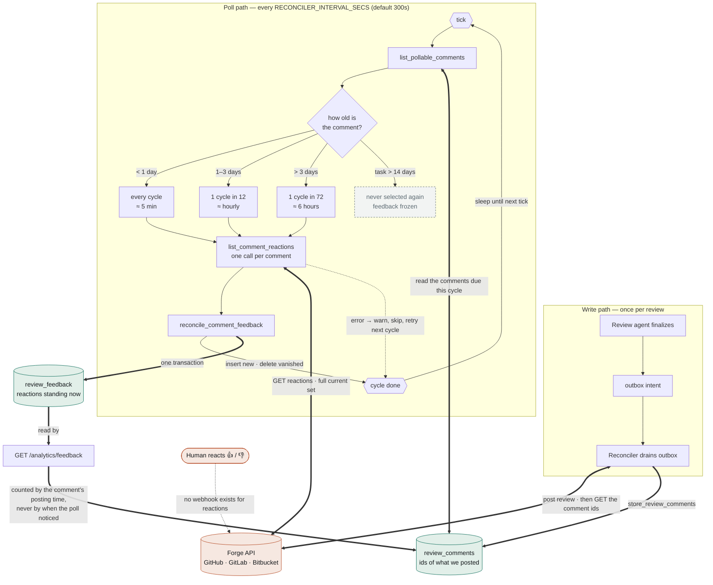

# How 👍/👎 reaction polling works

Read from the code on `feat/review-analytics-endpoints` @ `948ae8a`. Every snippet is copied from the
source, not paraphrased.

## The short answer

**It is a clock, not a trigger.** Reactions are read by a periodic loop in the `reconciler` role that
ticks every `RECONCILER_INTERVAL_SECS` — **300 seconds (5 minutes) by default**. Nothing about a new
review run causes a poll; running the reviewer again only adds new comments for the loop to find.

But "every 5 minutes" is only true for *recently posted* comments. Each comment is polled on a
schedule that decays with its age, so API usage stays flat as the estate grows:

| Comment age | Polled | Effective cadence at the 5-minute default |
| --- | --- | --- |
| under 1 day | every cycle | **every 5 minutes** |
| 1–3 days | 1 cycle in 12 | **about once an hour** |
| over 3 days | 1 cycle in 72 | **about every 6 hours** |
| task older than `RECONCILER_WINDOW_DAYS` (14) | never again | **frozen at its last reading** |

That last row is the one with consequences: 👍/👎 on anything older than two weeks stops being
updated, so a reaction added — or removed — after that is never seen.

---

## 1. Why a poll and not a webhook

This was a deliberate correction, recorded in
[ADR-0035](docs/adr/0035-review-feedback-signal.md), whose status line reads:

> **Status:** Accepted (capture mechanism **corrected** below: GitHub does not webhook reactions —
> poll the REST API instead)

The ADR spells out the reason:

> GitHub does **not** emit webhook events for reactions (verified against the webhook-events docs:
> there is no `reaction` event, and `issue_comment`/`pull_request_review_comment` fire on comment
> create/edit/delete, never on a reaction).

So there is no event to subscribe to. A periodic reconciliation against the reactions API is the only
way to see them — and it buys one thing a webhook would not: **un-reacting is detected for free**,
because each poll compares the full current set against what is stored.

---

## 2. The pipeline, end to end

Two views. This one is the **control flow** — where it loops, where it branches, and which way data
actually moves:



The thick double-headed arrows are the round trips: the reconciler asks the forge and the database
for something and uses what comes back in the same step. The dashed arrows are the two things that
are **not** connections — a human's reaction never reaches us as an event, and a failed call drops
out of the cycle rather than retrying inside it.

And this one is the **ordering** of the same work over time:

```mermaid
sequenceDiagram
    autonumber
    participant A as Review agent
    participant CP as Control plane (serve)
    participant R as Reconciler (single replica)
    participant F as Forge (GitHub / GitLab)
    participant H as Human reviewer
    participant DB as Postgres

    A->>CP: findings, replies, summary (mediated writes)
    CP->>DB: outbox intent (review)
    R->>DB: drain outbox
    R->>F: post the review
    F-->>R: comment ids (a follow-up GET; the create response omits them)
    R->>DB: INSERT review_comments (task_id, comment_id, kind, file, line)
    H->>F: reacts 👍 / 👎 (no webhook is emitted)
    loop every RECONCILER_INTERVAL_SECS (default 300s)
        R->>DB: list_pollable_comments(within_days, interval_secs)
        Note over R,DB: age-tiered: only a slice of comments each cycle
        R->>F: GET reactions for each selected comment
        R->>DB: reconcile_comment_feedback — INSERT new, DELETE vanished
    end
```

**A prerequisite makes this possible at all:** the reconciler records the id of every comment it
posts, because without those ids there is nothing to poll. That is `store_review_comments`, called
right after a review is posted (`src/queue/reconciler.rs`). Comments the bot did not create are never
polled — this only ever reads reactions on our own output.

---

## 3. Where the loop lives

The poll is part of the `reconciler` role, which is also the sole platform egress. From the module
doc (`src/queue/reconciler.rs`):

```rust
//! - **inbound (ADR-0035):** reads 👍/👎 reactions on the comments we posted and reconciles them into
//!   `review_feedback` (GitHub emits no webhook for reactions).
//!
//! Single replica is load-bearing: it makes "sole consumer" literal and keeps the outbox's per-task
//! ordering intact.
```

It is **spawned alongside** the outbox drain, on its own cadence, so posting and polling never block
each other:

```rust
pub async fn run(
    pool: PgPool,
    platforms: HashMap<Platform, Arc<dyn CodePlatform>>,
    review: Arc<ReviewSection>,
    interval: Duration,
    within_days: i32,
) -> anyhow::Result<()> {
    // Feedback poll (ADR-0035) on its own cadence, alongside the drain.
    {
        let (pool, platforms) = (pool.clone(), platforms.clone());
        let interval_secs = interval.as_secs() as i64;
        tokio::spawn(async move {
            tracing::info!(interval_secs, within_days, "reconciler: feedback poll started");
            let mut tick = tokio::time::interval(interval);
            // A slow cycle (e.g. platform stalling) must not make the next ticks burst-fire to catch up
            // and spike DB + API load — skip the missed ticks instead (gemini #219).
            tick.set_missed_tick_behavior(tokio::time::MissedTickBehavior::Skip);
            loop {
                tick.tick().await;
                match poll_once(&pool, &platforms, within_days, interval_secs).await {
                    Ok(n) => tracing::debug!(comments = n, "feedback poll cycle complete"),
                    Err(error) => tracing::warn!(%error, "feedback poll cycle failed (will retry)"),
                }
            }
        });
    }
    run_outbox_drain(pool, platforms, review).await
}
```

Two details worth keeping:

- **`MissedTickBehavior::Skip`** — if a cycle runs long (a slow forge), the timer does not fire the
  missed ticks back-to-back afterwards. Without it, a stall would be followed by a burst of API
  calls exactly when the forge is already unhappy.
- **A failed cycle is logged, not fatal.** The loop keeps ticking.

The interval and window are read once at startup (`src/main.rs`):

```rust
let interval = std::time::Duration::from_secs(reconciler_env_u64(
    "RECONCILER_INTERVAL_SECS",
    "POLLER_INTERVAL_SECS",
    300,
));
```

**If the `reconciler` role is not deployed, no reactions are ever captured.** The feature fails
silently to "no feedback at all" rather than to an error.

---

## 4. What each cycle actually selects

This is where "every 5 minutes" becomes more interesting. A cycle does **not** re-read every comment
ever posted — it takes an age-tiered slice (`src/db/feedback.rs`):

```rust
/// Comments to poll this cycle (ADR-0035), within `within_days`, **tiered by age** so API usage stays
/// flat regardless of repo activity instead of re-reading every comment every cycle: fresh comments
/// (< 1 day) every cycle, 1–3 days old ~1-in-12 cycles, 3+ days old ~1-in-72 cycles. The tier filter
/// is a deterministic `comment_id % N == current_cycle % N` (the cycle index is wall-clock /
/// `interval_secs`), so it needs no per-comment state and spreads load evenly across cycles.
```

```sql
SELECT rc.task_id, rc.platform_comment_id, rc.kind, r.owner, r.name, t.installation_id, r.platform,
       t.target_id, t.target_type
FROM review_comments rc
JOIN tasks t ON t.id = rc.task_id
JOIN repositories r ON r.id = t.repository_id
WHERE t.created_at > now() - ($1 * interval '1 day')
  AND (
    rc.created_at > now() - interval '1 day'
    OR (rc.created_at BETWEEN now() - interval '3 days' AND now() - interval '1 day'
        AND (rc.platform_comment_id % 12) = (extract(epoch from now())::bigint / $2) % 12)
    OR (rc.created_at < now() - interval '3 days'
        AND (rc.platform_comment_id % 72) = (extract(epoch from now())::bigint / $2) % 72)
  )
ORDER BY rc.created_at, rc.id
```

How to read it:

- **`$1` is `RECONCILER_WINDOW_DAYS`** (default 14) and it bounds on **the task's** age, not the
  comment's. Past that, a comment is never selected again.
- **`extract(epoch from now()) / $2`** is a cycle counter: wall-clock divided by the interval. Taking
  it modulo 12 or 72 picks a different slice of comment ids each cycle — **no per-comment state, no
  "last polled" column**, and the load spreads evenly because comment ids are effectively random
  modulo 12 or 72.
- The tiers use `rc.created_at`, so a comment "ages out" of the fast tier on its own schedule.

**Kinds are not filtered.** `review_comments` holds `inline`, `reply` and `failure_notice` rows, and
the poll reads reactions for all three. The analytics endpoints later count only `inline` and
`reply`, so a 👍 on a failure notice is stored but never charted.

---

## 5. What one poll does per comment

One HTTP call per selected comment — there is no batch reactions API (`src/queue/reconciler.rs`):

```rust
let is_review_comment = c.kind == "inline";
match platform
    .list_comment_reactions(
        &repo,
        c.platform_comment_id,
        is_review_comment,
        Some(c.target_id),
        Some(&c.target_type),
    )
    .await
{
    Ok(reactions) => {
        let pairs: Vec<(String, String)> = reactions
            .into_iter()
            .map(|r| (r.user_login, r.content))
            .collect();
        match crate::db::reconcile_comment_feedback(pool, c.task_id, c.platform_comment_id, &c.kind, &pairs).await { ... }
    }
    Err(error) => {
        tracing::warn!(%error, comment = c.platform_comment_id, "reading reactions failed")
    }
}
```

`is_review_comment` matters because the endpoint differs by comment kind. **GitHub**
(`src/integrations/github.rs`):

```rust
let kind = if is_review_comment { "pulls" } else { "issues" };
...
.get(format!(
    "https://api.github.com/repos/{owner}/{repo}/{kind}/comments/{comment_id}/reactions?per_page=100"
))
```

**GitLab** has no global note endpoint, so the parent MR/issue `iid` is carried along for exactly
this reason (`src/integrations/gitlab.rs`):

```rust
// GitLab notes are scoped to their parent (MR or issue) — there is NO global
// `/projects/{id}/notes/{note_id}` endpoint. The parent iid is carried from the task's
// `target_id` (via `PollableComment`) so we can address the note's award emoji directly.
```

It also normalises GitLab's award-emoji names into GitHub's vocabulary, so `reaction = '-1'` means
the same thing everywhere, and treats a **404 as "no reactions"** rather than an error — a deleted
note then prunes its stale feedback instead of failing every cycle forever.

**Bitbucket always returns nothing** (`src/integrations/bitbucket.rs`):

```rust
// Documented simplification (ADR-0108): no reaction API on Bitbucket Cloud (see
// `add_reaction`) — there is never anything to find, so the 👍/👎 feedback poll
// (`reconcile_comment_feedback`, ADR-0035) always sees an empty list for this platform and
// simply never suppresses a finding via feedback here, rather than erroring every cycle.
Ok(vec![])
```

So **Bitbucket repositories will always show zero feedback**, by design, not by fault.

---

## 6. Reconciliation: how un-reacting is caught

Each poll hands the database the **complete current set** for that comment, and the write is a
two-step reconcile in one transaction (`src/db/feedback.rs`):

```rust
let mut tx = pool.begin().await?;
for (reactor, reaction) in reactions {
    sqlx::query(
        "INSERT INTO review_feedback \
         (id, task_id, platform_comment_id, comment_kind, reactor, reaction) \
         VALUES ($1, $2, $3, $4, $5, $6) \
         ON CONFLICT (platform_comment_id, comment_kind, reactor, reaction) DO NOTHING",
    )...
}
// Drop feedback no longer present on GitHub. ... An empty
// `present` set makes `<> ALL('{}')` true for every row → all are deleted.
let present: Vec<String> = reactions.iter().map(|(u, c)| format!("{u}|{c}")).collect();
sqlx::query(
    "DELETE FROM review_feedback \
     WHERE platform_comment_id = $1 AND comment_kind = $2 \
       AND (reactor || '|' || reaction) <> ALL($3)",
)...
tx.commit().await
```

- **Insert is idempotent** — re-polling an unchanged comment writes nothing.
- **Delete is what gives "un-react" for free.** Anything stored but no longer on the forge goes away.
- There is **no history**: `review_feedback` holds what is standing right now. A 👎 that was added
  and removed leaves no trace.

---

## 7. Failure handling

| Failure | What happens |
| --- | --- |
| One comment's API call fails | Logged at `warn`, that comment is skipped, the cycle continues |
| One comment's DB write fails | Logged at `warn`, cycle continues |
| A platform has no configured implementation | Logged at `warn`, comment skipped |
| The whole cycle errors | Logged at `warn`, the loop keeps ticking |
| GitLab note deleted (404) | Treated as "no reactions", so stale feedback is pruned |
| The cycle runs long | Missed ticks are skipped, never fired in a burst |

Nothing here retries within a cycle — the next cycle is the retry.

---

## 8. Configuration

From `deploy/config-reference.md`:

| Variable | Default | Effect |
| --- | --- | --- |
| `RECONCILER_INTERVAL_SECS` (legacy `POLLER_INTERVAL_SECS`) | `300` | Cycle length. Also scales every tier: halving it doubles poll frequency in all tiers |
| `RECONCILER_WINDOW_DAYS` (legacy `POLLER_WINDOW_DAYS`) | `14`, clamped ≥ 1 | How far back tasks stay pollable. Past this, feedback freezes |

A `0` window would silently disable the poll entirely, so it is clamped to 1 and the clamp is logged:

```rust
if configured_days < 1 {
    tracing::warn!(
        configured_days,
        "RECONCILER_WINDOW_DAYS < 1 would disable the feedback poll; clamping to 1"
    );
}
```

The analytics API reports this same window to the UI (`reconciler_window_days()` is shared), so a page
can tell the reader where reactions stop being kept current. **Both roles must be deployed with the
same value** — each reads its own process env.

---

## 9. What this means in practice

Consequences worth knowing before trusting a number built on this data:

1. **Freshness is a cycle, not instant.** A 👍 typically appears within 5 minutes on a fresh comment,
   within the hour on a 1–3 day old one, and within 6 hours on anything older.
2. **After 14 days, feedback is frozen.** Reactions added or removed later are never picked up. Any
   long-window report has a stale left edge.
3. **`review_feedback.created_at` is the reconcile time, not the reaction time.** It records when a
   poll *noticed* the reaction, which can be hours or days late. This is exactly why the analytics
   endpoints count reactions by *the comment's posting time* instead of this column.
4. **There is no reaction history.** Only what stands right now.
5. **Bitbucket always reads empty.**
6. **A comment with more than 100 reactions is truncated** — both the GitHub and GitLab calls request
   `per_page=100` with no pagination loop. Not a practical limit on review comments, but it is a
   silent cap.
7. **No reconciler, no feedback.** If the role is not running, the tables simply stay empty.

## 10. What it costs in API calls

One call per selected comment per cycle. With `C_fresh`, `C_mid` and `C_old` comments in each tier:

```text
calls per cycle ≈ C_fresh + C_mid / 12 + C_old / 72
```

For a estate with 50 fresh, 150 mid-aged and 800 older comments still inside the 14-day window, that
is roughly `50 + 13 + 11 ≈ 74` calls per 5-minute cycle, about **890 calls an hour** — well inside a
GitHub App installation's hourly budget, and flat with respect to how many old comments exist. The
tiering is what keeps that last property true.

---

## 11. Verifying it locally

The loop announces itself at startup, so the fastest check is the log line:

```text
reconciler: feedback poll started   interval_secs=300 within_days=14
```

Per-cycle completions are at `debug` (`feedback poll cycle complete comments=<n>`), so raise the log
level to see them.

To see what the next cycle would pick up, run the selection query directly, or check what has landed:

```sql
SELECT reaction, count(*) FROM review_feedback GROUP BY reaction ORDER BY 2 DESC;
SELECT count(*) FROM review_comments WHERE created_at > now() - interval '1 day';
```

An empty `review_feedback` with a non-empty `review_comments` means either nobody has reacted, or the
reconciler is not running.

---

## 12. Where the code is

| File | Role |
| --- | --- |
| `services/control-plane/src/queue/reconciler.rs` | The loop (`run`), one cycle (`poll_once`), and recording comment ids after posting |
| `services/control-plane/src/db/feedback.rs` | `list_pollable_comments` (the tiered selection) and `reconcile_comment_feedback` (insert/delete) |
| `services/control-plane/src/main.rs` | Role dispatch (`reconciler`, legacy alias `poller`), interval and window from env |
| `services/control-plane/src/integrations/{github,gitlab,bitbucket}.rs` | The per-platform reactions call |
| `services/control-plane/migrations/0015_review_feedback.sql` | `review_comments` and `review_feedback` |
| `docs/adr/0035-review-feedback-signal.md` | Why it polls instead of listening |
| `docs/adr/0058-rename-poller-role-to-reconciler.md` | Why it lives in the reconciler, single-replica |
