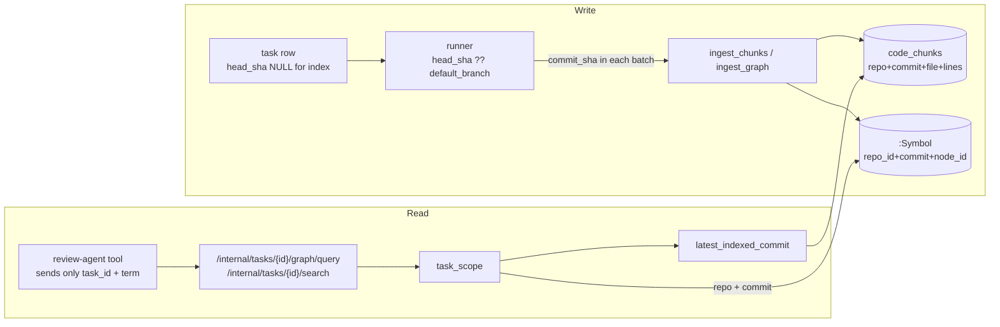

# Index snapshots: what defines one, how it is written, and how a lookup finds it

**Repository:** `ADORSYS-GIS/lightbridge-code-intelligence` · **Read at `main` = `0aa4ca5`** (2026-09-23)

Every line and snippet below is quoted from that revision. Where behaviour is observed in production it
says so.

---

## 1. In one page

A **snapshot** is everything stored under one `(repository_id, commit)` pair — `:Symbol` nodes and
`REL` edges in Neo4j, `code_chunks` rows in pgvector. There is no `Snapshot` type in the code; the pair
*is* the snapshot.

The two sides of the system decide that pair differently, and that asymmetry explains most of what
follows:

| | Who decides the key | How |
|---|---|---|
| **Write** | the **runner** | `head_sha.unwrap_or(default_branch)`, sent with every batch; the control plane stores what it is given |
| **Read** | the **control plane** | `latest_indexed_commit(repo)` — the `commit_sha` of the most recently written chunk row |

For an index task `head_sha` is always `NULL`, so default-branch snapshots are keyed by the **branch
name** (`'main'`), not a commit. PR reviews carry the PR head, so those are keyed by a real SHA.



---

## 2. What a snapshot is

Nothing declares it. It exists as a key repeated across both stores and every query.

**pgvector** — `migrations/0004_code_chunks.sql` (embedding widened to 4096 in `0005`):

```sql
CREATE TABLE IF NOT EXISTS code_chunks (
    id            BIGSERIAL PRIMARY KEY,
    repository_id BIGINT  NOT NULL REFERENCES repositories (id) ON DELETE CASCADE,
    commit_sha    TEXT    NOT NULL,
    file_path     TEXT    NOT NULL,
    ...
    UNIQUE (repository_id, commit_sha, file_path, start_line, end_line)
);
CREATE INDEX IF NOT EXISTS code_chunks_commit_idx ON code_chunks (repository_id, commit_sha);
```

**Neo4j** — every node carries the pair as properties, and the write keys on it
(`integrations/neo4j.rs:115`):

```cypher
UNWIND $nodes AS n
MERGE (s:Symbol {repo_id: $repo, commit: $commit, node_id: n.id})
SET s.label = n.label, s.source_file = n.file, s.start_line = n.line, ...
```

The closest thing to a definition is in the design records:

- **ADR-0052** — *"Indexing stores a full snapshot per `(repository_id, commit_sha)` in both pgvector
  (`code_chunks`) and Neo4j."*
- **ADR-0050** — *"retrieval … is pinned to a `(repository_id, commit_sha)` scope."*

---

## 3. Where the commit comes from (the write path)

### 3.1 The task row

An **index** task is created without a commit — `db/repositories.rs:400`, the only creator of index
tasks, called from the three push handlers (`webhook.rs:869`, `:1311`, `:1737`) and from repository
approval (`admin.rs:447`):

```rust
"INSERT INTO tasks (id, repository_id, installation_id, target_type, target_id, \
 command_text, run_epoch, status) \
 SELECT $1, $2, $3, 'repository', $2, 'index', ... 'queued' \
 WHERE NOT EXISTS ( \
   SELECT 1 FROM tasks WHERE repository_id = $2 AND command_text = 'index' \
     AND status IN ('queued', 'running', 'posting_result') \
 ) \
 RETURNING id",
```

No `head_sha` column is listed, so it is `NULL`. (The `NOT EXISTS` clause is also why only one index
task per repository can be in flight.)

A **review** task is created from a PR event and does carry the PR's head SHA (`webhook.rs`, the
`NewTask { … head_sha, … }` construction at `:874`, `:1113`, `:1308`, `:1525`, `:1728`, `:1971`).

### 3.2 The runner turns that into the key

Both halves of the index do the same thing — `agent-runner/src/indexer/graph.rs:41` and
`indexer/mod.rs:65`:

```rust
let commit_sha = context
    .head_sha
    .as_deref()
    .unwrap_or(&context.default_branch)
    .to_string();
```

So: **review task → PR head SHA; index task → the default branch's name.**

### 3.3 The submission carries the key, and the server stores it as given

The runner puts `commit_sha` in every batch (`ChunkBatch`, `GraphBatch`), and the control plane writes
with that value rather than resolving its own — `http/internal.rs:718` (chunks), `:902` (graph):

```rust
match crate::db::upsert_code_chunks(pool, repository_id, &batch.commit_sha, &chunks).await { … }
```

```rust
crate::integrations::neo4j::upsert_graph(neo4j, repository_id, &batch.commit_sha, &nodes, &edges)
```

Only `repository_id` is taken from the task. **The key of a snapshot is therefore decided by the
runner.**

---

## 4. How it is stored

### 4.1 Chunks — insert or overwrite, never delete

`db/code_chunks.rs:174`:

```sql
INSERT INTO code_chunks (...)
VALUES ($1, $2, $3, $4, $5, $6, $7, $8, $9, $10::vector)
ON CONFLICT (repository_id, commit_sha, file_path, start_line, end_line)
DO UPDATE SET language = EXCLUDED.language, chunk_type = EXCLUDED.chunk_type,
              symbol_name = EXCLUDED.symbol_name, content = EXCLUDED.content,
              embedding = EXCLUDED.embedding
```

Same key → content and embedding replaced. New key → inserted. A key the new commit no longer produces
is **left in place**.

### 4.2 Graph — merge, never delete

`upsert_graph` (`neo4j.rs`) writes nodes and edges in one transaction, both by `MERGE`: nodes on
`(repo_id, commit, node_id)`, edges by matching both endpoints in the same snapshot. Nothing in the
write path removes a node that the new commit no longer has.

A node id is minted by `lci-codegraph` (pinned at `agent-runner/Cargo.toml:52`) as
`<file>#<line>:<name>` for definitions, and the bare path for a file node — so a definition's identity
includes the line it starts on.

### 4.3 The schema the writes rely on

Declared at startup by `ensure_indexes` (`neo4j.rs`), in this order:

| Name | Line | Purpose |
|---|---|---|
| `snapshot_write_lock` (constraint) | `:428` | makes the per-snapshot write lock exclusive (#664) |
| `symbol_embedding_idx` (vector) | `:456` | ADR-0114 semantic symbol search |
| `symbol_label_fulltext` | `:468` | lexical symbol search |
| `symbol_snapshot` on `(repo_id, commit)` | `:479` | snapshot-level reads and deletes (#663) |
| `symbol_identity` on `(repo_id, commit, node_id)` | `:501` | identity seek; **refused in prod today** — duplicates (#665) |

---

## 5. How a lookup finds the snapshot (the read path)

### 5.1 The review agent's tools send no commit

`review-agent/src/tools/graph.rs` — the tool the model calls passes a task id and a term:

```rust
self.services
    .client
    .graph_find_symbol(cx.task_id, &args.term, clamp_limit(args.limit))
    .await
```

`agent-clients/src/control_plane/search.rs` turns that into one request:

```rust
pub async fn graph_find_symbol(&self, task_id: Uuid, term: &str, limit: i64) -> anyhow::Result<Vec<SymbolHit>> {
    self.graph_query(task_id, serde_json::json!({ "op": "find_symbol", "term": term, "limit": limit })).await
}
// POST {base}/internal/tasks/{task_id}/graph/query
```

The OpenCode-hosted review registers the same tool names
(`agent-runner/src/bootstrap/config/file.rs:182`).

### 5.2 `task_scope` is the only place a read picks a snapshot

`http/internal.rs` — used by `graph_query`, `search` and the graph endpoints alike:

```rust
async fn task_scope(pool: &sqlx::PgPool, id: Uuid) -> Result<Option<(i64, String)>, sqlx::Error> {
    let Some(ctx) = crate::db::get_task_context(pool, id).await? else {
        return Ok(None);
    };
    let commit = match crate::db::latest_indexed_commit(pool, ctx.repository_id).await? {
        Some(c) => c,
        None => retrieval_commit(ctx.head_sha.as_deref(), &ctx.default_branch),
    };
    Ok(Some((ctx.repository_id, commit)))
}
```

```rust
fn retrieval_commit(head_sha: Option<&str>, default_branch: &str) -> String {
    head_sha.unwrap_or(default_branch).to_string()
}
```

`latest_indexed_commit` (`db/code_chunks.rs:20`) is *"whatever key the newest chunk row carries"*:

```sql
SELECT commit_sha FROM code_chunks WHERE repository_id = $1
ORDER BY created_at DESC, id DESC LIMIT 1
```

**Consequences worth being explicit about:**

- The read key comes from **pgvector**, and is then used for **Neo4j** too. The graph is looked up by a
  key discovered from the chunk table.
- A review of a PR reads the **base** snapshot, not the PR's code. That is deliberate (ADR-0050): the
  PR's own changes reach the model as the diff (ADR-0025).
- The task's own `head_sha` is used **only** when the repository has never been indexed.

### 5.3 The queries are scoped to that pair

Graph (`neo4j.rs`, `find_symbol` at `:340`, `get_callers` at `:377`, `hybrid_symbol_search` at `:543`):

```cypher
MATCH (s:Symbol {repo_id: $repo, commit: $commit})
WHERE toLower(s.label) CONTAINS toLower($term)
```

```cypher
MATCH (caller:Symbol {repo_id: $repo, commit: $commit})-[:REL {relation: 'calls'}]->
      (target:Symbol {repo_id: $repo, commit: $commit, node_id: $id})
```

Chunks (`db/code_chunks.rs`, `search_code_chunks`):

```sql
SELECT file_path, language, chunk_type, symbol_name, start_line, end_line, content, ...
FROM code_chunks
WHERE repository_id = $2 AND commit_sha = $3
ORDER BY embedding <=> $1::vector
```

### 5.4 The external MCP server is different

`control-plane/src/mcp/` serves IDEs and other clients, and there the **caller supplies the commit**
(`mcp/handler.rs:72`):

```rust
pub struct GraphSearchArgs {
    pub platform: String,
    pub org: String,
    pub repo: String,
    /// The commit the structural graph was indexed at. This server has no tool to look it up —
    pub commit_sha: String,
    ...
}
```

It never consults `latest_indexed_commit`. Only the task-scoped internal endpoints do.

---

## 6. Who removes a snapshot

| Path | Trigger | Scope |
|---|---|---|
| `prune_graph` / `prune_code_chunks` | the index sweeper, periodically | every snapshot of a repo **outside the keep-set** |
| `delete_commit_graph` | a failed paged graph submit (`DELETE /internal/tasks/{id}/graph`) | one snapshot |
| `delete_repo_graph` / `delete_code_chunks_for_repo` | repo removed or denied | all of a repo's |

The keep-set (`queue/index_sweeper.rs`):

```rust
let mut keep = db::in_use_commits(pool, repository_id).await?;
if let Some(latest) = db::latest_indexed_commit(pool, repository_id).await?
    && !keep.contains(&latest)
{
    keep.push(latest);
}
```

```sql
-- in_use_commits
SELECT DISTINCT head_sha FROM tasks
WHERE repository_id = $1 AND head_sha IS NOT NULL
  AND status NOT IN ('succeeded', 'failed', 'timed_out', 'cancelled')
```

Two things follow. An index task contributes nothing to `in_use_commits` (its `head_sha` is `NULL`),
and the latest snapshot is always kept — so for a repository indexed from its default branch, the
`'main'` snapshot **is never pruned**.

---

## 7. What this produces in practice

Observed in prod (Grafana, Neo4j data source, 2026-09-22):

| repo_id | commit | symbols |
|---|---|---|
| 7910 | `main` | 6,192 |
| 8349 | `main` | 3,687 |
| 10752 | `850f91df8d39b1cf10e7ef16db7fe6b313d98fa8` | 463 |

- **7910, 8349** — indexed from the default branch, so one snapshot keyed by the branch name, updated
  in place by every re-index.
- **10752** — a SHA, so its only index came from a **review** task (a repository whose base index was
  skipped at approval is indexed by the next PR review). Until a default-branch push indexes it, every
  review of every PR on that repository retrieves against that one PR's commit.

Because a re-index of `'main'` only adds and overwrites, and that snapshot is never pruned, it
accumulates everything the code has dropped. Replaying this repository's last 30 pushes through the
real indexer: 4,925 symbols in the code, 6,032 stored, **18% stale**, most of them line-shifted copies
of code that still exists. That is **issue #669**.

---

## 8. How it got this way

| When | Change | Effect |
|---|---|---|
| 19 Jun 2026 | first runner slices, epic #5 (#29, #34) | introduces `head_sha.unwrap_or(default_branch)` — a sensible fallback for a task without a SHA |
| 21 Jun 2026 | "index repos on admin approval" (#80) | adds `create_index_task`, which inserts **no** `head_sha` |
| 24 Jun 2026 | "re-index on push to the default branch" (#183) | reuses `create_index_task`, so the pushed SHA — present in the payload — is not recorded |
| later | ADR-0050 | pins retrieval to `latest_indexed_commit`, building on the same key |
| later | ADR-0052 / RFC-0002 | describe the intended design as *"every default-branch push writes a full new `(repository_id, commit_sha)` snapshot"* |

No decision records "a snapshot is a branch". The fallback plus an index task without a SHA produced
it, and the later records assume per-commit snapshots the code never created.

---

## 9. Quick reference

| Question | Answer | Where |
|---|---|---|
| What is a snapshot? | the pair `(repository_id, commit)` in both stores | `migrations/0004`, `neo4j.rs:115` |
| Who sets the key on write? | the runner, from the task | `indexer/graph.rs:41`, `indexer/mod.rs:65` |
| What does an index task carry? | no `head_sha` → the branch name | `db/repositories.rs:400` |
| What does a review task carry? | the PR head SHA | `webhook.rs` `NewTask { head_sha … }` |
| Does the server verify the key? | no — it stores `batch.commit_sha` | `http/internal.rs:718`, `:902` |
| Who picks the key on read? | `task_scope` → `latest_indexed_commit` | `http/internal.rs`, `db/code_chunks.rs:20` |
| Do the agent's tools pass a commit? | no — task id and term only | `review-agent/src/tools/graph.rs` |
| Does any caller pass one? | yes, the external MCP server | `mcp/handler.rs:72` |
| Who deletes snapshots? | the sweeper, keeping in-use + latest | `queue/index_sweeper.rs` |

## 10. Related work in flight

- **#669** — the growth and staleness this keying causes; suggests keying default-branch snapshots by
  the commit the runner indexed.
- **#658** (approved, unmerged) — its resume skips chunks already stored for a key, which is only safe
  once a key means one version of the code.
- **#666** — its rollback reasoning ("a snapshot that predates this run is complete") has the same
  dependency.
- **#665** — duplicate `:Symbol` nodes under one key, which block `symbol_identity`.
