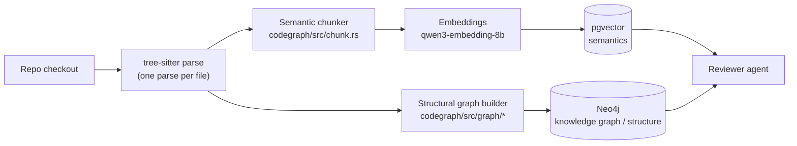
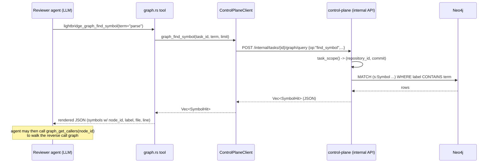

# Tree-sitter, Graphify & the Knowledge Graph in Lightbridge Code Intelligence

> How syntax-aware parsing, the (now-retired) Graphify dependency, and the in-house
> `lci-codegraph` crate feed the structural knowledge graph that the **reviewer agent** queries.

---

## 1. TL;DR

- **tree-sitter** is the syntax engine. It parses source files into an AST once per file. That single
  parse feeds **two** consumers: the **semantic chunker** (→ pgvector) and the **structural graph
  builder** (→ Neo4j).
- **Graphify** was the *original* Python CLI that built the structural graph. It was **fully retired**
  in **ADR-0086** and replaced by the in-house Rust crate **`lci-codegraph`** (the `codegraph` service).
  Today "Graphify" only appears in docs/ADRs as the thing that was removed. There is **no Python, no
  subprocess, no fallback** left.
- The **reviewer agent** (`review-agent` service) never sees a raw syntax tree at review time. At
  *index* time the tree is collapsed into a **knowledge graph** (Neo4j) + **semantic chunks**
  (pgvector). At *review* time the agent reaches those pre-built artifacts through two read-only tools —
  `lightbridge_graph_find_symbol` and `lightbridge_graph_get_callers` — plus `read_file` for raw source.

---

## 2. The two-index architecture (one parse, two stores)



Both stores are scoped per `(repository_id, commit_sha)` so a review task can only read its own repo's
index (trust boundary, ADR-0002 / ADR-0050).

---

## 3. Where tree-sitter lives

### 3.1 Grammar dependencies

The grammars are workspace-level dependencies (no per-service duplication):

`Cargo.toml` (workspace root)
```toml
# tree-sitter grammars compile their C grammar via build script (cc in the builder image).
tree-sitter = "0.26"
tree-sitter-rust = "0.24"
tree-sitter-javascript = "0.25"
tree-sitter-typescript = "0.23.2"
tree-sitter-python = "0.25"
tree-sitter-java = "0.23"
```

`services/agent-runner/Cargo.toml` (the index host) pulls them in:
```toml
# in-process (tree-sitter); replaced the retired Python Graphify CLI (ADR-0019).
tree-sitter.workspace = true
tree-sitter-rust.workspace = true
tree-sitter-javascript.workspace = true
tree-sitter-typescript.workspace = true
tree-sitter-python.workspace = true
```

### 3.2 The shared parse plumbing — `services/codegraph/src/lang/mod.rs`

This module is the single source of truth for "which language has a grammar / a graph extractor" and
owns the **one parse per file** that both chunking and graph extraction share.

```rust
// services/codegraph/src/lang/mod.rs:23
use tree_sitter::{Language, Parser, Query, Tree};

/// One language the crate ships a tree-sitter grammar for.
pub trait LanguageSupport: Sync {
    fn id(&self) -> &'static str;
    fn extensions(&self) -> &'static [&'static str];
    fn ts_language(&self) -> Language;
    fn graph_strategy(&self) -> Option<GraphStrategy>;
}

static REGISTRY: &[&dyn LanguageSupport] = &[
    &rust::Rust, &python::Python, &javascript::JavaScript,
    &typescript::TypeScript, &typescript::Tsx, &java::Java,
];

/// Parse `source` with the grammar for language id `lang`.
/// Tree-sitter is error-tolerant, so a tree is returned even for source with localised syntax errors.
#[must_use]
pub fn parse(source: &str, lang: &str) -> Option<Tree> {
    let language = by_id(lang)?.ts_language();
    let mut parser = Parser::new();
    parser.set_language(&language).ok()?;
    parser.parse(source, None)
}
```

`GraphStrategy` decides how a language's structural graph is extracted:

```rust
// services/codegraph/src/lang/mod.rs:27
pub enum GraphStrategy {
    /// Rust keeps its own tree-sitter node-kind extractor (byte-stable golden).
    RustNative,
    /// Every other language is classified by the grammar's bundled `tags.scm` query.
    Tags(&'static Query),
}
```

`has_graph(language)` (line 137) is what gates whether a file produces structural facts at all
(Rust, Python, TS/JS+TSX, Java today; `go`/`c`/`text` are chunked but have no graph extractor yet).

### 3.3 The "parse once" branch — `services/codegraph/src/walk.rs`

The top-level walk parses each file **once** and feeds both the chunker and the graph builder from the
same `Tree`:

```rust
// services/codegraph/src/walk.rs:161
let file_chunks = if options.build_graph && lang::has_graph(language) {
    // Parse ONCE and feed both the chunker and the graph builder (ADR-0086 "parse once").
    if let Some(tree) = lang::parse(&source, language) {
        file_symbols.push(graph::extract_file(&tree, &rel_path, &source, language));
        let mut cs = chunk::chunk_tree(&tree, &rel_path, &source, language, options.tuning);
        if cs.is_empty() {
            cs = chunk::chunk_text(&rel_path, &source, language, options.tuning);
        }
        cs
    } else {
        chunk::chunk_file(&rel_path, &source, language, options.tuning)
    }
} else {
    chunk::chunk_file(&rel_path, &source, language, options.tuning)
};
```

`walk_checkout` returns both artifacts together:

```rust
// services/codegraph/src/walk.rs:53
pub struct WalkOutput {
    pub chunks: Vec<Chunk>,
    pub graph: Graph,
    pub stats: WalkStats,
}
```

---

## 4. Graphify — what it was, and why it's gone

Graphify was a **standalone Python** multi-language AST→graph extractor. The indexer spawned it as
`graphify update … --no-cluster`, parsed the `graph.json` it wrote, and handed the nodes+edges to the
control plane (which owned the Neo4j write). It was the **only** reason a Python runtime lived in the
indexer image and drove the ~4 GiB index-Job footprint — which forced the `review` runner to be carved
into a separate slim, no-Python image (PR #207).

**ADR-0086** ("In-house code-graph crate — retire Graphify", accepted 2026-07-12, implemented
2026-07-13) replaced it with `lci-codegraph`. The decision drivers:

- Collapse the two runner images into one lean binary (the agent-plane goal, ADR-0085).
- Right-size the index Job (a bounded Rust extractor, not a 4 GiB Python artifact).
- Own a core competency (code-graph extraction *is* the product).
- Parse once: chunking + graph + embedding-prep over one tree-sitter pass instead of two toolchains.

> The graph it produced is exactly what powers the deep-tier retrieval tools
> `lightbridge_graph_find_symbol` and `lightbridge_graph_get_callers`
> (`review-agent/src/tools/graph.rs`). — ADR-0086 §Context

The migration was **payload-compatible**: `lci-codegraph` emits the same `GraphNodePayload` /
`GraphEdgePayload` shape Graphify's `graph.json` produced, so the control plane, Neo4j store, and
retrieval tools were untouched behind the seam. Graphify is now fully deleted — there is no flag or
fallback.

---

## 5. The in-house structural graph — `services/codegraph/src/graph/*`

The graph is **edges on top of per-file symbols** extracted from the same tree-sitter parse. Output is
payload-compatible with the retired Graphify schema:

```rust
// services/codegraph/src/graph/mod.rs:47
pub struct GraphNode {
    pub node_id: String,      // "<file>#<line>:<name>"
    pub label: String,        // callable labels carry a "()" suffix (Graphify parity)
    pub source_file: String,
    pub start_line: i64,      // 1-based
}
pub struct GraphEdge {
    pub source: String,
    pub target: String,
    pub relation: String,     // "contains" | "method" | "calls"
}
```

### 5.1 Definition + call identification — `tags.rs`

For every language except Rust, definitions and call references are found by running the grammar's
**bundled `tags.scm` query** (the `TAGS_QUERY` the grammar authors ship), rather than hand-maintaining
per-language node-kind lists:

```rust
// services/codegraph/src/tags.rs:48
pub fn extract(language: &str, tree: &Tree, source: &str) -> Option<TaggedSymbols> {
    let query = match lang::by_id(language)?.graph_strategy()? {
        GraphStrategy::Tags(query) => query,
        GraphStrategy::RustNative => return None,
    };
    // ... runs query.capture_names() over the tree, collecting @definition.* and @reference.call
}
```

Rust keeps its own node-kind extractor (`interesting_node`) so the committed golden is byte-stable.

### 5.2 Node/edge emission — `graph/emit.rs`

A single DFS over the parsed tree emits def nodes, `contains`/`method` edges, and records call sites
attributed to the innermost enclosing definition:

```rust
// services/codegraph/src/graph/emit.rs:73 (abridged)
fn walk(classifier, node, bytes, source_file, stack, scope, enclosing_kind, facts) {
    for child in node.children(&mut cursor) {
        if let Some((kind, name)) = classifier.classify(&child, bytes) {
            let node_id = def_node_id(source_file, start_line, kind, name.as_deref());
            let relation = if is_callable && is_type_container(enclosing_kind) {
                "method"            // callable inside impl/trait/struct/enum/class/interface
            } else { "contains" };
            facts.contains.push(GraphEdge { source: parent_id, target: node_id.clone(), relation });
            facts.nodes.push(GraphNode { node_id, label, source_file, start_line });
            // record callables for resolution, tagged with their type scope
        } else if let Some(caller) = stack.last()
               && let Some(callee) = classifier.call_site(&child, bytes) {
            facts.calls.push(CallSite { caller: caller.clone(), name: callee.name, qualifier: callee.qualifier });
        }
        walk(...); // recurse
    }
}
```

### 5.3 Callee extraction — `graph/callee.rs`

Given an AST node identified as a call site, recover its bare callee name plus an optional qualifier
(`A::new` → `{name:"new", qualifier:Some("A")}`) used only to break same-name ambiguity:

```rust
// services/codegraph/src/graph/callee.rs:18
pub(super) fn callee_ref_of(call: &Node<'_>, bytes: &[u8]) -> Option<CalleeRef> {
    let func = call.child_by_field_name("function")?;
    callee_ref(&func, bytes)
}
// scoped_identifier "a::b::foo" -> name="foo", qualifier="b"
// field_expression "x.foo"     -> name="foo", qualifier=None (receiver type unknown)
```

For tags-captured languages the qualifier is recovered from the callee name node's tree position
(`qualifier_from_callee_node`), because `tags.scm` drops the receiver.

### 5.4 Cross-file resolution — `graph/resolve.rs`

This is the hard, high-value part: turning recorded call sites into `calls` edges that may span files
(a call in `a.rs` resolved to a definition in `b.rs`). Resolution is **precision-favouring** — a bare
name matching several same-named defs is **dropped and counted, never fanned out**:

```rust
// services/codegraph/src/graph/resolve.rs:55
pub fn resolve(files: Vec<FileSymbols>) -> Graph {
    // global callable table: name -> all callables across files (cross-file resolution)
    let mut global: HashMap<&str, Vec<&Callable>> = HashMap::new();
    // ... per-file table for same-file-first resolution ...
    for call in &f.calls {
        let local_pick = pick(local.get(call.name...), qualifier);
        let target = match local_pick {
            Pick::One(id) => Some(id),
            Pick::None | Pick::Ambiguous =>
                match pick(global.get(call.name...), qualifier) {
                    Pick::One(id) => Some(id),
                    Pick::Ambiguous => { ambiguous += 1; None }
                    Pick::None => { unresolved += 1; None }
                }
        };
        if let Some(target) = target {
            edges.push(GraphEdge { source: call.caller.clone(), target, relation: "calls" });
        }
    }
    // canonicalise: sort + dedup for stable goldens / stable submit
}
```

---

## 6. The knowledge graph in Neo4j (control plane)

### 6.1 Ingestion — `POST /internal/tasks/{id}/graph`

The runner builds the graph in-process and POSTs nodes+edges; the **control plane owns the Neo4j
credentials** so the untrusted per-task Job never holds them (trust boundary). `repository_id` is read
from the DB, not trusted from the caller.

```rust
// services/control-plane/src/http/internal.rs:752
pub async fn ingest_graph(_auth: RunnerAuth, State(state), Path(id), Json(batch): Json<GraphBatch>) {
    // repository_id loaded from DB (not from caller) -> ADR-0002
    let nodes: Vec<neo4j::GraphNode> = batch.nodes.into_iter().map(...).collect();
    let edges: Vec<neo4j::GraphEdge> = batch.edges.into_iter().map(...).collect();
    neo4j::upsert_graph(neo4j, repository_id, &batch.commit_sha, &nodes, &edges).await
}
```

The actual Bolt write (one transaction, idempotent MERGE scoped by `(repo_id, commit)`):

```rust
// services/control-plane/src/integrations/neo4j.rs:54
pub async fn upsert_graph(graph, repository_id, commit_sha, nodes, edges) -> (usize, usize) {
    let mut txn = graph.start_txn().await?;
    for n in nodes {
        txn.run(query(
            "MERGE (s:Symbol {repo_id: $repo, commit: $commit, node_id: $id}) \
             SET s.label = $label, s.source_file = $file, s.start_line = $line"))
            .param("repo", repository_id).param("commit", commit_sha)/* ... */.await?;
    }
    for e in edges {
        txn.run(query(
            "MATCH (a:Symbol {repo_id: $repo, commit: $commit, node_id: $src}) \
             MATCH (b:Symbol {repo_id: $repo, commit: $commit, node_id: $dst}) \
             MERGE (a)-[r:REL {relation: $rel}]->(b)")).await?;
    }
    txn.commit().await?;
}
```

Nodes are a generic `:Symbol` and edges a generic `[:REL {relation}]` — Cypher can't parameterize
labels/relationship types, so the relation is a property, keeping the write a single prepared statement.

### 6.2 Querying the graph — `find_symbol` / `get_callers`

These are the two Cypher queries the reviewer's tools ultimately hit:

```rust
// services/control-plane/src/integrations/neo4j.rs:184
pub async fn find_symbol(graph, repository_id, commit_sha, term, limit) -> Vec<SymbolHit> {
    graph.execute(query(
        "MATCH (s:Symbol {repo_id: $repo, commit: $commit}) \
         WHERE toLower(s.label) CONTAINS toLower($term) \
            OR toLower(s.node_id) CONTAINS toLower($term) \
            OR toLower(s.source_file) CONTAINS toLower($term) \
         RETURN s.node_id, s.label, s.source_file, s.start_line LIMIT $limit"))
        .param("repo", repository_id).param("commit", commit_sha).param("term", term).param("limit", limit)
        .await?;
    // ... collect rows into SymbolHit ...
}

// services/control-plane/src/integrations/neo4j.rs:221
pub async fn get_callers(graph, repository_id, commit_sha, node_id, limit) -> Vec<SymbolHit> {
    graph.execute(query(
        "MATCH (caller:Symbol {repo_id: $repo, commit: $commit}) \
               -[:REL {relation: 'calls'}]-> \
               (target:Symbol {repo_id: $repo, commit: $commit, node_id: $id}) \
         RETURN caller.node_id, caller.label, caller.source_file, caller.start_line LIMIT $limit"))
        .param("repo", repository_id).param("commit", commit_sha).param("id", node_id).param("limit", limit)
        .await?;
    // ... collect rows into SymbolHit ...
}
```

Both are pinned to the task's `(repository_id, commit_sha)` via `task_scope()`
(`internal.rs:839`) — the agent can only read its own repo's snapshot.

---

## 7. The reviewer agent — how it reaches the syntax tree & knowledge graph

### 7.1 The two graph tools — `services/review-agent/src/tools/graph.rs`

The reviewer does **not** parse source itself. It exposes two read-only retrieval tools that proxy to
the control plane (which queries Neo4j):

```rust
// services/review-agent/src/tools/graph.rs:12
pub const GRAPH_FIND_SYMBOL: &str = "lightbridge_graph_find_symbol";
pub const GRAPH_GET_CALLERS: &str = "lightbridge_graph_get_callers";

// FindTool::call (abridged)
fn call<'a>(&'a self, cx: &'a ToolCx<'a>, call: &'a ToolCallReq) -> BoxFuture<'a, ToolOutcome> {
    Box::pin(async move {
        match parse::<FindArgs>(&call.function.arguments) {
            Ok(args) => ToolOutcome::Continue(render(
                GRAPH_FIND_SYMBOL,
                self.services.client
                    .graph_find_symbol(cx.task_id, &args.term, clamp_limit(args.limit)).await)),
            Err(error) => ToolOutcome::Continue(error),
        }
    })
}
```

`graph_get_callers` is identical but calls `self.services.client.graph_get_callers(...)`. Both are
`ToolKind::ReadOnly(ReadKind::Retrieval)` and `ReplaySafety::ReadOnly`.

### 7.2 The client hop — `services/agent-clients/src/control_plane/search.rs`

`ReviewServices` holds an `Arc<ControlPlaneClient>` (`tools.rs:37`). The client turns a tool call into
an HTTP POST to the internal API:

```rust
// services/agent-clients/src/control_plane/search.rs:60
pub async fn graph_find_symbol(&self, task_id, term, limit) -> anyhow::Result<Vec<SymbolHit>> {
    self.graph_query(task_id,
        json!({ "op": "find_symbol", "term": term, "limit": limit })).await
}

async fn graph_query(&self, task_id, body) -> anyhow::Result<Vec<SymbolHit>> {
    let url = format!("{}/internal/tasks/{task_id}/graph/query", self.base_url);
    self.http.post(&url).bearer_auth(&self.token).json(&body)
        .send().await?.error_for_status()?.json::<Vec<SymbolHit>>().await
}
```

### 7.3 The full request path (review time)



### 7.4 "Access to the syntax tree" — what the agent actually has

The agent has **no live parser**. Its structural awareness comes entirely from the pre-built graph:

| Capability | How the agent gets it | Source of truth |
|---|---|---|
| Find a symbol by name/file | `lightbridge_graph_find_symbol` | Neo4j `:Symbol` nodes |
| Reverse call graph (who calls X) | `lightbridge_graph_get_callers` | Neo4j `[:REL {relation:'calls'}]` edges |
| Semantic search (what does X do) | `lightbridge_vector_semantic_search` | pgvector chunks |
| Raw source text (the actual tree, line-by-line) | `read_file` | the checkout on disk |

So the "syntax tree" the reviewer reasons about is the **materialized graph** (symbols + call edges)
plus the **raw file text** it can read on demand — not a parser it runs. The tree-sitter parse already
happened at index time and was collapsed into those artifacts.

### 7.5 Tool assembly — `services/review-agent/src/tools.rs`

The graph tools are registered alongside the other built-ins into one `ToolRegistry`:

```rust
// services/review-agent/src/tools.rs:102
pub fn tool_registry(client, embedder, discovered, caps, sast) -> Result<ToolRegistry, RegistryError> {
    let services = ReviewServices { client, embedder };
    let mut registry = ToolRegistry::new();
    vector::register(&mut registry, &services, caps)?;
    graph::register(&mut registry, &services, caps)?;   // <-- the two graph tools
    read_file::register(&mut registry, caps)?;
    record::register(&mut registry, &services, caps)?;
    // ... reply, finish, mcp, sast ...
}
```

The agent loop (`review::run_native_agent` in `agent-runner/src/run.rs:450`) dispatches the LLM's tool
calls through this registry; a `graph_find_symbol` call flows `tool -> client -> HTTP -> control plane
-> Neo4j` and the `SymbolHit` JSON is fed back to the model as context.

---

## 8. End-to-end: index → review

```mermaid
flowchart TD
    subgraph INDEX["Index time (agent-runner, trusted-ish Job)"]
        CLONE[clone @ commit] --> WALK["lci-codegraph::walk_checkout<br/>(tree-sitter, parse once)"]
        WALK --> CHUNKS[chunks -> embed -> pgvector]
        WALK --> GRAPH[Graph{nodes,edges}]
        GRAPH --> SUBMIT["client.submit_graph()<br/>POST /internal/tasks/{id}/graph"]
        SUBMIT --> NEO[(Neo4j :Symbol + :REL)]
    end
    subgraph REVIEW["Review time (review-agent)"]
        LLM[LLM decides] --> TOOL["lightbridge_graph_find_symbol / _get_callers"]
        TOOL --> CLIENT[ControlPlaneClient]
        CLIENT --> API["POST /internal/tasks/{id}/graph/query"]
        API --> NEO
        NEO --> API --> CLIENT --> TOOL --> LLM
        LLM --> RF[read_file for raw source if needed]
    end
```

Key files in the path:

- **Parse + extract:** `services/codegraph/src/{lang/mod.rs, walk.rs, tags.rs, graph/*}`
- **Index submit:** `services/agent-runner/src/indexer/graph.rs` → `ControlPlaneClient::submit_graph`
- **Control-plane ingest + query:** `services/control-plane/src/http/internal.rs`
  (`ingest_graph`, `graph_query`) and `services/control-plane/src/integrations/neo4j.rs`
- **Reviewer tools:** `services/review-agent/src/tools/graph.rs` + `tools.rs`
- **Client:** `services/agent-clients/src/control_plane/search.rs`

---

## 9. File reference index

| Concern | File | Key symbols / lines |
|---|---|---|
| Grammar deps (workspace) | `Cargo.toml` | `tree-sitter* = "..."` (L151-157) |
| Index host deps | `services/agent-runner/Cargo.toml` | `tree-sitter.workspace` (L62-66) |
| Language registry + parse | `services/codegraph/src/lang/mod.rs` | `REGISTRY` (L55), `parse` (L91), `GraphStrategy` (L27), `has_graph` (L137) |
| One-pass walk | `services/codegraph/src/walk.rs` | `walk_checkout` (L63), parse-once branch (L161), `WalkOutput` (L53) |
| Def/call via tags.scm | `services/codegraph/src/tags.rs` | `extract` (L48), `map_def_kind` (L96) |
| Node/edge emission | `services/codegraph/src/graph/emit.rs` | `extract_file` (L21), `walk` (L73), `Classifier` (L184) |
| Callee extraction | `services/codegraph/src/graph/callee.rs` | `callee_ref_of` (L18), `qualifier_from_callee_node` (L85) |
| Cross-file resolution | `services/codegraph/src/graph/resolve.rs` | `resolve` (L55), `pick` (L27) |
| Graph types | `services/codegraph/src/graph/mod.rs` | `GraphNode` (L47), `GraphEdge` (L57) |
| Index submit | `services/agent-runner/src/indexer/graph.rs` | `index_graph` (L21) |
| Neo4j write | `services/control-plane/src/integrations/neo4j.rs` | `upsert_graph` (L54), `find_symbol` (L184), `get_callers` (L221) |
| Ingest + query HTTP | `services/control-plane/src/http/internal.rs` | `ingest_graph` (L752), `graph_query` (L917), `task_scope` (L839) |
| Reviewer graph tools | `services/review-agent/src/tools/graph.rs` | `GRAPH_FIND_SYMBOL` (L12), `FindTool::call` (L85) |
| Tool assembly | `services/review-agent/src/tools.rs` | `ReviewServices` (L37), `tool_registry` (L102) |
| Client hop | `services/agent-clients/src/control_plane/search.rs` | `graph_find_symbol` (L60), `graph_query` (L87) |
| Retire-Graphify decision | `docs/adr/0086-in-house-code-graph-crate.md` | full ADR |
| Original Graphify design | `docs/adr/0019-graphify-cli-structural-graph.md`, `docs/adr/0010-graphify-treesitter-indexing-baseline.md` | (superseded) |

