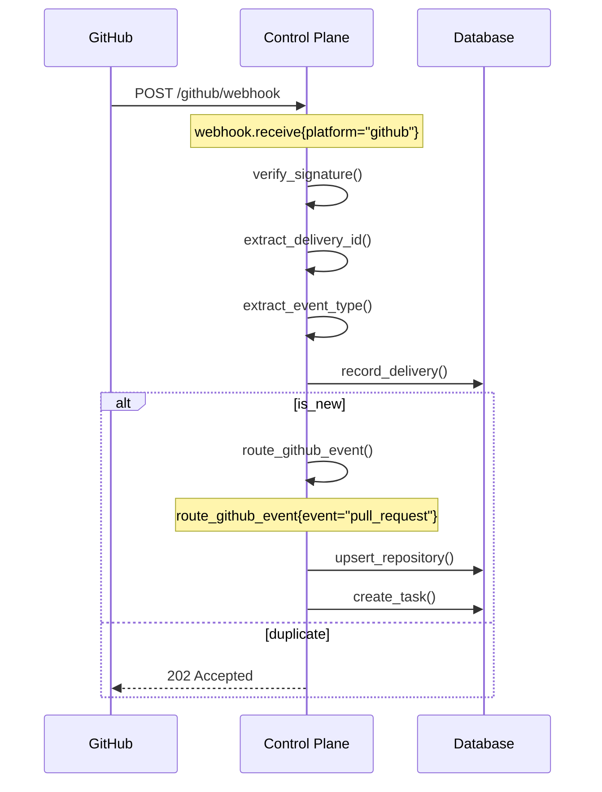
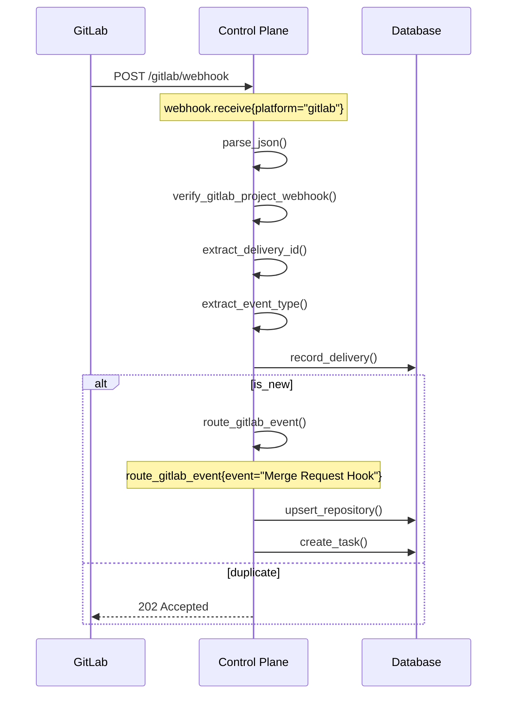

# Webhook Separation Implementation Plan

> **Goal:** Separate the unified webhook route into platform-specific routes (`/github/webhook` and `/gitlab/webhook`) and remove the legacy `/github/webhook` alias.
>
> **Status:** Draft
> **Date:** 2026-07-21
> **Related ADRs:** ADR-0072 (Platform-abstraction layer), ADR-0059 (Reconciler owns all egress)

---

## Table of Contents

1. [Current State](#1-current-state)
2. [Desired State](#2-desired-state)
3. [Rationale](#3-rationale)
4. [Implementation Plan](#4-implementation-plan)
5. [File Changes](#5-file-changes)
6. [Database Changes](#6-database-changes)
7. [Testing Strategy](#7-testing-strategy)
8. [Rollout Checklist](#8-rollout-checklist)
9. [Risk Assessment](#9-risk-assessment)
10. [References](#10-references)

---

## 1. Current State

### 1.1 Unified Webhook Route

The control plane currently has:

1. **Unified `/webhook` route** (`services/control-plane/src/http/webhook.rs`):
   - Detects platform from headers (`x-github-event` vs `x-gitlab-event`)
   - Verifies signatures (HMAC-SHA256 for GitHub, plain token for GitLab)
   - Dedupes on `webhook_deliveries` table
   - Routes to platform-specific handlers

2. **Legacy `/github/webhook` route** (`services/control-plane/src/main.rs`):
   - Forwards to the unified handler
   - Kept during the transition to avoid breaking existing GitHub webhook configurations

### 1.2 Platform Detection Logic

```rust
fn detect_platform(headers: &HeaderMap) -> Option<Platform> {
    if headers.contains_key("x-github-event") {
        Some(Platform::GitHub)
    } else if headers.contains_key("x-gitlab-event") {
        Some(Platform::GitLab)
    } else {
        None
    }
}
```

### 1.3 Routing Logic

```rust
if state.db.is_some() {
    match platform {
        Platform::GitHub => route_github_event(&state, &event, &payload, &delivery_id).await,
        Platform::GitLab => route_gitlab_event(&state, &event, &payload, &delivery_id).await,
    }
}
```

---

## 2. Desired State

### 2.1 Platform-Specific Routes

The control plane will have:

1. **`POST /github/webhook` route**:
   - GitHub-specific signature verification (HMAC-SHA256)
   - GitHub-specific dedup (`webhook_deliveries` table, `x-github-delivery` header)
   - Routes to `route_github_event()`

2. **`POST /gitlab/webhook` route**:
   - GitLab-specific signature verification (plain token)
   - GitLab-specific dedup (`webhook_deliveries` table, `x-gitlab-event-uuid` header)
   - Routes to `route_gitlab_event()`

3. **Removed routes**:
   - Unified `/webhook` route
   - Legacy `/github/webhook` route

### 2.2 Route Structure

```
POST /github/webhook  → GitHub-specific handler
POST /gitlab/webhook  → GitLab-specific handler
```

---

## 3. Rationale

### 3.1 Benefits

1. **Clearer separation of concerns**: Each platform has its own dedicated route with its own verification logic
2. **Simpler routing**: No need to detect platform from headers at the route level
3. **Better observability**: Each route can have its own metrics and tracing spans
4. **Easier testing**: Platform-specific tests can be isolated
5. **Future-proof**: Adding a new platform (e.g., Bitbucket) will be clearer with dedicated routes

### 3.2 Consistency with ADR-0072

ADR-0072 introduced the `CodePlatform` trait to abstract platform-specific behavior. Separating the webhook routes aligns with this abstraction:

- The trait already abstracts webhook verification (`verify_webhook()`, `delivery_id()`, `event_type()`)
- The route separation moves the platform detection from the HTTP layer to the trait implementation
- This makes the system more extensible for future platforms

### 3.3 Minimal Breaking Changes

- GitHub webhook configurations will need to update their endpoint URL from `/webhook` to `/github/webhook`
- GitLab webhook configurations will need to update their endpoint URL from `/webhook` to `/gitlab/webhook`
- No database schema changes required (dedup logic remains on `webhook_deliveries` table)
- No changes to the outbox, reconciler, or agent-runner

---

## 4. Implementation Plan

### Phase 1: Refactor GitHub Webhook Handler

**Goal:** Extract GitHub-specific logic into a dedicated handler function.

**Steps:**

1. Create `route_github_webhook()` function that:
   - Verifies GitHub signature using `verify_signature()`
   - Extracts `x-github-delivery` header for dedup
   - Extracts `x-github-event` header for routing
   - Parses JSON payload
   - Calls `route_github_event()` for event routing
   - Returns appropriate HTTP status

2. Update `webhook.rs` to export this function:
   ```rust
   pub async fn github_webhook_handler(
       State(state): State<AppState>,
       headers: HeaderMap,
       body: Bytes,
   ) -> Response {
       // GitHub-specific logic
   }
   ```

3. Update `main.rs` to use the new handler:
   ```rust
   .route("/github/webhook", post(webhook::github_webhook_handler))
   ```

### Phase 2: Refactor GitLab Webhook Handler

**Goal:** Extract GitLab-specific logic into a dedicated handler function.

**Steps:**

1. Create `route_gitlab_webhook()` function that:
   - Parses JSON payload (GitLab needs this to get `project.id` for secret selection)
   - Verifies GitLab signature using `verify_gitlab_project_webhook_with_registry()`
   - Extracts `x-gitlab-event-uuid` header for dedup
   - Extracts `x-gitlab-event` header for routing
   - Calls `route_gitlab_event()` for event routing
   - Returns appropriate HTTP status

2. Update `webhook.rs` to export this function:
   ```rust
   pub async fn gitlab_webhook_handler(
       State(state): State<AppState>,
       headers: HeaderMap,
       body: Bytes,
   ) -> Response {
       // GitLab-specific logic
   }
   ```

3. Update `main.rs` to use the new handler:
   ```rust
   .route("/gitlab/webhook", post(webhook::gitlab_webhook_handler))
   ```

### Phase 3: Remove Unified Route

**Goal:** Remove the unified `/webhook` route and its platform detection logic.

**Steps:**

1. Remove the unified route from `main.rs`:
   ```rust
   // REMOVED:
   // .route("/webhook", post(webhook::webhook_router))
   ```

2. Remove the unified handler from `webhook.rs`:
   - Delete `webhook_router()` function
   - Delete `webhook_router_body()` function
   - Delete `detect_platform()` function (no longer needed)

3. Remove legacy `/github/webhook` route from `main.rs`:
   ```rust
   // REMOVED:
   // .route("/github/webhook", post(webhook::github_webhook_legacy))
   ```

4. Remove legacy handler from `webhook.rs`:
   - Delete `github_webhook_legacy()` function

### Phase 4: Update Documentation

**Goal:** Update all documentation to reflect the new webhook routes.

**Steps:**

1. Update `docs/adr/0072-platform-abstraction-layer.md`:
   - Update the flow diagram to show separate routes
   - Update the "Webhook intake" section to describe `/github/webhook` and `/gitlab/webhook`
   - Update the "Consequences" section to reflect the separation

2. Update `docs/gitlab-implementation-plan.md`:
   - Update Phase 2 to describe the new GitLab webhook route
   - Update the file change manifest to reflect the separation

3. Update `docs/gitlab-integration-report.md`:
   - Update the webhook section to describe the new routes

4. Update any other documentation that references `/webhook`:
   - `docs/INDEX.md`
   - `docs/github-app-and-control-plane.md`
   - `docs/review-pipeline.md`
   - Any README files or deployment guides

### Phase 5: Update Environment Variables

**Goal:** Ensure environment variables are clearly associated with their platform.

**Steps:**

1. Document the following environment variables:
   - `GITHUB_WEBHOOK_SECRET` (HMAC-SHA256 secret for `/github/webhook`)
   - `GITLAB_WEBHOOK_SECRET` (plain token for `/gitlab/webhook`)

2. Update any config validation to ensure both secrets are set when their respective platforms are configured.

---

## 5. File Changes

### 5.1 `services/control-plane/src/http/webhook.rs`

**Changes:**

1. **Add new functions:**
   ```rust
   /// GitHub webhook handler — dedicated route for GitHub webhooks.
   pub async fn github_webhook_handler(
       State(state): State<AppState>,
       headers: HeaderMap,
       body: Bytes,
   ) -> Response {
       // GitHub-specific signature verification
       // GitHub-specific dedup
       // Route to route_github_event()
   }

   /// GitLab webhook handler — dedicated route for GitLab webhooks.
   pub async fn gitlab_webhook_handler(
       State(state): State<AppState>,
       headers: HeaderMap,
       body: Bytes,
   ) -> Response {
       // GitLab-specific signature verification
       // GitLab-specific dedup
       // Route to route_gitlab_event()
   }
   ```

2. **Remove functions:**
   - `webhook_router()`
   - `webhook_router_body()`
   - `detect_platform()`
   - `github_webhook_legacy()`

3. **Keep functions:**
   - `route_github_event()`
   - `route_gitlab_event()`
   - `handle_pull_request()`
   - `handle_push()`
   - `handle_issue_comment()`
   - `handle_installation()`
   - `handle_installation_repositories()`
   - `handle_gitlab_merge_request()`
   - `handle_gitlab_push()`
   - `handle_gitlab_note()`
   - `verify_signature()`
   - `verify_gitlab_project_webhook_with_registry()`
   - `verified_gitlab_payload()`
   - All helper functions (`gitlab_path_split()`, `gitlab_project_identity()`, etc.)

### 5.2 `services/control-plane/src/main.rs`

**Changes:**

1. **Update routes:**
   ```rust
   // BEFORE:
   .route("/webhook", post(webhook::webhook_router))
   .route("/github/webhook", post(webhook::github_webhook_legacy))

   // AFTER:
   .route("/github/webhook", post(webhook::github_webhook_handler))
   .route("/gitlab/webhook", post(webhook::gitlab_webhook_handler))
   ```

2. **Remove routes:**
   - Unified `/webhook` route
   - Legacy `/github/webhook` route

### 5.3 Documentation Files

**Files to update:**

1. `docs/adr/0072-platform-abstraction-layer.md`
2. `docs/gitlab-implementation-plan.md`
3. `docs/gitlab-integration-report.md`
4. `docs/INDEX.md`
5. Any other files that reference `/webhook`

---

## 6. Database Changes

### 6.1 No Schema Changes Required

The separation of webhook routes does **not** require any database schema changes:

- The `webhook_deliveries` table remains unchanged
- Deduplication logic remains on the `webhook_deliveries` PRIMARY KEY
- The `platform` column in `repositories` table is unchanged
- The `platform` column in `tasks` table is unchanged
- The `platform` column in `outbox` table is unchanged

### 6.2 Migration Required

No migration is needed. The separation is purely a routing change at the HTTP layer.

---

## 7. Testing Strategy

### 7.1 Unit Tests

1. **GitHub webhook handler tests:**
   - Test signature verification with valid/invalid secrets
   - Test delivery ID extraction
   - Test event type extraction
   - Test JSON parsing
   - Test deduplication (with and without database)

2. **GitLab webhook handler tests:**
   - Test project ID extraction from payload
   - Test project-specific secret verification
   - Test delivery ID extraction
   - Test event type extraction
   - Test JSON parsing
   - Test deduplication (with and without database)

3. **Integration tests:**
   - Test end-to-end webhook flow for GitHub
   - Test end-to-end webhook flow for GitLab
   - Test duplicate delivery handling
   - Test invalid signature handling

### 7.2 Manual Testing

1. **GitHub webhook:**
   - Configure a GitHub webhook to point to `https://<control-plane>/github/webhook`
   - Trigger a PR open event
   - Verify the task is created
   - Verify the review is posted
   - Verify the feedback reactions work

2. **GitLab webhook:**
   - Configure a GitLab webhook to point to `https://<control-plane>/gitlab/webhook`
   - Trigger a MR open event
   - Verify the task is created
   - Verify the review is posted
   - Verify the feedback reactions work

3. **Duplicate delivery:**
   - Trigger the same event twice
   - Verify the second request returns `202 Accepted`
   - Verify only one task is created

4. **Invalid signature:**
   - Send a webhook with an invalid signature
   - Verify the request returns `401 Unauthorized`

### 7.3 Regression Tests

1. **Existing functionality:**
   - Verify all existing GitHub webhook events still work (PR open/close, push, issue comment, installation)
   - Verify all existing GitLab webhook events still work (MR open/close, push, note)
   - Verify approval gate still works
   - Verify bot detection still works
   - Verify re-index on default branch push still works

2. **Performance:**
   - Verify webhook latency is not significantly affected
   - Verify deduplication performance is not affected

---

## 8. Rollout Checklist

### Pre-Deployment

- [ ] All unit tests pass
- [ ] All integration tests pass
- [ ] All manual tests pass
- [ ] Documentation updated
- [ ] Environment variables documented
- [ ] Rollback plan documented

### Deployment Steps

1. **Deploy to staging environment:**
   - [ ] Deploy new control-plane image
   - [ ] Verify GitHub webhook works
   - [ ] Verify GitLab webhook works
   - [ ] Verify duplicate delivery handling
   - [ ] Verify invalid signature handling

2. **Monitor in staging:**
   - [ ] Monitor webhook delivery metrics
   - [ ] Monitor task creation metrics
   - [ ] Monitor review posting metrics
   - [ ] Monitor error rates
   - [ ] Monitor latency

3. **Deploy to production:**
   - [ ] Deploy new control-plane image
   - [ ] Update GitHub webhook configuration to point to `/github/webhook`
   - [ ] Update GitLab webhook configuration to point to `/gitlab/webhook`
   - [ ] Verify GitHub webhook works
   - [ ] Verify GitLab webhook works
   - [ ] Monitor for 24 hours

4. **Post-Deployment:**
   - [ ] Verify all metrics are healthy
   - [ ] Verify no errors in logs
   - [ ] Verify webhook delivery rate is stable
   - [ ] Verify task creation rate is stable
   - [ ] Verify review posting rate is stable

### Rollback Plan

If issues are detected:

1. **Immediate rollback:**
   - Revert control-plane image to previous version
   - This will restore the unified `/webhook` route

2. **Update webhook configurations:**
   - Revert GitHub webhook to point to `/webhook`
   - Revert GitLab webhook to point to `/webhook`

3. **Investigate issues:**
   - Review logs
   - Review metrics
   - Review error rates
   - Identify root cause

---

## 9. Risk Assessment

### 9.1 Risks

| Risk | Likelihood | Impact | Mitigation |
|------|------------|--------|------------|
| Webhook configurations not updated | Medium | High | Provide clear migration guide; use feature flags to gradually roll out |
| Duplicate delivery handling broken | Low | Medium | Thorough testing of dedup logic; monitor for duplicate tasks |
| Signature verification broken | Low | High | Unit tests for signature verification; manual testing with real webhooks |
| Performance regression | Low | Medium | Benchmark before and after; monitor latency metrics |
| Database connection issues | Low | High | Ensure database pool is sized appropriately; monitor connection pool metrics |

### 9.2 Mitigation Strategies

1. **Feature flags:**
   - Use a feature flag to enable the new webhook routes
   - Gradually roll out to a subset of production instances
   - Monitor before enabling for all instances

2. **Monitoring:**
   - Set up alerts for webhook delivery failures
   - Set up alerts for task creation failures
   - Set up alerts for review posting failures
   - Set up alerts for high error rates

3. **Testing:**
   - Comprehensive unit tests
   - Comprehensive integration tests
   - Manual testing with real webhooks
   - Load testing with simulated webhooks

4. **Documentation:**
   - Clear migration guide for webhook configurations
   - Clear documentation of new routes
   - Clear documentation of environment variables

---

## 10. References

### ADRs

- [ADR-0072: Platform-abstraction layer (`CodePlatform` trait) for GitHub + GitLab](./adr/0072-platform-abstraction-layer.md)
- [ADR-0059: Reconciler owns all GitHub egress](./adr/0059-reconciler-owns-all-github-egress.md)
- [ADR-0063: CLI-only repository approval](./adr/0063-cli-only-repository-approval.md)

### Documentation

- [GitLab Integration Report](../gitlab-integration-report.md)
- [GitLab Implementation Plan](../gitlab-implementation-plan.md)
- [GitHub App and Control Plane](../github-app-and-control-plane.md)
- [Review Pipeline](../review-pipeline.md)

### Code Files

- `services/control-plane/src/http/webhook.rs` — Current webhook handler
- `services/control-plane/src/integrations/platform.rs` — `CodePlatform` trait
- `services/control-plane/src/integrations/github.rs` — GitHub implementation
- `services/control-plane/src/integrations/gitlab.rs` — GitLab implementation
- `services/control-plane/src/main.rs` — Route definitions

---

## Appendix A: Example Webhook Configuration

### GitHub Webhook Configuration

```yaml
# GitHub repository settings → Webhooks → Add webhook
URL: https://<control-plane>/github/webhook
Content type: application/json
Secret: <GITHUB_WEBHOOK_SECRET>
Events:
  - pull_request
  - push
  - issue_comment
  - installation
  - installation_repositories
```

### GitLab Webhook Configuration

```yaml
# GitLab project settings → Webhooks → Add webhook
URL: https://<control-plane>/gitlab/webhook
Trigger: Push events, Merge request events, Note events
Secret: <GITLAB_WEBHOOK_SECRET>
```

---

## Appendix B: Metrics to Monitor

### Webhook Metrics

- `webhook_deliveries_total{platform="github"}` — Total GitHub webhooks received
- `webhook_deliveries_total{platform="gitlab"}` — Total GitLab webhooks received
- `webhook_deliveries_total{platform="unknown"}` — Total webhooks with unknown platform
- `webhook_deliveries_total{platform="github",status="duplicate"}` — Duplicate GitHub webhooks
- `webhook_deliveries_total{platform="gitlab",status="duplicate"}` — Duplicate GitLab webhooks
- `webhook_deliveries_total{platform="github",status="invalid_signature"}` — GitHub webhooks with invalid signature
- `webhook_deliveries_total{platform="gitlab",status="invalid_signature"}` — GitLab webhooks with invalid signature

### Task Metrics

- `tasks_created_total{platform="github",kind="review"}` — GitHub review tasks created
- `tasks_created_total{platform="gitlab",kind="review"}` — GitLab review tasks created
- `tasks_created_total{platform="github",kind="index"}` — GitHub index tasks created
- `tasks_created_total{platform="gitlab",kind="index"}` — GitLab index tasks created

### Review Metrics

- `reviews_posted_total{platform="github"}` — GitHub reviews posted
- `reviews_posted_total{platform="gitlab"}` — GitLab reviews posted
- `reviews_failed_total{platform="github"}` — GitHub reviews that failed
- `reviews_failed_total{platform="gitlab"}` — GitLab reviews that failed

---

## Appendix C: Tracing Spans

### GitHub Webhook Span



### GitLab Webhook Span



---

## Appendix D: Migration Guide for Operators

### Step 1: Update Control Plane

1. Deploy the new control-plane image
2. Verify the new routes are available:
   ```bash
   curl -I https://<control-plane>/github/webhook
   curl -I https://<control-plane>/gitlab/webhook
   ```

### Step 2: Update GitHub Webhook

1. Go to your GitHub repository settings
2. Navigate to Webhooks → Manage
3. Update the webhook URL to:
   ```
   https://<control-plane>/github/webhook
   ```
4. Keep the existing secret (`GITHUB_WEBHOOK_SECRET`)
5. Save the webhook

### Step 3: Update GitLab Webhook

1. Go to your GitLab project settings
2. Navigate to Webhooks → Edit
3. Update the webhook URL to:
   ```
   https://<control-plane>/gitlab/webhook
   ```
4. Keep the existing secret (`GITLAB_WEBHOOK_SECRET`)
5. Save the webhook

### Step 4: Verify

1. Trigger a test event on GitHub (e.g., open a PR)
2. Trigger a test event on GitLab (e.g., open an MR)
3. Verify the tasks are created
4. Verify the reviews are posted
5. Monitor the logs for any errors

### Step 5: Cleanup

After verifying everything works:

1. Remove the old unified `/webhook` route from your documentation
2. Remove any references to `/webhook` in your deployment guides
3. Update your monitoring dashboards to use the new routes

---

## Appendix E: Troubleshooting

### Issue: Webhook returns 404 Not Found

**Cause:** The webhook URL is incorrect or the control plane is not running.

**Solution:**
1. Verify the control plane is running:
   ```bash
   curl https://<control-plane>/healthz
   ```
2. Verify the webhook URL is correct:
   ```bash
   curl -I https://<control-plane>/github/webhook
   ```
3. Check the control plane logs for errors

### Issue: Webhook returns 401 Unauthorized

**Cause:** The webhook secret is incorrect.

**Solution:**
1. Verify the secret is set in the control plane environment:
   ```bash
   echo $GITHUB_WEBHOOK_SECRET
   echo $GITLAB_WEBHOOK_SECRET
   ```
2. Verify the secret matches the webhook configuration
3. Check the control plane logs for signature verification errors

### Issue: Webhook returns 202 Accepted but no task is created

**Cause:** The event type is not handled or the payload is malformed.

**Solution:**
1. Check the control plane logs for errors
2. Verify the event type is in the list of handled events
3. Verify the payload is valid JSON
4. Check the database for any errors

### Issue: Duplicate tasks are created

**Cause:** The deduplication logic is not working.

**Solution:**
1. Check the control plane logs for duplicate delivery messages
2. Verify the database is accessible
3. Verify the `webhook_deliveries` table exists
4. Check the control plane logs for any errors during deduplication

---

## Appendix F: Future Considerations

### Adding a New Platform (e.g., Bitbucket)

When adding a new platform in the future:

1. Implement the `CodePlatform` trait for the new platform
2. Add a new route in `main.rs`:
   ```rust
   .route("/bitbucket/webhook", post(webhook::bitbucket_webhook_handler))
   ```
3. Add a new handler function in `webhook.rs`:
   ```rust
   pub async fn bitbucket_webhook_handler(
       State(state): State<AppState>,
       headers: HeaderMap,
       body: Bytes,
   ) -> Response {
       // Bitbucket-specific logic
   }
   ```
4. Add the new platform to the `Platform` enum in `platform.rs`
5. Update documentation

### Moving to a Single Route with Path Prefix

An alternative design could be to use a single route with a path prefix:

```
POST /platforms/github/webhook
POST /platforms/gitlab/webhook
```

This would require:

1. A new route handler that parses the path prefix
2. Platform detection from the path instead of headers
3. Updated documentation

However, the current design (separate routes) is simpler and clearer for operators.

### Using a Reverse Proxy for Route Selection

If you use a reverse proxy (e.g., Nginx, Caddy) in front of the control plane, you could:

1. Configure the reverse proxy to route `/github/webhook` to the control plane
2. Configure the reverse proxy to route `/gitlab/webhook` to the control plane
3. Remove the routes from the control plane itself

This would move the routing logic to the reverse proxy, but it adds complexity to the infrastructure and makes the system less portable.

---

**End of Implementation Plan**