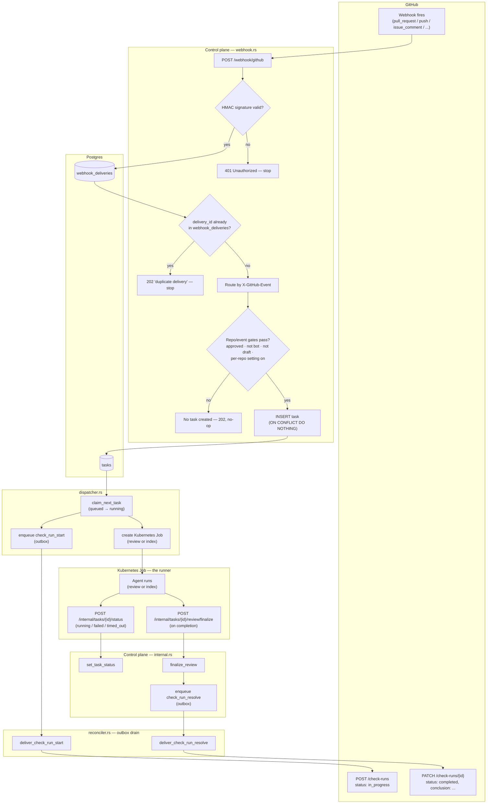
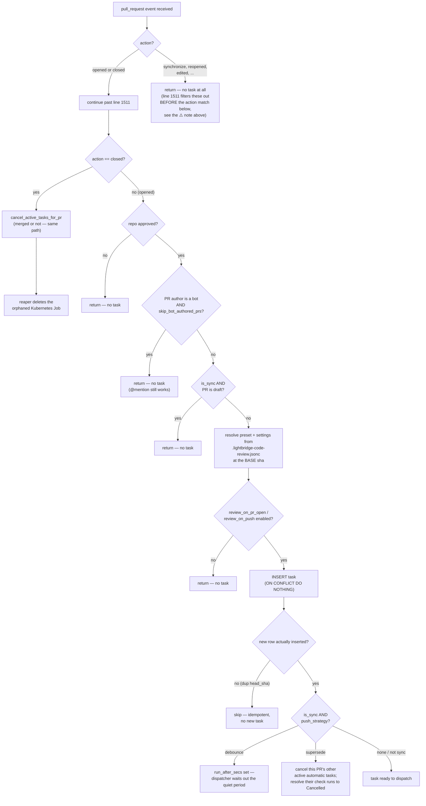
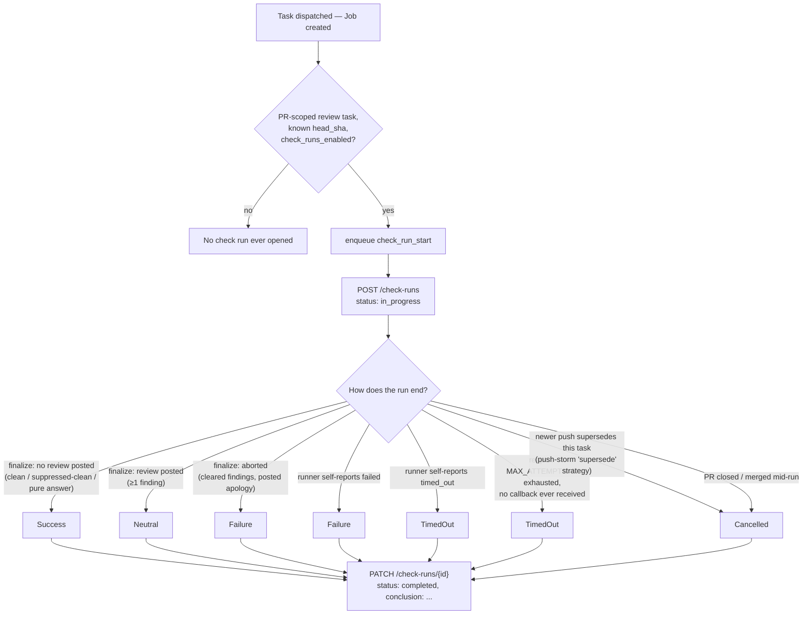

# Task Lifecycle Report — Webhook → Index/Review Decision → GitHub Check Run

**Scope:** the full life of one task run in `lightbridge-code-intelligence`: how a GitHub webhook is received and verified, how the control plane decides between indexing, reviewing, or doing nothing, what happens when a PR is closed/merged, and how the GitHub "check" (the CI-style status on the PR) is opened and resolved as the run progresses.

Generated: 2026-09-22. Sources: `services/control-plane/src/http/webhook.rs`, `services/control-plane/src/http/internal.rs`, `services/control-plane/src/queue/{dispatcher,reconciler,reaper}.rs`, `services/control-plane/src/integrations/{github,k8s,platform}.rs`, `services/control-plane/src/db/tasks.rs`, and relevant ADRs (0056, 0059, 0068, 0103).

---

## 1. Overview



Three independent axes drive what happens on any given webhook: **which event/action** GitHub sent, **repo-level gates** (approval, bot-authorship, draft state, per-repo settings), and **idempotency** (has this exact thing already been recorded). A task, once created, is dispatched to a Kubernetes Job; the Job reports back over plain HTTP callbacks (not Kubernetes watch/poll on the happy path), and a background reaper is the safety net for Jobs that die without reporting.

## 2. Webhook receipt & signature verification

`POST /webhook/github` → `github_webhook_body` (`services/control-plane/src/http/webhook.rs`). Signature is HMAC-SHA256 over the raw body, compared in constant time:

```rust
// webhook.rs:41-52
fn verify_signature(secret: &[u8], body: &[u8], signature: &str) -> bool {
    if secret.is_empty() { return false; }
    let Ok(mut mac) = HmacSha256::new_from_slice(secret) else { return false; };
    mac.update(body);
    let expected = format!("sha256={}", hex::encode(mac.finalize().into_bytes()));
    use subtle::ConstantTimeEq;
    expected.as_bytes().ct_eq(signature.as_bytes()).into()
}
```

```rust
// webhook.rs:74-94
let verified = if let Some(github) = state.platforms.get(&Platform::GitHub) {
    github.verify_webhook(&headers, &body)
} else if !state.github_webhook_secret.is_empty() {
    verify_signature(state.github_webhook_secret.as_bytes(), &body, &header(&headers, "x-hub-signature-256"))
} else {
    tracing::error!("no github platform or webhook secret configured");
    return (StatusCode::SERVICE_UNAVAILABLE, "github platform not configured").into_response();
};
if !verified {
    crate::http::metrics::webhook_signature_failure("github");
    tracing::warn!(platform = "github", "invalid webhook signature");
    return (StatusCode::UNAUTHORIZED, "invalid signature").into_response();
}
```

A bad signature is a flat `401` — nothing downstream ever sees the payload. Once verified, the delivery is persisted for idempotency (§6) and only *then* routed by the `X-GitHub-Event` header:

```rust
async fn route_github_event(state: &AppState, event: &str, payload: &serde_json::Value, delivery_id: &str) {
    match event {
        "pull_request" => handle_pull_request(state, payload, delivery_id).await,
        "push" => handle_push(state, payload, delivery_id).await,
        "issue_comment" => handle_issue_comment(state, payload, delivery_id).await,
        "installation" => handle_installation(state, payload, delivery_id).await,
        "installation_repositories" => handle_installation_repositories(state, payload, delivery_id).await,
        _ => {}
    }
}
```

**Only these five GitHub event types do anything at all.** Everything else GitHub might send — `pull_request_review`, `pull_request_review_comment`, `check_run`, `status`, `ping`, etc. — is recorded in `webhook_deliveries` for audit and then silently dropped (`_ => {}`). Notably, review-thread comments (`pull_request_review_comment`) are **not** wired up — only top-level PR/issue comments (`issue_comment`) drive `@mention` reviews.

GitLab and Bitbucket have their own routes/handlers (`webhook.rs:500-559` and onward) that mirror this same shape — same idempotency table, same approval gate, same open→review / close→cancel / push-to-default→reindex / mention→re-review pattern — but no `installation` event (repos are registered via the admin console instead).

## 3. The decision: index, review, or nothing

### 3.1 `pull_request` events

```rust
// webhook.rs:1497-1513
/// `pull_request` events. `opened` → the automatic first review. `synchronize` (epic #566) → a
/// review of the new commits, gated on the repo's `review_on_push` setting (off by default) and
/// skipped for bots/drafts. `closed` → cancel the PR's active tasks (the reaper then stops their
/// Jobs). `reopened` does nothing — a re-review is requested with an `@<handle>` comment.
async fn handle_pull_request(state: &crate::AppState, payload: &serde_json::Value, delivery_id: &str) {
    let Some(pool) = state.db.as_ref() else { return; };
    let action = payload["action"].as_str().unwrap_or_default();
    if !matches!(action, "opened" | "closed") {
        return;
    }
    ...
```

> **⚠️ Observed discrepancy, worth confirming with the team.** The guard at line 1511 only lets `"opened"` and `"closed"` through. Further down, the code branches again on `match action { "opened" | "synchronize" => { ... } }` (line 1548-1549) with a full, deliberately-built pipeline for `synchronize` — draft-PR gating, the `review_on_push` setting, a dedicated `EntryPoint::PrSync`, and a push-storm debounce/supersede strategy (§3.4). But because the *first* guard already filtered out every `synchronize` action, that whole branch appears to be **unreachable dead code** as currently written — a real `synchronize` webhook (new commits pushed to an open PR) returns at line 1511-1512 and never reaches any of it. If that's not intentional, it means **pushing new commits to an already-open PR currently triggers no automatic review at all** — only `opened` and an explicit `@mention` do. Worth a quick sanity check against production logs/behavior before relying on this report's description of `synchronize` below as *live* behavior; I'm describing the code as written, including this apparent gap.

Assuming that guard is corrected (or already fixed after this snapshot), here's the full `opened`/`synchronize` pipeline, gate by gate:

**Gate 1 — repo approval** (Epic #75), fail-closed on any DB error:

```rust
// webhook.rs:2001-2023
async fn approved_or_skip(pool: &sqlx::PgPool, repository_id: i64, delivery_id: &str, pr: i64) -> bool {
    match crate::db::repository_approved(pool, repository_id).await {
        Ok(true) => true,
        Ok(false) => {
            tracing::info!(delivery_id, pr, repository_id, "repository not approved; skipping (awaiting admin approval)");
            false
        }
        Err(error) => {
            tracing::error!(%error, delivery_id, repository_id, "approval check failed; skipping (fail closed)");
            false
        }
    }
}
```

**Gate 2 — bot-authored PR** (RFC-0003), applies to both `opened` and `synchronize`:

```rust
fn pr_author_is_bot(pull_request: &serde_json::Value) -> bool {
    let user = &pull_request["user"];
    if user["type"].as_str() == Some("Bot") { return true; }
    user["login"].as_str().is_some_and(|login| login.ends_with("[bot]"))
}
fn should_skip_bot_review(skip_bot_authored_prs: bool, pull_request: &serde_json::Value) -> bool {
    skip_bot_authored_prs && pr_author_is_bot(pull_request)
}
```
Dependabot/Renovate/another App/itself — mechanical diffs burn LLM budget and risk bot-on-bot feedback loops. `@mention` still works on these PRs; only the *automatic* review is skipped.

**Gate 3 — draft PR**, `synchronize`-only (a draft is, by construction, still being pushed to repeatedly):

```rust
if is_sync && pr["draft"].as_bool() == Some(true) {
    tracing::info!(delivery_id, pr = pr_number, repository_id,
        "PR is a draft; skipping the on-push review (mention-triggered reviews still run)");
    return;
}
```

**Gate 4 — preset/settings resolution.** `.lightbridge-code-review.jsonc` is read at the PR's **base** SHA (never the head — fork-safe by construction, ADR-0103), falling back to the platform default (`fast` tier) when the repo declares nothing.

**Gate 5 — per-event on/off setting:**

```rust
let (setting, disabled_msg) = if is_sync {
    (&settings.review_on_push, "review-on-push disabled for this repo; skipping (mention-triggered reviews still run)")
} else {
    (&settings.review_on_pr_open, "automatic on-open review disabled for this repo; skipping (mention-triggered reviews still run)")
};
if !setting.value {
    tracing::info!(delivery_id, repository_id, is_sync, source = ?setting.source, "{disabled_msg}");
    return;
}
```
`review_on_pr_open` defaults **on**; `review_on_push` defaults **off** — a repo has to explicitly opt in to get a review on every push.

Only after all five gates pass does it build the task and insert it:

```rust
let task = crate::db::NewTask {
    repository_id, installation_id,
    webhook_delivery_id: delivery_id.to_string(),
    target_type: "pull_request".to_string(),
    target_id: pr_number,
    command_text: "review".to_string(),
    base_sha, head_sha,
    run_epoch: 0,           // automatic reviews always start at epoch 0
    preset,
    entry_point: entry.as_str().to_string(),  // "pr_open" | "pr_sync"
    trigger_comment_id: None,   // no comment → lifecycle reactions land on the PR body
    ...
};
```

**A brand-new PR opened → a review only**, never indexing directly — indexing runs off `push` events to the default branch, independently (§3.2). There is no "both" path from `pull_request`.

**The full `pull_request` decision path, visualized** (including where `closed` branches off, and where the §3.1 discrepancy actually sits):



### 3.2 `push` events → indexing

```rust
// webhook.rs:1686-1747 (trimmed)
async fn handle_push(state: &crate::AppState, payload: &serde_json::Value, delivery_id: &str) {
    let Some(pool) = state.db.as_ref() else { return; };
    if payload["deleted"].as_bool() == Some(true) { return; }      // branch/tag deletion: nothing to index
    ...
    if git_ref != format!("refs/heads/{default_branch}") { return; }   // only the default branch matters
    let Some(installation_id) = payload["installation"]["id"].as_i64() else { return; };
    ...
    if !approved_or_skip(pool, repository_id, delivery_id, 0).await { return; }

    match crate::db::create_index_task(pool, repository_id, installation_id).await {
        Ok(Some(task_id)) => tracing::info!(delivery_id, %task_id, "default-branch push -> re-index queued"),
        Ok(None) => tracing::info!(delivery_id, "default-branch push -> index already in flight; skipped"),
        Err(error) => tracing::error!(%error, delivery_id, "push: failed to create index task"),
    }
}
```
A push that merges (or lands any other way) onto the default branch re-indexes the repo, provided it's approved. A push to any other branch is ignored outright. `create_index_task` is itself idempotent — a second push while an index is still running is a no-op (`Ok(None)`), so pushes can't pile up concurrent indexing jobs.

### 3.3 `issue_comment` → `@mention`

```rust
// webhook.rs:1755-1818 (trimmed)
async fn handle_issue_comment(state: &crate::AppState, payload: &serde_json::Value, delivery_id: &str) {
    let Some(pool) = state.db.as_ref() else { return; };
    if payload["action"].as_str() != Some("created") { return; }     // edits/deletions do nothing

    let body = payload["comment"]["body"].as_str().unwrap_or_default();
    if !mentions_handle(body, &state.app_handle) { return; }          // not addressed to us

    let is_pr = !payload["issue"]["pull_request"].is_null();          // PR thread vs. plain issue
    let target_type = if is_pr { "pull_request" } else { "issue" };
    ...
    if !approved_or_skip(pool, repository_id, delivery_id, number).await { return; }   // even @mention can't bypass approval
    ...
```

```rust
fn mentions_handle(body: &str, handle: &str) -> bool {
    let mention = format!("@{}", handle.to_ascii_lowercase());
    body.trim_start().to_ascii_lowercase().starts_with(&mention)
}
```

There's no separate "fast" vs. "deep" keyword parser here — the **entire comment body** (trimmed, capped at 2,000 chars) is carried verbatim into `command_text`, and the agent itself figures out review-vs-question intent from that free text at run time. On a PR thread it's a diff-scoped re-review (the code fetches the PR's base/head SHAs, since the comment payload doesn't carry them); on a plain issue it's a conversational answer with no diff. `@mention` tasks always get created — they're the one path that deliberately skips content-deduplication (§6), so a re-ask on an unchanged head still produces a fresh run.

### 3.4 Push-storm handling (`synchronize`, when reachable)

Two configurable strategies apply only to `synchronize`-triggered tasks, so a burst of force-pushes doesn't pile up parallel review runs:

```rust
// webhook.rs:1934-1966 (trimmed)
async fn create_review_task(pool, mut task, delivery_id, is_sync, settings) {
    if is_sync && settings.push_strategy.value == PushStrategy::Debounce {
        task.run_after_secs = Some(settings.push_debounce.value.as_secs());
    }
    match crate::db::create_task(pool, &task).await {
        Ok(Some(task_id)) => {
            if is_sync && settings.push_strategy.value == PushStrategy::Supersede
                && let Some(keep_head) = head_sha.as_deref()
            {
                supersede_older_reviews(pool, repository_id, pr, keep_head, delivery_id).await;
            }
        }
        Ok(None) => tracing::info!(delivery_id, pr, run_epoch, "review task already exists; skipping (idempotent)"),
        Err(error) => tracing::error!(%error, delivery_id, pr, "failed to create task"),
    }
}
```
- **`debounce`** — the new task is inserted with a `run_after_secs` delay; the dispatcher's claim query only offers up tasks whose `run_after <= now()`, so a quiet period has to elapse before it actually runs.
- **`supersede`** — the new task runs immediately, but any *other* still-active automatic run on the same PR is cancelled, and each cancelled task's check run is explicitly resolved to `Cancelled` (rather than left hanging "in progress" forever):

```rust
// webhook.rs:1972-1996
async fn supersede_older_reviews(pool, repository_id, pr, keep_head, delivery_id) {
    match crate::db::cancel_superseded_pr_reviews(pool, repository_id, pr, keep_head).await {
        Ok(ids) if !ids.is_empty() => {
            for id in ids {
                crate::http::internal::resolve_cancelled_check_run(pool, id).await;
            }
        }
        ...
    }
}
```

### 3.5 Summary — what produces no task at all

| Situation | Where it's caught |
|---|---|
| Unrecognized event type (`pull_request_review`, `check_run`, `ping`, …) | `route_github_event`'s `_ => {}` |
| Repo not yet admin-approved | `approved_or_skip` — checked before every kind of task creation |
| Bot-authored PR (Dependabot, Renovate, self) | `should_skip_bot_review`, automatic review only — `@mention` still works |
| Draft PR on `synchronize` | explicit `pr["draft"]` check |
| `review_on_pr_open` / `review_on_push` disabled in repo settings | the `setting.value` check |
| Comment doesn't start with `@<handle>` | `mentions_handle` |
| Comment `action` is an edit/deletion, not `created` | `payload["action"] != "created"` |
| Push deletes a branch/tag | `payload["deleted"]` |
| Push to a non-default branch | `git_ref != refs/heads/{default_branch}` |
| Duplicate webhook redelivery | `persist_delivery` / `webhook_deliveries` unique key — short-circuits with `202 "duplicate delivery"` **before** any routing happens (§6) |
| Same head SHA already has a task (automatic reviews/index only) | the `tasks` idempotency unique index — `ON CONFLICT DO NOTHING` (§6) |
| Missing/garbled payload fields (repo id, owner, PR number, …) | `let Some(...) = ... else { return; }` guards throughout, logged as warnings |

## 4. PR closed / merged

```rust
// webhook.rs:1663-1676
"closed" => {
    match crate::db::cancel_active_tasks_for_pr(pool, repository_id, pr_number).await {
        Ok(ids) if !ids.is_empty() => tracing::info!(
            delivery_id, pr = pr_number, cancelled = ids.len(),
            "PR closed; cancelled active tasks (reaper stops their Jobs)"
        ),
        Ok(_) => {}
        Err(error) => tracing::error!(%error, delivery_id, pr = pr_number, "failed to cancel PR tasks"),
    }
}
```

**Merged and closed-without-merging are treated identically** here — the `merged` boolean in the payload is never even read in this arm. Either way, every `queued`/`running`/`posting_result` task for that PR is flipped to `cancelled`:

```sql
-- db/tasks.rs:281-297, cancel_active_tasks_for_pr
UPDATE tasks SET status = 'cancelled', completed_at = now(),
    lease_owner = NULL, lease_expires_at = NULL
WHERE repository_id = $1 AND target_type = 'pull_request' AND target_id = $2
  AND status IN ('queued', 'running', 'posting_result')
RETURNING id
```

The webhook handler itself never talks to Kubernetes — it just flips the DB row. Two things then happen independently:
- **The runner polls its own status.** `GET /internal/tasks/{id}/status` (`http/internal.rs:2221-2237`) exists specifically so an in-flight runner Job notices its own task was cancelled and stops promptly, even if the reaper is slow:
```rust
/// `GET /internal/tasks/{id}/status` — the task's current status, so the runner can stop promptly
/// when its task is cancelled (e.g. its PR closed) even if the reaper that would delete the Job is
/// down. Lightweight: no token mint. A missing task is `404` — the runner treats that as "stop" too.
```
- **The reaper deletes the orphaned Job.** It polls `db::list_cancelled_with_job` and deletes any Kubernetes Job still around for a cancelled task, freeing the task-id-derived Job name for reuse.

**Merging into the default branch does still trigger re-indexing** — but that comes from the separate `push` event (§3.2) that GitHub fires for the merge commit landing on the default branch, not from the `pull_request`/`closed` handler itself. `reopened` does nothing on its own; re-triggering a review on a reopened PR requires an explicit `@mention`.

## 5. Idempotency

Two independent layers guard against duplicate work.

**Layer 1 — webhook delivery dedup.** `webhook_deliveries.delivery_id` is a Postgres primary key; the insert is `ON CONFLICT DO NOTHING`, and the row-count tells the caller whether this delivery was already seen:

```rust
// db/mod.rs:141-159
pub async fn record_delivery(pool: &PgPool, platform: Platform, delivery_id: &str, event_name: &str, payload: &Value) -> Result<bool, sqlx::Error> {
    let result = sqlx::query(
        "INSERT INTO webhook_deliveries (platform, delivery_id, event_name, payload_json) \
         VALUES ($1, $2, $3, $4) ON CONFLICT (delivery_id) DO NOTHING",
    ).bind(platform).bind(delivery_id).bind(event_name).bind(payload).execute(pool).await?;
    Ok(result.rows_affected() > 0)
}
```
A duplicate delivery (GitHub redelivers on a timeout, or an admin manually redelivers from the App settings UI) gets a flat `202 Accepted "duplicate delivery"` and never reaches `route_github_event` at all — no double-dispatch is even attempted.

**Layer 2 — same-head-SHA task dedup.** A unique index on the task's natural key, `NULLS NOT DISTINCT` so a `NULL` head_sha (e.g. an index task) still collapses correctly:

```sql
-- migrations/0003_task_queue.sql:14-16
CREATE UNIQUE INDEX IF NOT EXISTS tasks_idempotency_idx
    ON tasks (repository_id, target_type, target_id, command_text, head_sha, run_epoch)
    NULLS NOT DISTINCT;
```
Automatic reviews insert via `ON CONFLICT DO NOTHING ... RETURNING id, status` — a redundant delivery for the same head collapses to `Ok(None)`, logged as `"review task already exists; skipping (idempotent)"`.

`@mention` tasks deliberately **bypass** this — they compute the next `run_epoch = MAX(run_epoch)+1` over the same natural key inside the insert (retrying on a `23505` unique-violation race), so asking the same question twice on an unchanged head still produces a fresh row. True redeliveries of the *comment itself* are already caught by Layer 1, so content-dedup on this path would only drop legitimate re-asks.

## 6. Kubernetes Job dispatch

The dispatcher (`queue/dispatcher.rs`) runs a loop that claims due, queued tasks (`claim_next_task`, the `queued → running` transition, which is also the trigger for the 👀 "work started" reaction, ADR-0068) and hands each to a `TaskLauncher`:

```rust
// dispatcher.rs:330-353 (trimmed)
match db::set_task_job(pool, task.id, &job_name).await {
    Ok(()) => tracing::info!(task_id = %task.id, job_name, "dispatched task to a Job"),
    Err(error) => tracing::error!(%error, task_id = %task.id, job_name, "failed to record job name"),
}
react_work_started(pool, task, review).await;      // 👀 reaction
start_check_run_signal(pool, task).await;          // open the "in progress" check (§7)
```

`KubeLauncher` (`integrations/k8s.rs`) builds the Job manifest (image chosen by `command_text == "index"` vs. review, a scoped per-task runner token, an owner reference back to the task) and creates it against the Kubernetes API; a `409 already exists` is treated as "adopt, don't error" (the Job name is deterministically derived from the task id).

**Discovery of success/failure is callback-driven, not watch/poll on the happy path.** The runner Job itself calls back over HTTP using its per-task token:
- `POST /internal/tasks/{id}/status` — interim status transitions (`running`, `failed`, `timed_out`).
- `POST /internal/tasks/{id}/review/finalize` — end-of-run, carrying the outcome, findings, and summary.

Kubernetes Job **polling** (`job_liveness`) exists only as the reaper's backstop for tasks whose lease has expired with no callback — a crashed pod, an OOM kill, a lost node, or the Job hitting `activeDeadlineSeconds` (1h) without ever getting to report. The reaper runs on its own interval inside the dispatcher loop.

## 7. The GitHub "CI" — Check Run lifecycle

This is the actual mechanism behind what shows up as a status check on the PR (like a CI job). It's a **GitHub Check Run** (`/repos/{owner}/{repo}/check-runs`), not GitHub Actions — Lightbridge calls the Checks API directly as the GitHub App.

### 7.1 Opening it ("in progress")

Opened right after the Job is dispatched (not at webhook receipt), gated per-repo:

```rust
// dispatcher.rs:429-461 (trimmed)
async fn start_check_run_signal(pool: &PgPool, task: &db::ClaimedTask) {
    if task.command_text == "index" || task.target_type != "pull_request" { return; }
    let Some(head_sha) = task.head_sha.as_deref() else { return; };
    let context = /* load owner/repo/installation */;
    if !context.check_runs_enabled { return; }     // per-repo opt-out, snapshotted at task creation
    crate::outbox::enqueue_check_run_start(pool, &t, context.target_id, head_sha).await
}
```

Only PR-scoped review tasks with a known `head_sha` get a check — an index task or a plain-issue `@mention` has no commit to anchor one to. This doesn't call GitHub directly; it enqueues an **outbox** row (ADR-0059: the reconciler owns all GitHub egress, so every write is queued and retried, never inline). The reconciler drains it:

```rust
// reconciler.rs (dispatch table)
"check_run_start" => deliver_check_run_start(pool, platform, repo, row).await,
```
which calls the platform trait → GitHub's implementation:

```rust
// integrations/github.rs:318-351 (trimmed)
pub async fn create_check_run_in_progress(&self, token: &str, owner: &str, repo: &str, head_sha: &str, details_url: Option<&str>) -> anyhow::Result<i64> {
    let response = self.http.post(format!("https://api.github.com/repos/{owner}/{repo}/check-runs"))
        .header("Authorization", format!("Bearer {token}"))
        .header("Accept", "application/vnd.github+json")
        .json(&Self::check_run_start_payload(head_sha, details_url))
        .send().await?;
    let created: CheckRunResponse = /* .json() */;
    Ok(created.id)
}
```

```rust
// integrations/github.rs:252-260 — the request body
fn check_run_start_payload(head_sha: &str, details_url: Option<&str>) -> serde_json::Value {
    let mut payload = serde_json::json!({
        "name": CHECK_RUN_NAME,     // "Lightbridge Review"
        "head_sha": head_sha,
        "status": "in_progress",
    });
    Self::attach_details_url(&mut payload, details_url);
    payload
}
```

The returned check-run `id` is persisted onto the task row (`set_check_run_external_id`) so the resolve step below patches the **same** check run instead of opening a second one.

### 7.2 Resolving it ("completed")

The conclusion is derived purely from the run's finalize outcome:

```rust
// http/internal.rs:1479-1487
fn resolve_check_conclusion(aborted: bool, queued_review: bool) -> CheckConclusion {
    if aborted { CheckConclusion::Failure }
    else if queued_review { CheckConclusion::Neutral }   // findings aren't a build break
    else { CheckConclusion::Success }                    // clean pass, suppressed-clean pass, or a pure `ask`
}
```

That's enqueued as another outbox row (`enqueue_check_run_resolve`) and delivered by the reconciler:

```rust
// integrations/github.rs:1110-1146 (trimmed) — resolve_check_run
let conclusion = req.conclusion.github_str();
match req.external_id {
    Some(id) => self.update_check_run_completed(&token, owner, name, id, conclusion, req.title, req.summary, req.details_url).await,
    // self-healing fallback: no id was ever recorded (e.g. the start intent dead-lettered), open a
    // check that is ALREADY completed rather than leaving the SHA with no check at all
    None => self.create_check_run_completed(&token, owner, name, req.head_sha, conclusion, req.title, req.summary, req.details_url).await,
}
```

```rust
// integrations/github.rs:355-387 — the PATCH that "stops" a check run
pub async fn update_check_run_completed(&self, token, owner, repo, check_run_id, conclusion, title, summary, details_url) -> anyhow::Result<()> {
    self.http.patch(format!("https://api.github.com/repos/{owner}/{repo}/check-runs/{check_run_id}"))
        .header("Authorization", format!("Bearer {token}"))
        .json(&Self::check_run_update_payload(conclusion, title, summary, details_url))
        .send().await?;
    ...
}
```

GitHub's conclusion vocabulary used here: `success | failure | neutral | cancelled | timed_out`.

### 7.3 Every path that stops a check run

| Trigger | Conclusion | Where |
|---|---|---|
| Runner finalizes cleanly, no review posted (clean/suppressed-clean/pure-answer) | `Success` | `resolve_check_conclusion`, `http/internal.rs:1479` |
| Runner finalizes with a posted review (findings) | `Neutral` | same |
| Runner finalizes `aborted` (cleared unverified findings, posted an apology) | `Failure` | same |
| Runner self-reports `failed` | `Failure` | `internal.rs:2190-2201` → `handle_review_failure` |
| Runner self-reports `timed_out` | `TimedOut` | same |
| Reaper gives up after `MAX_ATTEMPTS = 5` with no callback ever received (dead Job, no HTTP report) | `TimedOut` | `queue/reaper.rs:232-251`, `enqueue_reaper_failure_notice` |
| A newer push supersedes this task's run (push-storm `supersede` strategy) | `Cancelled` | `webhook.rs:1988`, `resolve_cancelled_check_run` |
| PR closed while a check is still open (implicitly, via the same cancellation path) | `Cancelled` | task cancellation (§4) feeds the same resolve path |

The same table, as a flowchart — every branch converges on the one `resolve_check_run` PATCH call, so the "how did it end" question is really the only thing that varies:



The reaper's own decision policy — what counts as "stuck" and what to do about it — is a pure function, unit-tested in isolation:

```rust
// queue/reaper.rs:56-68
pub fn decide(liveness: JobLiveness, attempts: i32, max_attempts: i32) -> ReapAction {
    match liveness {
        JobLiveness::Active => ReapAction::RenewLease,
        JobLiveness::Succeeded => ReapAction::MarkSucceeded,   // Job finished OK, the HTTP report was lost
        JobLiveness::Failed | JobLiveness::Gone => {
            if attempts < max_attempts { ReapAction::Requeue } else { ReapAction::Fail }
        }
    }
}
```
And the `TimedOut`-specifically-not-`Failure` reasoning is explicit in the reaper's own comment: *"this path is specifically 'the Job stopped reporting', closer to a timeout than a clean failure"* (`reaper.rs:233-235`).

## 8. Appendix: files referenced

- `services/control-plane/src/http/webhook.rs` — webhook entry point, signature verification, all GitHub/GitLab/Bitbucket event routing and decision gates
- `services/control-plane/src/http/internal.rs` — runner callback endpoints (`/internal/tasks/{id}/status`, `/review/finalize`), check-run conclusion derivation
- `services/control-plane/src/queue/dispatcher.rs` — task claiming, Job launch, 👀 reaction + check-run-start signal
- `services/control-plane/src/queue/reconciler.rs` — the egress outbox drain (all GitHub/GitLab/Bitbucket writes, including check runs)
- `services/control-plane/src/queue/reaper.rs` — stuck-task reconciliation against real Kubernetes Job state
- `services/control-plane/src/integrations/github.rs` — the actual GitHub REST calls (`check-runs`, issue comments, reactions)
- `services/control-plane/src/integrations/k8s.rs` — `KubeLauncher`, Job manifest construction, `job_liveness`
- `services/control-plane/src/db/tasks.rs` — task persistence, idempotency indexes, `cancel_active_tasks_for_pr`
- `docs/adr/0056-control-plane-owns-the-posted-output.md`, `0059-reconciler-owns-all-github-egress.md`, `0068-reaction-driven-review-lifecycle.md`, `0103-repo-configurable-opencode-review-presets.md`
